# 눈치코치 (Nunchi_Coach)

전임자가 남긴 문서 더미에서 **무슨 업무를 맡았는지, 언제 해야 하는지, 지난번엔 어떻게 처리했는지, 지금 무엇부터 하면 되는지**를 근거 문서와 함께 찾아 주는 Windows용 업무 인수인계 도구입니다. 전임자가 자리에 없어도 쓸 수 있습니다.

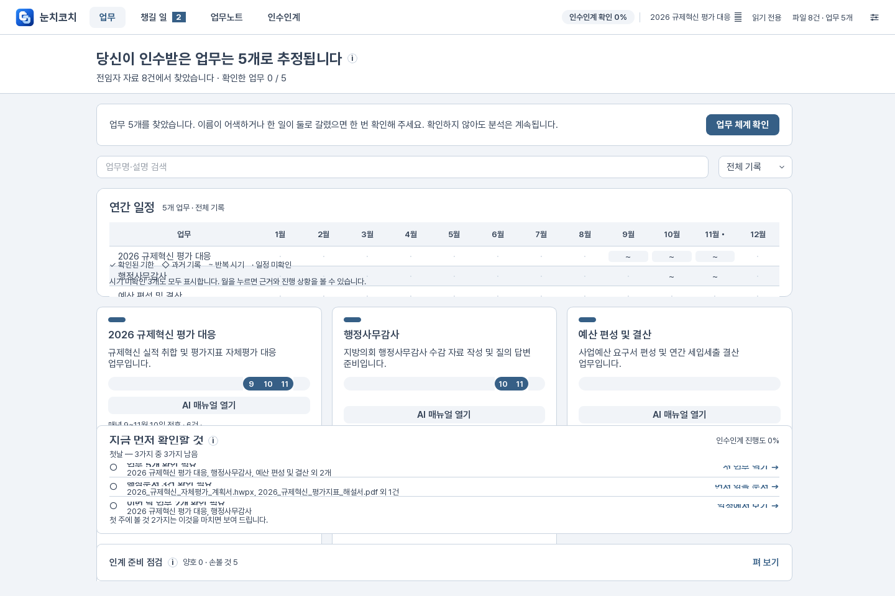

*2026-10-08 현재 소스의 실제 앱 화면입니다. 합성 문서 90건을 분석한 예시이며 실제 기관 자료가 아닙니다. 이 문서의 모든 화면은 같은 조건으로 촬영했습니다([촬영 조건](docs/screenshots/README.md)).*

**이 문서는 사용 설명서입니다.** 처음이면 [5분 만에 시작하기](#1-5분-만에-시작하기)부터 차례로 읽으세요. 개발·검증 정보는 [맨 아래](#8-개발자용)에 따로 모았습니다.

## 목차

1. [5분 만에 시작하기](#1-5분-만에-시작하기)
2. [화면 읽는 법](#2-화면-읽는-법)
3. [업무 — 무엇을 맡았고 지금 무엇을 하나](#3-업무--무엇을-맡았고-지금-무엇을-하나)
4. [일정 — 언제 무엇을 하나](#4-일정--언제-무엇을-하나)
5. [문서 — 이 파일이 무엇인가](#5-문서--이-파일이-무엇인가)
6. [질문 — 자료에 직접 물어보기](#6-질문--자료에-직접-물어보기)
7. [저장·내보내기·설정](#7-저장내보내기설정)
8. [개발자용](#8-개발자용)

### 이 프로그램이 지키는 약속

| 약속 | 뜻 |
|---|---|
| **원본은 읽기만 합니다** | 전임자 자료를 수정·이동·삭제·이름 변경하지 않습니다. 분석 결과는 별도 폴더에 저장합니다. 화면 위쪽의 `읽기 전용` 표시가 이 뜻입니다. |
| **PC 밖으로 나가지 않습니다** | 인터넷 없이 동작합니다. AI도 이 PC의 Ollama(`127.0.0.1`)에만 연결합니다. 예외는 하나 — 사용자가 설정에서 직접 켠 **현행 법령 조회**이며, 그때도 자료 본문은 보내지 않습니다([7-6](#7-6-노트북--자료를-모아-묻고-정리하고-문서로-남기기)). |
| **근거를 보여 줍니다** | 기한·금액·절차·답변마다 어느 문서의 어느 대목에서 읽었는지 열어 볼 수 있습니다. |
| **모르면 모른다고 합니다** | 자료에 없는 것은 지어내지 않습니다. 질문에는 답을 보류하고, 업무에는 ‘확인이 필요한 정보’로 남깁니다. |
| **추정과 확인을 구분합니다** | 프로그램이 자료에서 읽은 것은 `◐ 자료에서 추정`, 사람이 확인한 것은 `✓ 담당자 확인`으로 따로 표시합니다. |

---

## 1. 5분 만에 시작하기

### 1-1. 준비물

| 준비물 | 설명 |
|---|---|
| Windows 10/11 (64비트) | |
| **Python 3.14** | 소스로 실행할 때 필요합니다. 설치할 때 `Add python.exe to PATH`를 체크하세요. (직접 빌드한 실행 파일을 쓰면 필요 없습니다 — [8-3](#8-3-실행-파일-만들기와-오픈소스-고지)) |
| **Ollama와 모델 2개** (권장) | 업무 자동 묶기·질문·요약에 쓰는 로컬 AI입니다. 기본 모델은 답변용 `gemma4:e2b`, 검색용 `bge-m3`입니다. 다른 모델을 쓰려면 설정에서 고릅니다([7-4](#7-4-설정)). |

> **Ollama가 없으면?** 문서 읽기, 시점 확인, 파일명·본문 검색은 그대로 됩니다. 다만 문서를 업무별로 자동으로 묶는 일과 질문·요약은 Ollama가 있어야 합니다.

### 1-2. 실행

저장소 폴더에서 `start.bat`을 더블클릭합니다. 처음 한 번은 필요한 구성요소를 설치하느라 몇 분 걸립니다.

```cmd
start.bat
```

인터넷이 없는 PC에서는 [오프라인 설치](#8-2-오프라인-설치)를 따르세요.

### 1-3. 인수인계 만들기

처음 실행하면 **시작 화면**이 뜹니다. 인수인계 하나가 프로젝트 하나입니다.

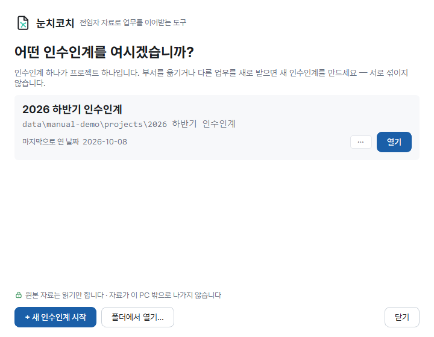

- **+ 새 인수인계 시작** — 이름을 정해 새로 만듭니다. 부서를 옮기거나 다른 업무를 새로 받으면 하나 더 만드세요. 서로 섞이지 않습니다.
- **열기** — 전에 만든 인수인계를 이어서 봅니다.
- **폴더에서 열기…** — USB나 공유 폴더에 있는 프로젝트 폴더를 직접 고릅니다.
- **⋯** — 이름 바꾸기, 목록에서 빼기(파일은 남음), 완전 삭제(분석 결과만 지움 — 원본 자료는 지우지 않습니다).

### 1-4. 전임자 자료 폴더 연결

새 인수인계를 열면 자료 폴더를 묻습니다.

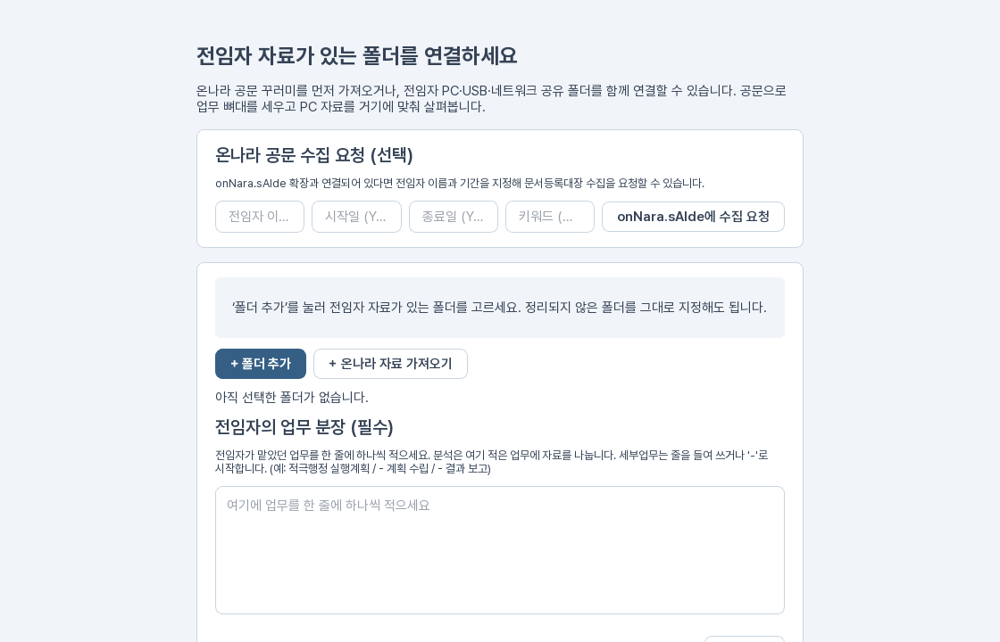

1. **+ 폴더 추가**로 전임자 자료가 있는 폴더를 고릅니다. 로컬 폴더, USB, 네트워크 공유 폴더를 여러 개 함께 등록할 수 있습니다.
2. **분석 시작**을 누릅니다.

정리되지 않은 폴더를 그대로 지정해도 됩니다. `최종`, `진짜최종`, `복사본`이 섞여 있어도 프로그램이 중복을 묶고 시점을 가려냅니다.

### 1-5. 분석이 끝나기를 기다리지 않아도 됩니다

분석은 뒤에서 돌고, 화면 오른쪽 위에 `12 / 90 분석 중 · 문서를 읽는 중`처럼 진행 상황이 나옵니다. 먼저 끝난 결과부터 화면에 나타나므로 그동안 둘러봐도 됩니다. 프로그램을 껐다 켜면 멈춘 곳부터 이어서 합니다.

| 순서 | 하는 일 |
|---|---|
| 파일 찾기 → 중복 확인 → 내용 읽기 → 시점 확인 | 문서를 찾고, 같은 파일을 묶고, 본문과 작성 시점을 읽습니다 |
| 의미 색인 → 업무 파악 | 비슷한 문서끼리 묶어 업무 후보를 만듭니다 (Ollama 필요) |
| 일정 파악 → 처리 순서 파악 | 매년·매월 반복되는 시기와 지난 회차의 처리 순서를 찾습니다 |
| 업무 복원 | 기한·금액·제출처·절차를 문서에서 읽어 ‘지금 할 일’을 만듭니다 |
| 질문 준비 | 질문에 답할 수 있게 본문을 조각내 색인합니다 (Ollama 필요) |

참고로 합성 문서 90건은 이 문서를 촬영한 PC에서 약 3분 걸렸습니다. 실제 자료의 소요 시간은 문서 수와 PC 사양에 따라 다릅니다. 진행 문구를 누르면 단계별 진행과 읽지 못한 파일 목록을 볼 수 있습니다.

---

## 2. 화면 읽는 법

### 2-1. 위쪽 검은 띠

```
[눈치코치] [인수인계 이름] | 업무  일정  문서  질문          [인수인계 0%] 읽기 전용  파일 90건 · 업무 9개  [설정]
```

| 자리 | 설명 |
|---|---|
| **인수인계 이름** | 지금 보는 인수인계입니다. 누르면 다른 인수인계로 바꿉니다. |
| **업무 · 일정 · 문서 · 질문** | 메뉴는 넷뿐입니다. `Ctrl+1`~`Ctrl+4`로도 이동합니다. |
| **인수인계 0%** | 업무·핵심 문서·일정을 얼마나 확인했는지입니다. 확인할 때마다 오릅니다. 누르면 업무 화면으로 갑니다. |
| **파일 90건 · 업무 9개** | 분석 상태입니다. 누르면 단계별 진행을 보고 분석을 멈추거나 이어서 실행할 수 있습니다. |
| **오른쪽 끝 조절 막대 그림** | 설정 |

| 메뉴 | 답하는 질문 |
|---|---|
| **업무** | 내 업무는 무엇이고, 지금 무엇부터 하나 |
| **일정** | 언제 무엇을 하나 |
| **문서** | 이 파일이 무엇이고 최신본인가 |
| **질문** | 위 화면에 없는 것을 자료에 직접 물어본다 |

### 2-2. 상태 표시 — 이 네 가지만 알면 됩니다

| 표시 | 뜻 | 할 일 |
|---|---|---|
| `✓ 담당자 확인` | 사람이 직접 확인했습니다 | 없음. 다시 분석해도 바뀌지 않습니다 |
| `◐ 자료에서 추정` | 근거는 있으나 아직 사람이 확인하지 않았습니다 | 근거를 보고 맞으면 확인 |
| `△ 자료가 불충분` | 근거가 약하거나 자료끼리 엇갈립니다 | 근거를 꼭 열어 보세요 |
| `○ 확인할 수 없음` | 자료만으로는 알 수 없습니다 | 프로그램이 적어 준 ‘다음 행동’대로 확인 |

**표시가 없으면 추정입니다.** 처음에는 거의 모든 것이 `◐ 자료에서 추정`이라, 업무·일정 화면에서는 이 표시를 줄마다 달지 않습니다. 사람이 확인한 것, 자료가 불충분한 것, 확인할 수 없는 것처럼 **기본에서 벗어난 것만** 표시합니다.

**확인은 선택입니다.** 확인하지 않아도 모든 기능을 쓸 수 있고, 확인한 것은 재분석해도 지워지지 않습니다. 추정이 맞다고 남기는 단추는 어디서나 **맞습니다**입니다(`이 업무가 맞습니다`, `이 주기가 맞습니다` 등). 제목 옆의 `ⓘ`에 마우스를 올리거나 누르면 그 화면의 설명이 나옵니다.

키보드로도 쓸 수 있습니다. `Tab`으로 옮기면 지금 자리에 파란 테두리가 서고, 업무 카드와 `ⓘ`는 `Enter`나 `Space`로 엽니다.

---

## 3. 업무 — 무엇을 맡았고 지금 무엇을 하나

### 3-1. 업무 목록

맨 위 그림이 업무 목록입니다.

- **지금 먼저 확인할 것** — 첫날 할 일 세 가지(업무 이름 확인, 핵심 문서 읽기, 이번 달 업무 확인)입니다. 줄마다 어떤 것들인지와 바로 가는 링크가 붙어 있고, 마친 줄은 `✓`로 바뀝니다.
- **업무 카드** — 프로그램이 문서를 묶어 만든 업무 후보입니다. 카드를 누르면 상세로 들어갑니다.

| 카드에 보이는 것 | 뜻 |
|---|---|
| `17건 · 2022~2025` | 이 업무로 묶인 문서 수와 기간 |
| 가로 막대의 색 점 | 1~12월 가운데 이 업무의 문서가 몰린 달 |
| `매년 9~11월` | 자료에서 찾은 반복 시기 |
| `느슨한 묶음` | 문서 묶음이 확실하지 않습니다. 내용만으로 묶이지 않아 **파일명이 같은 낱말로 시작한다는 이유로** 묶은 업무에 붙고, 설명에 그 사실이 적힙니다. 같은 업무인지 확인하세요. 묶음이 단단한 업무에는 아무 표시도 붙지 않습니다. |
| `◐ 확인 필요` | 아직 사람이 확인하지 않은 업무(회색). 확인하면 초록 `✓ 확인함`으로 바뀝니다 |
| 왼쪽 띠의 색 | 업무를 구분하는 표시일 뿐 상태를 뜻하지 않습니다 |

오른쪽 위 **보고서 만들기**는 전체 업무의 확인 상태와 근거를 글 파일(Markdown)로 저장합니다. **업무 복원본**은 [7-2](#7-2-업무-복원본과-다른-pc로-이어받기)에서 설명합니다.

### 3-2. 업무 상세의 다섯 탭

업무를 열면 탭 다섯 개가 있습니다. 확인할 것이 남은 탭에는 `◐`가 붙습니다.

| 탭 | 내용 |
|---|---|
| **지금 할 일** | 다음 행동, 기한·제출처·서식, 처리 순서, 확인이 필요한 정보 |
| **먼저 읽을 문서** | 이 업무를 파악하려면 무엇부터 읽을지 |
| **언제 하는 일인가** | 반복 주기와 그렇게 판단한 근거 |
| **어떻게 처리했나** | 지난 연도의 실제 처리 순서 |
| **이 업무의 문서** | 이 업무에 묶인 문서 전체 |

머리줄의 **이 업무가 맞습니다**는 업무 이름과 묶음이 맞다는 확인입니다. 그 아래에는 문서 수·기간과, 묶음이 느슨하거나 빠진 것이 있을 때만 그 사실이 적힙니다. **수정 ▾**에서 업무명·설명을 고치고, 다른 업무와 합치거나 둘로 나누고, 업무가 아니라고 표시할 수 있습니다.

### 3-3. 지금 할 일 — 가장 먼저 볼 탭

자료에서 복원한 내용이 있으면 이 탭이 먼저 열립니다.

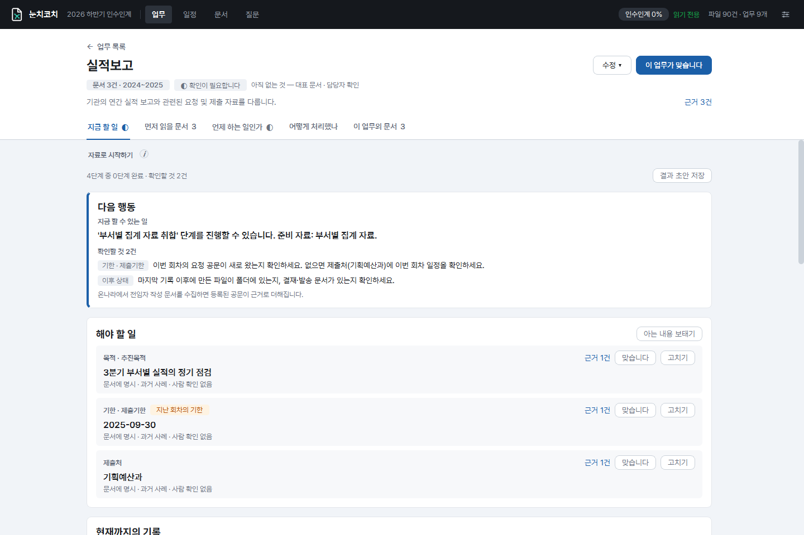

**① 다음 행동** — 맨 위에 답이 있습니다.

- **지금 할 수 있는 일** — 막히지 않은 첫 단계입니다. 큰 글씨로 한 줄 나옵니다. 여기서부터 시작하면 됩니다.
- **확인할 것 N건** — 자료만으로 알 수 없어 확인해야 하는 것과, **어디를 보고 누구에게 확인할지**입니다. 줄 앞의 꼬리표(`기한`, `제출처`, `이후 상태` 등)가 무엇에 관한 확인인지 말합니다.

**② 해야 할 일 · 시작 준비** — 문서에서 읽은 목적, 기한, 제출처, 준비 자료, 서식입니다. 줄마다 단추가 세 개 있습니다.

| 단추 | 하는 일 |
|---|---|
| **근거 N건** | 오른쪽에 그 값을 읽은 문서와 대목이 열립니다. **원본 열기**로 파일을 바로 엽니다. |
| **맞습니다** | 확인했다고 남깁니다. |
| **고치기** | 값이 틀렸으면 바로잡습니다. 나중에 자료가 달라지면 자료의 새 값을 옆에 보여 줍니다. |

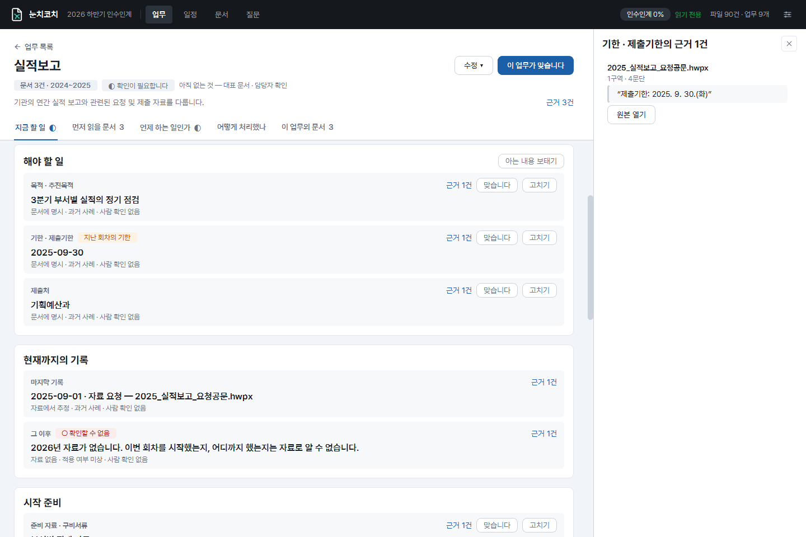

줄 아래의 작은 글씨(`문서에 명시 · 과거 사례 · 사람 확인 없음`)는 세 가지를 따로 말합니다 — 근거가 얼마나 확실한가, 지금 회차의 값인가 지난 회차의 값인가, 사람이 확인했는가. 위 예시의 기한 `2025-09-30`은 문서에 분명히 적혀 있지만 **지난 회차의 기한**이라 값 옆에 `지난 회차의 기한`이 붙고 ‘과거 사례’로 표시됩니다. 프로그램은 지난 기한을 올해 기한인 것처럼 내놓지 않습니다.

**③ 처리 순서** — 문서에 적힌 절차를 단계로 세운 것입니다.

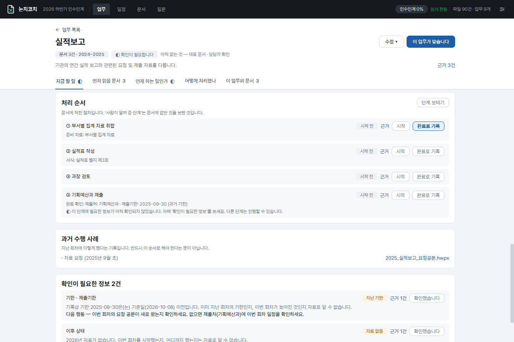

- 단계마다 **시작**, **완료로 기록**을 눌러 진행을 남깁니다. 다음 차례인 단계의 **완료로 기록**만 파랗게 강조됩니다. 완료는 누를 때만 기록됩니다. 프로그램을 닫았다 열어도, 다시 분석해도 기록이 남습니다.
- `◐ 이 단계에 필요한 정보가 아직 확인되지 않았습니다`가 붙은 단계는 기한·제출처 같은 정보가 빠져 막힌 단계입니다. **다른 단계는 그대로 진행할 수 있습니다.**
- **과거 수행 사례**는 지난 회차에 실제로 남은 문서의 순서입니다. 참고용이며 반드시 그 순서로 하라는 뜻이 아닙니다.
- **단계 보태기**로 문서에 없지만 실제로 거치는 단계를 적어 넣을 수 있습니다.

**④ 확인이 필요한 정보** — 자료에 없거나 엇갈리는 것입니다.

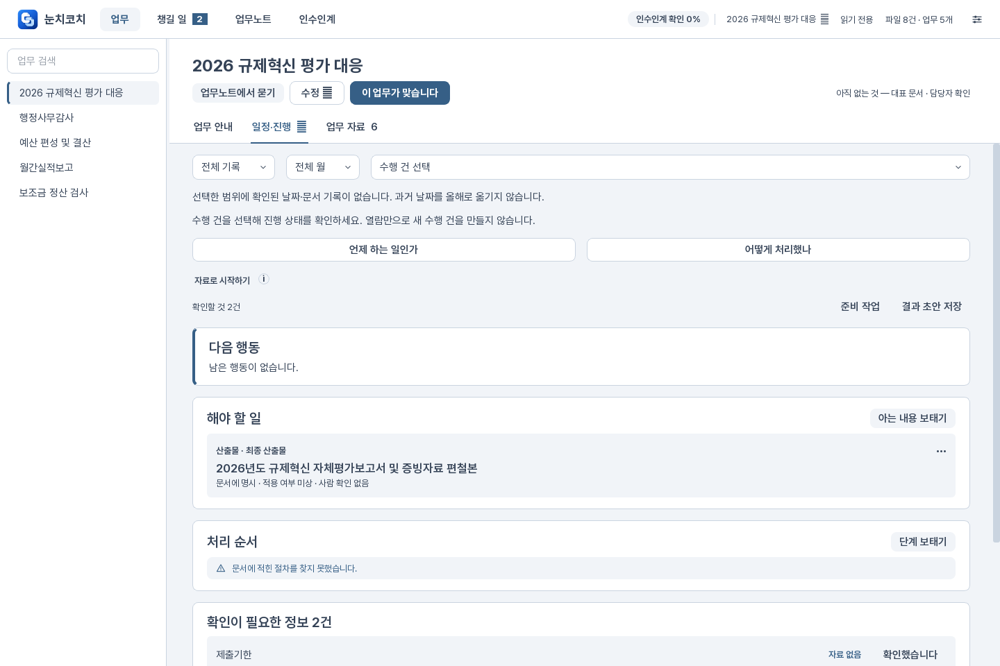

| 표시 | 뜻 |
|---|---|
| `자료 없음` | 기한·제출처·절차가 문서에 없거나, 마지막 기록 뒤의 자료가 없습니다(‘이후 상태’). 끝났는지 밀렸는지 단정하지 않습니다 |
| `자료가 엇갈림` | 같은 시기의 문서가 서로 다른 값을 적었습니다. 양쪽을 나란히 보여 주고 어느 쪽이 맞는지 고르지 않습니다 |
| `이전과 다름` | 개정 전후의 값이 다릅니다 |
| `지난 기한` | 기록된 기한이 이미 지났습니다. 지난 회차의 기한인지 이번 회차가 늦은 것인지는 자료로 알 수 없다고 적습니다 |

항목마다 **다음 행동**이 적혀 있습니다. 확인을 마치면 **확인했습니다**를 눌러 어떻게 확인했는지 적고 닫습니다. 사람이 닫은 것은 다시 열리지 않습니다.

**⑤ 문장에서 찾은 내용** — `제출기한: 9월 30일`처럼 이름표가 붙지 않고 문장으로만 적힌 내용을 로컬 AI가 골라 보여 줍니다.

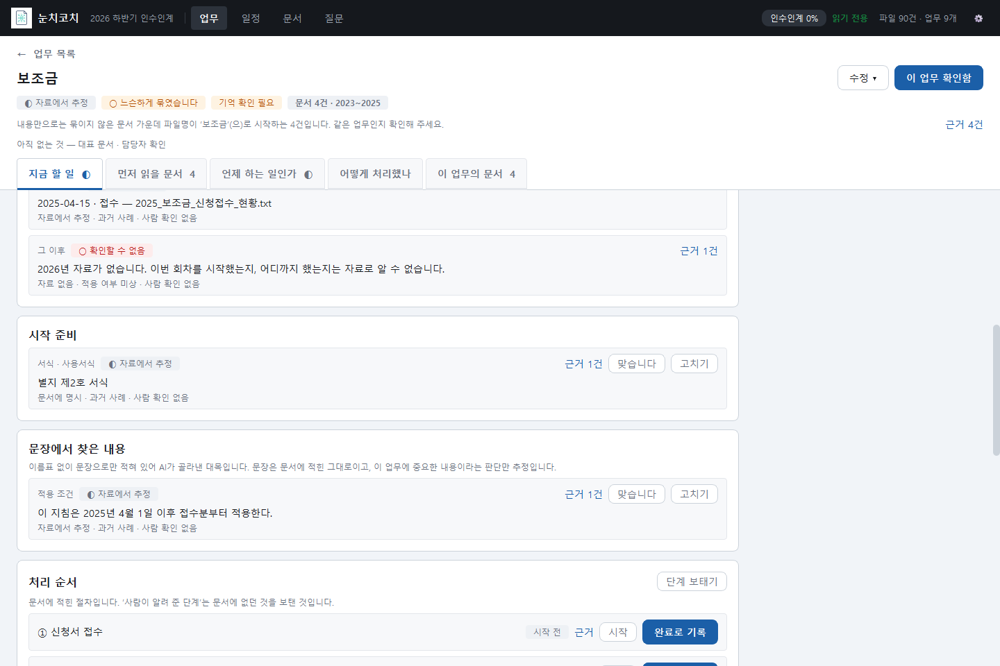

값은 문서의 문장 그대로이고, 사람이 확인하기 전에는 항상 추정입니다. 합성 표본으로 잰 결과 고른 문장 가운데 열에 두세 개는 쓸모없는 문장이었으므로([측정 결과](docs/단계4_검증결과.md)) 참고로만 보세요. 이 항목은 단계를 막거나 풀지 않습니다. Ollama가 없으면 이 묶음은 나오지 않습니다.

**⑥ 그 밖의 단추**

| 단추 | 하는 일 |
|---|---|
| **결과 초안 저장** | 확인한 값·절차·다음 행동·수행 기록을 근거 번호와 함께 글 파일로 저장합니다. 자료에 없는 값은 빈칸으로 둡니다. |
| **아는 내용 보태기** | 문서에 없는 기한·제출처·주의할 점을 직접 적습니다. 문서에서 읽은 값과 구분되어 남고, 재분석해도 지워지지 않습니다. |
| **확인·보충을 남기는 사람** | 화면 맨 아래에 있습니다. 기본은 `후임자`입니다. 전임자와 함께 볼 수 있을 때 `전임자`로 바꾸면 그 뒤의 확인·보충이 전임자의 것으로 기록됩니다. 전임자가 없어도 모든 기능은 그대로입니다. 이름은 기록용 표시이며 본인 확인이 아닙니다. |

### 3-4. 먼저 읽을 문서

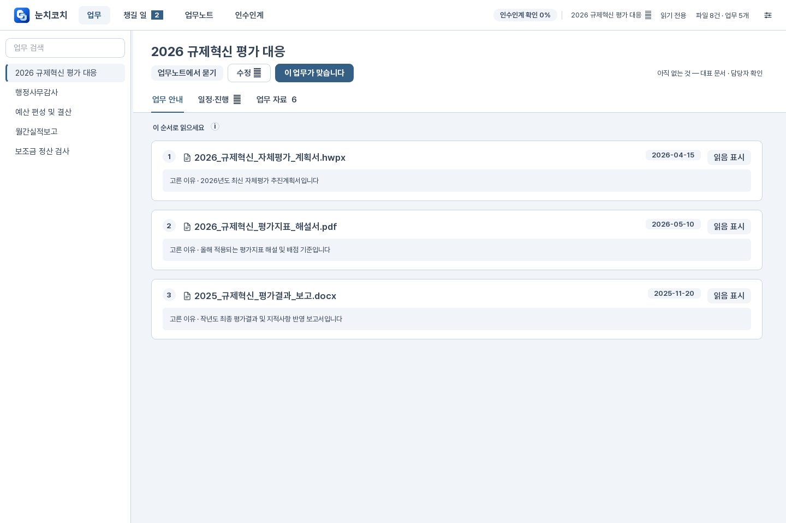

이 업무를 파악하려면 읽을 문서를 순서대로 골라 줍니다. 문서마다 고른 이유(‘실제 보낸 판본’, ‘가장 나중 판본’ 등)가 적혀 있습니다. 파일명을 누르면 오른쪽에 그 문서의 첫 대목이 열리고 거기서 **원본 열기**로 파일을 엽니다. 읽었으면 **읽음 표시**를 누르세요. 위쪽 인수인계 진행도에 반영됩니다.

### 3-5. 언제 하는 일인가

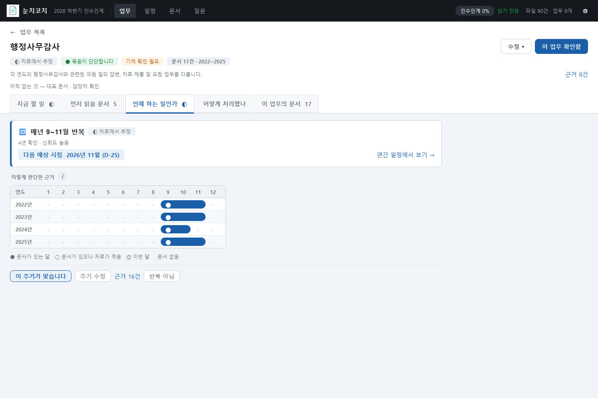

연도별로 어느 달에 문서가 있었는지 겹쳐 보여 주고, 거기서 찾은 반복 주기와 다음 예상 시점을 알려 줍니다. **이 주기가 맞습니다**로 확인하거나, **주기 수정**으로 고치거나, **반복 아님**으로 표시합니다.

### 3-6. 어떻게 처리했나

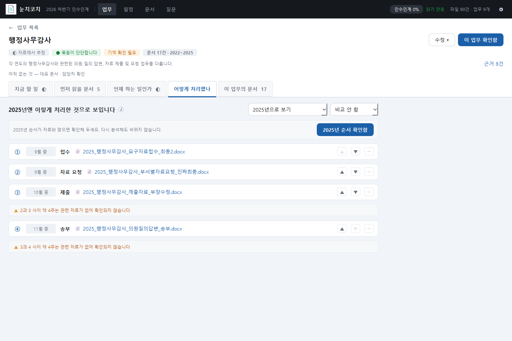

지난 연도의 문서를 시간순으로 놓아 그해의 처리 순서를 되짚은 것입니다.

- 위쪽에서 볼 연도를 고르고, **다른 연도와 비교**해 달라진 단계를 볼 수 있습니다.
- `⚠ 2과 3 사이 약 4주는 관련 자료가 없어 확인되지 않습니다`처럼 자료가 비는 구간을 알려 줍니다.
- 단계 오른쪽의 `▲ ▼ ⋯`로 순서를 바꾸고 이름을 고치거나 빼고, **＋ 단계 직접 추가**로 넣을 수 있습니다. 맞으면 **○○년 순서가 맞습니다**를 누릅니다.

---

## 4. 일정 — 언제 무엇을 하나

**직접 입력한 달력이 아니라 자료에서 읽어 낸 추정입니다.** 전임자 문서가 해마다 어느 달에 있었는지를 보고 반복을 찾습니다.

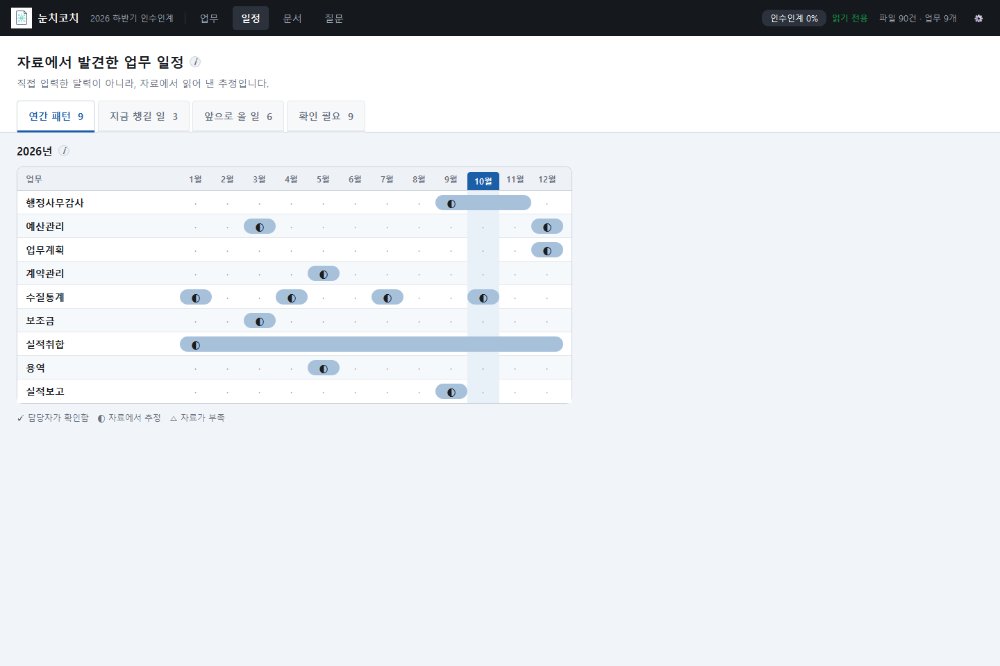

| 탭 | 내용 |
|---|---|
| **연간 패턴** | 업무별로 문서가 몰린 달. 이번 달 칸이 강조됩니다 |
| **지금 챙길 일** | 이번 달에 시작됐거나 진행 중일 것으로 보이는 업무 |
| **앞으로 올 일** | 다음 달 이후에 올 업무 |
| **확인 필요** | 아직 사람이 확인하지 않은 주기 |

**지금 챙길 일**에서는 지난해 같은 때 전임자가 무엇부터 시작했고 어떤 문서를 남겼는지 바로 볼 수 있습니다. 업무 이름을 누르면 그 업무의 상세로 갑니다.

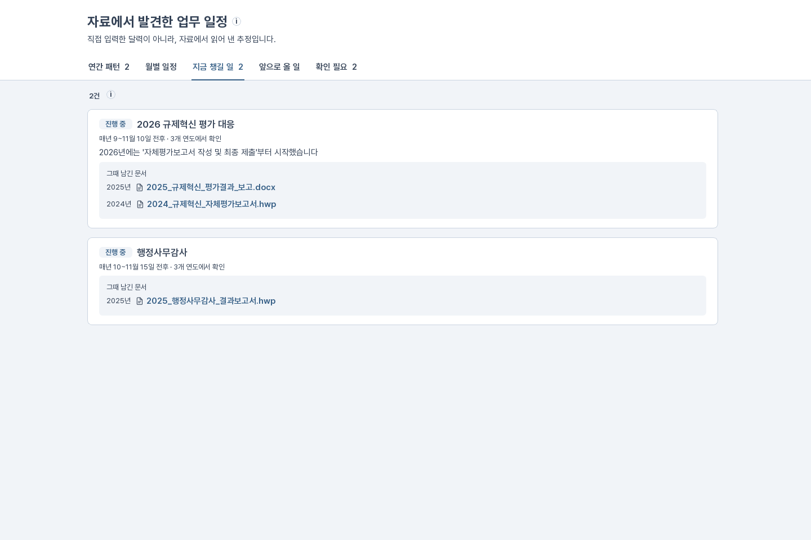

**확인 필요**에서는 주기를 한 줄씩 **맞습니다 / 수정 / 반복 아님**으로 정리합니다. 근거가 약한 것부터 위에 나옵니다.

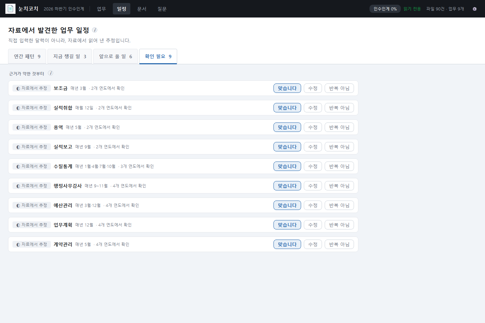

---

## 5. 문서 — 이 파일이 무엇인가

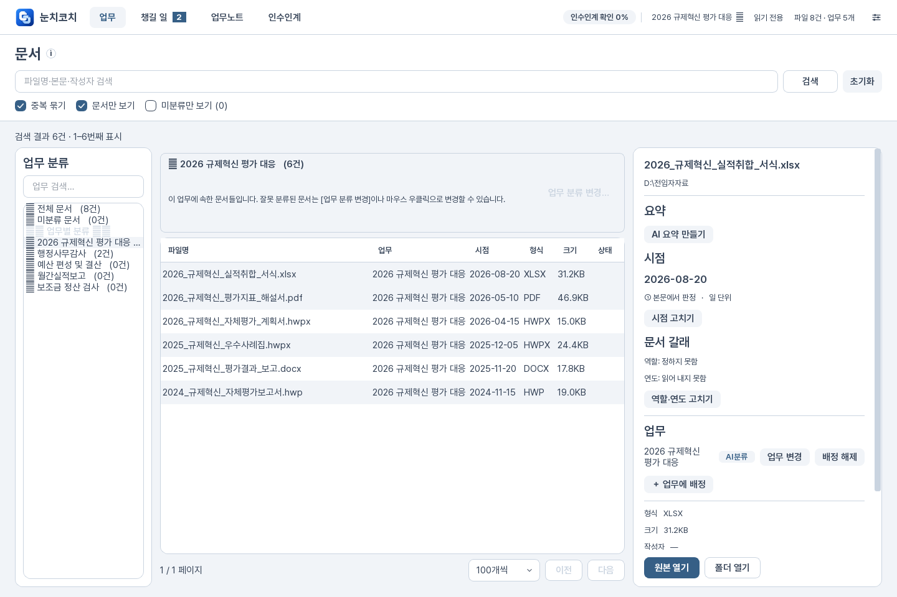

- **검색** — 파일명·본문·작성자로 찾습니다.
- **중복 묶기** — 내용이 완전히 같은 파일을 하나로 묶습니다. **문서만 보기**, **미분류만 보기**(어느 업무에도 묶이지 않은 문서)로 좁힙니다.
- 줄을 고르면 오른쪽에 상세가 나옵니다. 가운데 경계를 끌어 폭을 조절합니다.

| 상세 영역 | 내용 |
|---|---|
| **요약** | **AI 요약 만들기**를 누르면 그 문서를 요약합니다 (Ollama 필요) |
| **시점** | 이 문서를 언제의 것으로 판정했는지와 근거입니다. 본문 → 파일명 → 문서 속성 → 폴더 경로 → 파일 수정일 순으로 믿습니다. 틀렸으면 **시점 고치기** |
| **업무** | 배정된 업무입니다. **＋ 업무에 배정**, **배정 해제**, 업무와 무관한 문서는 **업무 없음으로 표시** |
| 형식·크기·작성자 | 문서의 기본 정보 |

상세 아래의 **원본 열기**, **폴더 열기**로 고른 파일을 엽니다.

목록의 **상태** 열은 문서를 읽은 결과입니다. **문제가 있는 줄만 적습니다.**

| 상태 | 뜻 |
|---|---|
| (빈칸) | 본문을 다 읽었습니다 |
| `◐ 일부만 읽음` | 일부만 읽었습니다(추출 한도 초과 등) |
| `✕ 읽기 실패` · `— 미지원 형식` | 읽지 못했습니다. 문서를 고르면 이유가 나옵니다 |
| `△ 암호 걸림` · `△ 다른 곳에서 열려 있음` · `△ 크기 초과` | 암호가 걸렸거나, 다른 프로그램이 열어 두었거나, 200MB를 넘습니다 |
| `⚠ 원본 없음` | 분석한 뒤 원본 파일이 사라졌습니다 |

### 읽을 수 있는 문서 형식

| 형식 | 범위 |
|---|---|
| HWPX | 본문과 표(행·머리글·단위·병합 칸 보존) |
| HWP (5.0) | 본문. 표 구조는 제한적으로 보존됩니다 |
| ODT | 문단과 표 (온나라 본문 형식) |
| DOCX · PPTX · XLSX/XLSM | 본문 · 슬라이드 · 시트 |
| PDF | 글자가 들어 있는 PDF. **스캔본은 읽지 못합니다**(OCR 없음) |
| TXT · CSV · MD · LOG | 글 그대로 |
| DOC · XLS · PPT · HWP 3.0 | 읽지 못합니다. `— 미지원 형식`으로 표시합니다 |

200MB를 넘는 파일은 읽지 않습니다. 이메일은 읽지 않습니다. 자료 폴더의 그림 파일과 스캔 PDF도 읽지 않습니다 — 그림 속 글자는 노트북에 **직접 올린 파일**에 한해 로컬 모델로 읽습니다([7-6](#7-6-노트북--자료를-모아-묻고-정리하고-문서로-남기기)).

---

## 6. 질문 — 자료에 직접 물어보기

등록한 자료만 근거로 답합니다. 평소 말하듯 물으면 됩니다. AI 또는 의미 색인이 준비되지 않았어도 읽은 문서의 **자료 검색 결과**와 원문을 볼 수 있습니다. 이 검색 결과는 생성 답변과 구분해서 표시합니다.

### 6-1. 묻기

질문을 적고 **질문**을 누르거나 Enter를 칩니다. 답을 만드는 동안 경과 시간이 보이고 **질문 취소**로 멈출 수 있습니다.

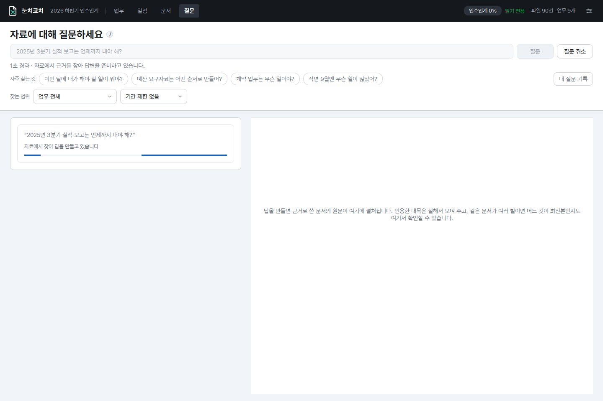

- **자주 찾는 것** — 예시 질문과 방금 물은 질문입니다. 누르면 바로 묻습니다.
- **내 질문 기록** — 지난 질문을 다시 고릅니다.
- **찾는 범위** — 특정 업무나 연도의 자료만 근거로 삼게 좁힙니다. 범위 안에 근거가 없으면 범위 밖 자료로 대신 답하지 않습니다.

### 6-2. 답과 근거 읽기

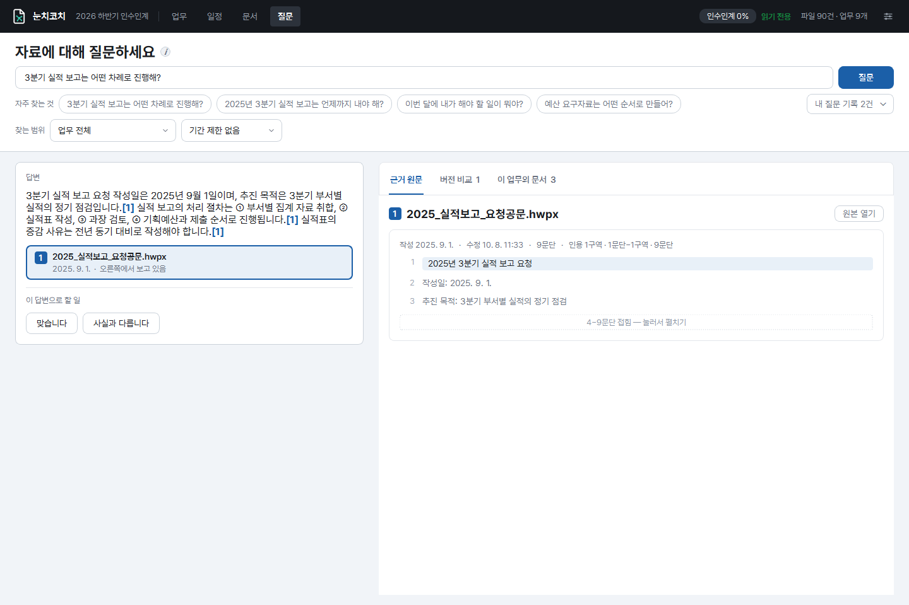

- 왼쪽이 답입니다. 문장 끝의 `[1]` `[2]`가 근거 번호입니다.
- 번호나 아래 근거 카드를 누르면 **오른쪽에 그 문서의 원문**이 펼쳐지고 인용한 대목이 칠해집니다. **원본 열기**로 파일을 엽니다.
- 오른쪽 탭 **버전 비교**는 같은 문서의 다른 판본(`최종`, `수정` 등)을, **이 업무의 문서**는 그 업무의 다른 문서를 보여 줍니다.
- **맞습니다 / 사실과 다릅니다**로 답이 맞았는지 남길 수 있습니다.

질문 하나하나는 독립적으로 처리합니다. 앞 질문을 기억하고 이어 묻는 대화는 아닙니다.

### 6-3. 답을 보류하는 경우

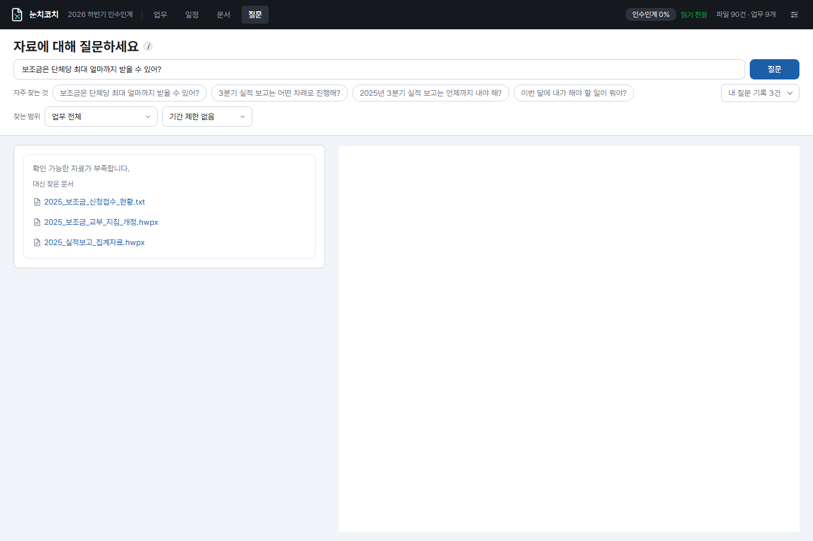

자료에 근거가 없으면 답하지 않고 **확인 가능한 자료가 부족합니다**라고 알린 뒤 관련 있어 보이는 문서를 대신 보여 줍니다. 위 예시의 ‘단체당 최대 금액’은 합성 자료 어디에도 없는 내용입니다.

> **답을 그대로 믿지 마세요.** 답은 로컬 AI가 만들고 프로그램이 근거와 대조해 거릅니다. 그래도 묻는 것과 조금 다른 내용을 답하는 경우가 남아 있습니다([알려진 한계](docs/단계4_검증결과.md)). 금액·기한처럼 중요한 값은 반드시 근거 원문을 열어 확인하세요.

---

## 7. 저장·내보내기·설정

### 7-1. 내보낼 수 있는 것

| 무엇 | 어디서 | 내용 |
|---|---|---|
| 인수인계 보고서 | 업무 → **보고서 만들기** | 전체 업무와 확인 상태·근거 |
| 결과 초안 | 업무 상세 → 지금 할 일 → **결과 초안 저장** | 업무 하나의 값·절차·다음 행동·수행 기록 |
| 업무 복원본 | 업무 → **업무 복원본** | 아래 7-2 |
| 활동 기록 | 설정 → 시스템 | 언제 무엇을 했는지의 기록(CSV) |

위 넷은 모두 글 파일(Markdown) 또는 CSV입니다. 한글·워드·PDF·엑셀로 내보내는 것은 노트북의 스튜디오에서 만든 문서뿐입니다([7-6](#7-6-노트북--자료를-모아-묻고-정리하고-문서로-남기기)). **전임자 자료 폴더 안이나 원본 파일 위에는 저장되지 않습니다** — 그렇게 고르면 프로그램이 거절합니다.

### 7-2. 업무 복원본과 다른 PC로 이어받기

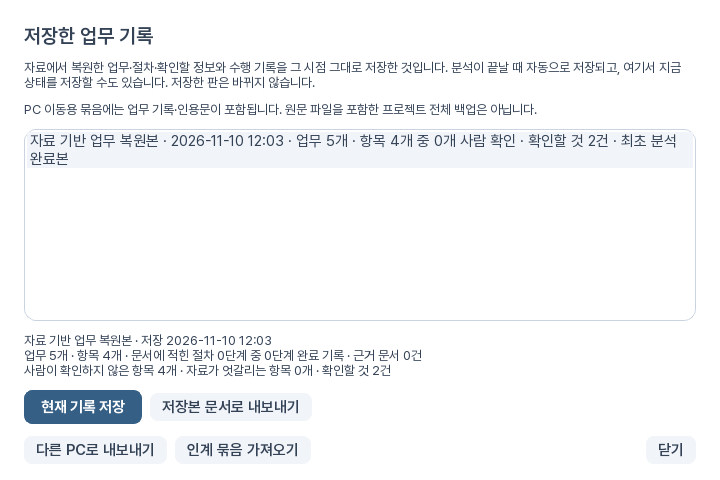

**업무 복원본**은 복원된 업무·절차·확인할 정보·수행 기록을 그 시점 그대로 저장한 판입니다. 분석이 끝날 때 자동으로 저장되고, 저장한 판은 바뀌지 않습니다.

| 단추 | 하는 일 |
|---|---|
| **지금 상태 저장** | 지금 상태를 새 판으로 저장합니다(달라진 것이 없으면 만들지 않습니다) |
| **글 파일로 내보내기** | 고른 판을 읽을 수 있는 글 파일로 저장합니다 |
| **묶음으로 내보내기** | 고른 판을 다른 PC로 옮길 묶음 파일(ZIP)로 저장합니다 |
| **묶음 가져오기** | 다른 PC에서 만든 묶음을 받아 이어서 씁니다 |

다른 PC로 옮기는 순서:

1. 보내는 PC — **묶음으로 내보내기**로 ZIP을 만듭니다.
2. 받는 PC — 새 인수인계를 만들고 같은 자료 폴더(복사본이어도 됩니다)를 연결합니다.
3. 받는 PC — **묶음 가져오기**로 ZIP을 고릅니다. 무엇을 몇 건 받았고 근거 문서를 어떻게 찾았는지 알려 줍니다.

알아 둘 것:

- **묶음에 원본 문서는 들어 있지 않습니다.** 받는 쪽에서 파일 내용(해시)과 폴더 안 위치로 원문을 다시 찾아 잇습니다. 폴더 경로가 달라도 내용이 같으면 찾습니다.
- 묶음에는 문서에서 인용한 대목이 들어 있고 암호화하지 않습니다. 공개 파일처럼 다루지 마세요.
- 받는 쪽에서 이미 고쳤거나 수행 중인 항목은 덮어쓰지 않습니다.

전임자가 검토자로 참여했을 때는 ‘지금 할 일’ 탭에서 **검토 인계본 발행**을 할 수 있습니다. 인계본에는 전임자가 확인한 항목과 **확인하지 않은 항목**이 함께 실립니다.

### 7-3. 분석 결과는 어디에 저장되나

기본 위치는 `%LOCALAPPDATA%\NunchiCoach\projects\<인수인계 이름>\`입니다. 설정 → 시스템 → 저장 위치에서 확인하고 폴더를 열 수 있습니다.

> **이 폴더도 민감정보입니다.** 원본 본문의 일부와 질문 기록이 들어 있고 **파일을 암호화하지 않습니다.** 원본과 같은 수준으로 관리하고, 필요 없어지면 시작 화면의 ‘완전 삭제’로 지우세요.

### 7-4. 설정

오른쪽 위 끝의 조절 막대 그림을 누릅니다. 갈래는 셋입니다.

**화면** — 글자 크기(작게·보통·크게)와 테마(시스템·밝게·어둡게). 고르면 바로 적용됩니다. 글꼴은 프로그램에 함께 든 Pretendard를 씁니다(PC에 설치하지 않습니다).

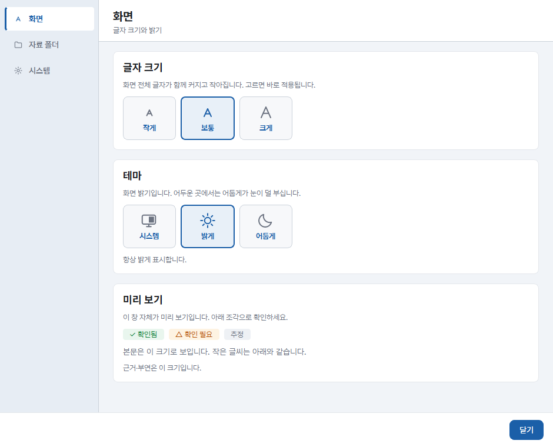

**자료 폴더** — 폴더를 더하거나, 위치가 바뀐 폴더를 다시 가리키거나, 뺍니다. 바꾸면 분석이 이어서 돕니다. 사람이 확인한 날짜와 업무 연결은 보존됩니다.

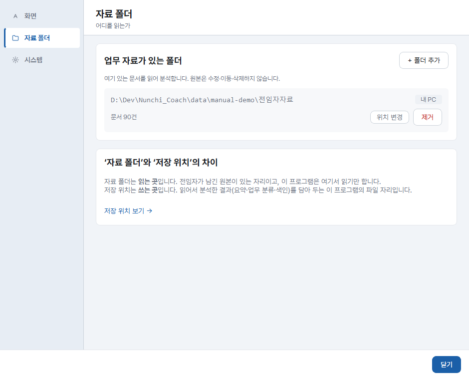

**시스템** — 로컬 AI 연결 상태와 모델 선택, 저장 위치, 최근 활동 기록, 오픈소스 고지.

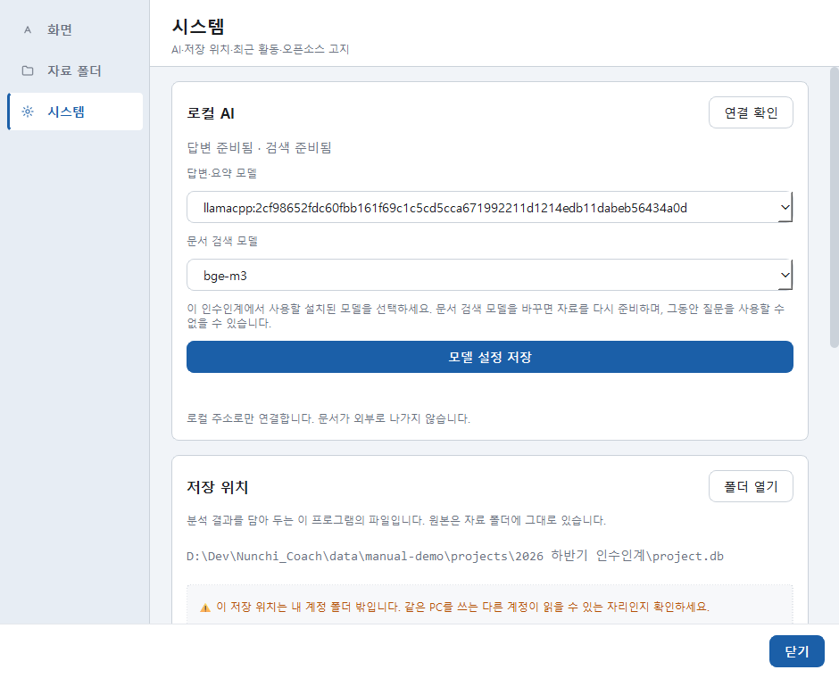

- **연결 확인**으로 Ollama 상태를 다시 봅니다. `답변 준비됨 · 검색 준비됨`이면 정상입니다.
- 모델은 인수인계마다 따로 저장됩니다. **문서 검색 모델을 바꾸면 자료를 다시 준비**하므로 그동안 질문을 쓸 수 없습니다.
- 기본값은 답변·요약 `gemma4:e2b`, 문서 검색 `bge-m3`입니다. 목록에는 이 PC의 Ollama에 설치된 이름이 그대로 나옵니다.

어두운 테마:

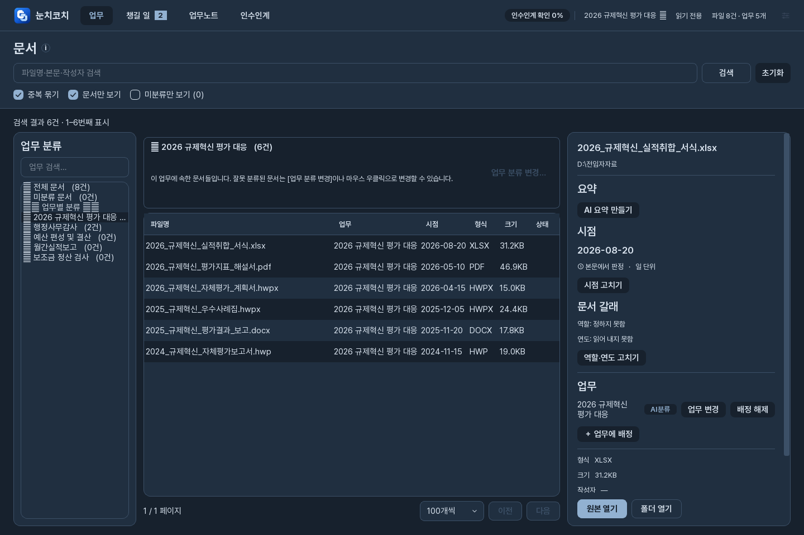

### 7-5. 문제가 생겼을 때

| 증상 | 확인할 것 |
|---|---|
| `start.bat`이 `Python was not found`로 끝남 | Python 3.14를 설치하고 PATH에 추가했는지 |
| `This release is verified with Python 3.14` | 다른 버전의 Python입니다. `.venv` 폴더를 지우고 3.14로 다시 실행 |
| 업무가 하나도 안 생김 | Ollama가 켜져 있는지, 설정 → 시스템에서 모델이 준비됐는지. 문서가 아주 적으면 묶이지 않을 수 있습니다 — 문서 화면에서 직접 배정하세요 |
| 질문 칸이 잠겨 있음 | ‘질문 준비’ 단계가 끝나지 않았거나 모델이 없습니다. 화면에 이유가 적힙니다 |
| 문서 목록의 상태 칸에 무언가 적혀 있음 | 스캔 PDF, 구형 형식(DOC·XLS·PPT), 암호 걸린 파일, 다른 프로그램이 열어 둔 파일인지 확인. 열어 둔 파일은 닫으면 다음 분석에서 다시 읽습니다 |
| ‘모델이 답변 문장을 만들지 못했습니다’ | 자료는 있는데 AI가 문장을 만들지 못한 경우입니다. 다시 물어보세요 |
| 답이 느림 | 첫 질문은 모델을 올리느라 느립니다. GPU가 없는 PC에서는 질문마다 수십 초가 걸릴 수 있습니다 |

오류 기록은 저장 위치의 `logs\diagnostic.log`에 남습니다. 문서 본문·질문·답변·파일 경로는 이 기록에 넣지 않습니다.

### 7-6. 노트북 — 자료를 모아 묻고, 정리하고, 문서로 남기기

상단의 **노트북**은 관련 자료만 모아 따로 분석하는 작업 공간입니다. 자료 폴더를 연결하지 않아도 파일을 직접 올려 쓸 수 있습니다. 기존 업무·일정·문서·질문 화면은 그대로입니다.

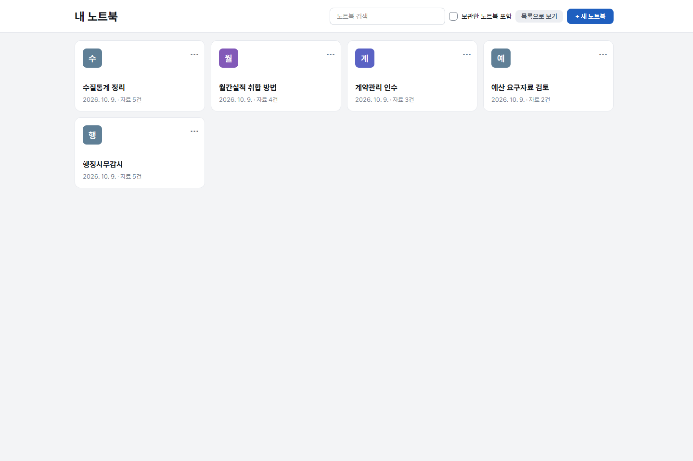

**홈**에는 노트북이 카드로 놓입니다. 카드를 누르면 들어가고, `•••`에서 이름 변경·표지 색·복제·보관·삭제를 합니다. **+ 새 노트북**으로 만듭니다.

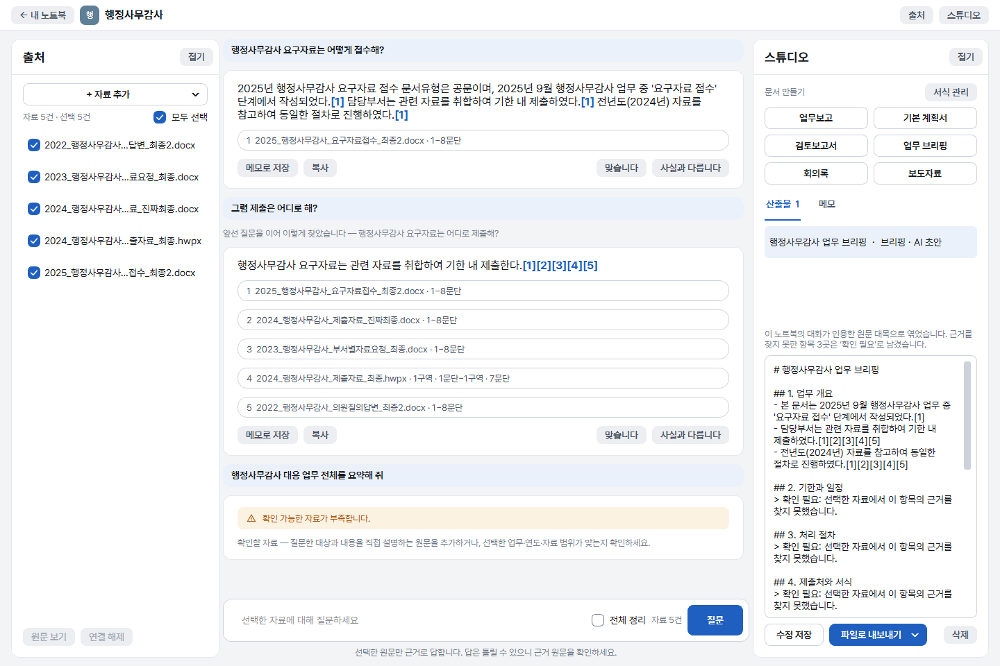

*2026-10-09 소스 화면. 합성 표본 문서 5건을 연결하고 이 PC의 로컬 모델로 실제로 묻고 엮은 결과입니다.*

노트북을 열면 화면이 왼쪽부터 **출처 | 대화 | 스튜디오** 셋으로 나뉩니다. 경계를 끌어 폭을 조절하고 **접기**로 좌우 판을 접습니다. 폭과 접힘은 노트북마다 기억합니다.

**① 출처 (왼쪽)** — `+ 자료 추가`에서 세 가지로 자료를 넣습니다. 파일을 판 위로 끌어다 놓아도 됩니다.

| 방법 | 설명 |
|---|---|
| **파일 올리기** | PDF · HWPX · HWP · DOCX · XLSX · PPTX · ODT · MD · TXT · CSV와 그림(PNG · JPG · BMP · GIF · TIFF · WEBP). 프로젝트 저장소 안 보관소에 **사본**을 두고 읽습니다. 원래 자리의 파일은 건드리지 않습니다. |
| **분석한 전임자 자료에서 고르기** | 이미 분석한 문서를 연결합니다. 파일을 복사하지 않습니다. |
| **온나라 수집본 가져오기** | 수집 엔진이 남긴 폴더(`manifest.json`이 있는 폴더)를 읽습니다. 문서번호·상태 같은 공식 출처가 인용에 함께 표시됩니다. 이 프로그램이 온나라에 접속하지는 않습니다. |

- 목록에서 체크한 자료만 근거로 씁니다. 체크를 끈 자료와 다른 노트북의 자료는 섞이지 않습니다.
- **그림과 스캔 PDF**는 이 PC의 로컬 모델이 글자를 읽습니다. 원문이 아니라 모델이 읽은 글이므로 `일부만 읽음`으로 표시하고, 숫자·이름은 원본과 대조하라고 알립니다. 그림을 읽을 수 있는 모델이 없으면 읽지 못합니다.
- 내용이 같은 파일은 한 번만 보관하고, 이미 분석한 문서와 내용이 같으면 그 문서를 연결합니다.
- 올린 파일은 업무 묶기·일정 파악에 쓰지 않습니다. 노트북의 참고 자료가 업무 카드로 묶이지 않습니다.
- 자료를 누르고 **원문 보기**를 누르면 같은 자리에 원문과 AI가 만든 자료 안내(요약·주제어)가 펼쳐집니다.

**② 대화 (가운데)** — 질문과 답이 위로 쌓입니다. 답의 번호나 근거 줄을 누르면 왼쪽에 그 문서의 원문이 펴지고 인용한 대목이 칠해집니다.

- “그럼 제출처는?”처럼 앞 질문에 기대는 후속 질문은 앞선 **질문**을 보고 풀어서 찾습니다. 어떻게 풀었는지 질문 아래에 적습니다. 과거의 AI 답변은 근거로 다시 쓰지 않습니다.
- 질문을 다른 표현으로 바꿔 함께 검색합니다(예: 마감 → 제출기한). 답과 근거 검증은 원래 질문으로 합니다.
- **전체 정리**를 켜고 물으면 선택한 자료 전체를 차례로 훑어 정리합니다. 보통 질문보다 훨씬 오래 걸립니다(자료가 많으면 몇 분).
- 자료 선택을 바꾸면 그 전에 받은 답은 가립니다. 선택에서 뺀 자료의 내용이 화면에 남지 않게 하기 위해서입니다.
- **메모로 저장**하면 오른쪽 스튜디오의 메모에 쌓입니다.

**③ 스튜디오 (오른쪽)** — 대화로 정리한 내용을 서식에 맞춘 문서로 만듭니다.

1. **문서 만들기**에서 서식(업무보고 · 기본 계획서 · 검토보고서 · 업무 브리핑 · 회의록 · 보도자료)을 고릅니다. **서식 관리**에서 항목과 작성 지침을 고치거나 새 서식을 만듭니다.
2. 서식의 항목마다 **이 노트북의 대화가 인용한 원문 대목만으로** 초안을 엮습니다. 근거를 찾지 못한 항목은 `확인 필요`로 남깁니다. 한 문서에 1분쯤 걸립니다.
3. **산출물** 탭에서 본문을 고칩니다. `# 제목`, `## 항목`, `- 목록`, `| 표 |`의 간단한 표기를 씁니다.
4. **파일로 내보내기**에서 한글(HWPX) · 워드(DOCX) · PDF · 엑셀(XLSX) · Markdown을 고릅니다. 자료 폴더·올린 파일 보관소·원본 위에는 저장할 수 없습니다.

> **초안을 그대로 쓰지 마세요.** 문장마다 근거 번호가 붙고 규칙 검증을 거치지만, 경량 모델은 문서의 연도·단계를 옆 문서와 바꿔 붙이는 일이 있습니다. 근거 번호를 눌러 원문과 대조하세요. 한글(HWPX) 파일은 본문·목록·표만 담고 결재란·쪽 번호 같은 문서 틀은 만들지 않습니다.

**메모** 탭에서는 답을 메모로 남기고, 원문과 적용 조건을 확인한 뒤 **근거 검토 후 지식 승격** → **업무 가이드에 게시**로 업무의 ‘지금 할 일’에 지식 카드로 올립니다. 원문 변경·메모 수정·연결 해제·유효기간 종료 뒤에는 게시한 지식이 재검토 상태가 됩니다. 검토자 표시는 로컬 기록이며 본인 인증이나 공문 결재가 아닙니다.

**현행 법령 조회 (선택)** — 설정 → 시스템 → **현행 법령 조회**에서 켜고 법령정보 공동활용 인증키(OC)를 넣으면, 대화 입력칸에 **법령**이 나타납니다. 그 질문에 한해 국가법령정보센터(law.go.kr)에서 현행 조문을 조회해 자료 답변과 **따로** 보여 줍니다.

- **이 기능만 인터넷을 씁니다.** 기본은 꺼져 있고, 인수인계마다 따로 켭니다. 켜져 있으면 상단 띠에 `법령 조회 켜짐`이 보입니다.
- 밖으로 보내는 것은 법령 이름·조문 번호와 그 질문 문장뿐입니다. 자료의 본문·파일 이름은 보내지 않습니다. `법령`은 질문마다 다시 골라야 합니다.
- 질문에 “지방계약법 제9조”처럼 조문이 적혀 있으면 그 조문을, 자료가 인용한 조문이 있으면 그 조문의 현행 본문을 조회합니다. 둘 다 없으면 질문 문장으로 관련 조문을 찾습니다.
- 답은 조회한 조문 본문만으로 만들고 `[법1]`처럼 표시합니다. 조회에 실패하면 조문을 지어내지 않고 실패했다고 알립니다. 법률 자문이 아닙니다.
- 인증키는 이 PC 사용자 폴더에 암호화하지 않고 저장하며, 인수인계 폴더·내보내기 묶음에는 들어가지 않습니다.

업무 수행 단계의 **결과 파일 연결**은 파일 위치만 기록합니다. 선택만으로 단계를 완료 처리하지 않습니다.

업무명과 질문한 항목이 원문에 명시되어 있으면 해당 값을 직접 인용합니다. 같은 업무·기간의 자료에 서로 다른 값이 있으면 양쪽 근거를 보여 주며 확정을 보류합니다. 사용할 판본을 직접 선택하거나 공식 변경 안내를 확인하세요. [상충 자료 대조 화면](docs/screenshots/25-source-conflict.png)(개편 전 화면)과 [질문 품질 구현·검증 기록](docs/QUESTION_QUALITY_STAGE_2026-10-09.md)을 참고하세요.

‘몇 대·몇 건’ 질문에는 답변의 수량과 단위를 원문에서 함께 확인합니다. “기록이 있다”는 답변이나 연도·관리번호만으로 수량을 확정하지 않습니다. 값이 확인되지 않으면 원문 확인과 재질문을 안내합니다. [수량 질문 검증 기록](docs/QUANTITY_ANSWER_STAGE_2026-10-09.md)에 지원 범위와 평가 결과를 정리했습니다.

### 7-7. 아직 안 되는 것

- **온나라에서 직접 가져오기** — 기관 연결 사양을 확보하지 못해 실제 연결은 구현·검증하지 않았습니다. 앱이 하는 일은 이미 내려받아 둔 **수집본 폴더를 노트북으로 가져오는 것**까지이고, 그것도 합성 수집본으로만 확인했습니다([현황](docs/온나라_연결프로필.md)).
- **법령 조회의 실제 서버 확인** — 응답 모양을 본뜬 대역으로만 시험했습니다. 실제 law.go.kr 호출은 설정의 **연결 확인**으로 사용자가 확인해야 합니다. 판례·해석례·행정규칙·자치법규·연혁 조회는 없습니다.
- **한글(HWPX) 출력의 실물 확인** — 꾸러미 구조와 자체 파서로 되읽기만 확인했습니다. 한글 프로그램에서 여는지는 확인하지 못했습니다. 올린 서식 파일에서 글꼴·기호를 뽑아 적용하는 기능도 없습니다(모든 서식이 기본 모양을 씁니다).
- **노트북 검색 다듬기의 품질 측정** — 질의 확장·후속 질문 풀이·전체 정리·문서 초안은 기능 시험과 소규모 실제 모델 실행으로만 확인했습니다. 동결 평가 세트로 정확도를 재지 않았습니다. DOCX·PDF의 표를 행 단위로 읽는 파서 개선도 하지 않았습니다.
- **실제 기관 문서 검증** — 지금까지의 확인은 모두 합성 자료입니다. 실제 한글 문서(HWP·HWPX)에서의 정확도는 재지 않았습니다.
- 전용 OCR 엔진, 이메일, 분석 결과 암호화, 여러 사람이 함께 쓰는 공유 기능, 답변을 글자 단위로 흘려 보여 주기.
- 메모를 검색 소스로 다시 쓰기, 주장별 검토, 지식팩·그래프·sAIde 브리지 연동은 후속 단계입니다. 인계본 ZIP에는 노트북 데이터가 들어가지 않습니다. [통합 구현 현황과 다음 순서](docs/INTEGRATION_IMPLEMENTATION_2026-10-09.md)를 참고하세요.

---

## 8. 개발자용

### 8-1. 개발 환경

기준은 Python 3.14와 `requirements.lock`입니다.

```powershell
python -m venv .venv
.\.venv\Scripts\python.exe -m pip install -r requirements.lock
.\.venv\Scripts\python.exe -m app.main
```

`--project 이름`을 주면 시작 화면을 건너뛰고 그 프로젝트를 엽니다. `--data 경로`는 프로젝트 저장 위치를 바꿉니다.

### 8-2. 오프라인 설치

인터넷이 되는 같은 Windows·Python 환경에서 패키지를 미리 받습니다.

```cmd
.venv\Scripts\python.exe -m pip download -r requirements.lock -d wheelhouse
```

`start.bat`은 저장소 옆에 `wheelhouse` 폴더가 있으면 인터넷 없이 설치합니다. 다른 위치는 이렇게 지정합니다.

```cmd
set NUNCHICOACH_OFFLINE=1
set NUNCHICOACH_WHEELHOUSE=D:\offline-packages\wheelhouse
start.bat
```

오프라인 모드에서는 패키지 폴더가 없어도 인터넷 설치로 넘어가지 않습니다. Ollama와 모델도 따로 반입해야 합니다. 깨끗한 오프라인 PC에서의 전체 설치는 검증하지 않았습니다.

### 8-3. 실행 파일 만들기와 오픈소스 고지

```powershell
.\.venv\Scripts\python.exe -m PyInstaller NunchiCoach.spec
dist\NunchiCoach\NunchiCoach.exe selftest tests\fixtures\sample_tree
dist\NunchiCoach\NunchiCoach.exe licenses
```

`dist\NunchiCoach` **폴더 전체**가 배포 단위입니다. 실행 파일만 복사하면 동작하지 않습니다. 모델과 Ollama는 실행물에 넣지 않습니다. 이 저장소는 빌드된 실행 파일을 내려받는 곳을 제공하지 않습니다.

빌드할 때마다 고지문(`THIRD_PARTY_NOTICES.txt`)을 다시 만들어 실행물 안과 실행 파일 옆에 넣습니다. 앱에서는 설정 → 시스템 → ‘오픈소스 고지’에서 봅니다.

- **PyMuPDF(및 MuPDF)** 는 **AGPL-3.0** 조건으로 씁니다(상용 라이선스 미사용). 실행물을 받은 사람이 이 프로그램의 대응 소스를 받을 수 있어야 하며, 고지문은 그 위치로 이 저장소를 적습니다. 저장소 주소가 바뀌면 `app/tools/notices.py`의 `SOURCE_URL`을 고칩니다.
- **PySide6/Qt** 는 LGPL-3.0 조건으로 쓰며 실행물 폴더에 동적 라이브러리로 따로 들어 있습니다.
- **Pretendard 글꼴**(1.3.9)은 SIL OFL 1.1 조건으로 고치지 않고 함께 넣습니다(`app/ui/assets/fonts/`의 Regular·SemiBold·Bold). 프로그램 안에서만 쓰고 PC에 설치하지 않습니다. 글꼴 파일을 바꾸면 `app/tools/notices.py`의 `PRETENDARD_VERSION`을 함께 고칩니다.
- AGPL-3.0·LGPL-3.0·GPL-3.0 본문과 Pretendard의 OFL 본문은 `app/licenses/texts/`에 두었습니다. 앞의 셋은 빠지면 빌드가 경고합니다.
- 이 고지는 각 구성요소가 밝힌 표기를 옮긴 것이며 법률 검토가 아닙니다. **저장소 자체의 `LICENSE` 파일과 소스 공개 방식은 아직 정하지 않았습니다.**

### 8-4. 검사와 평가

```powershell
.\.venv\Scripts\python.exe -m pytest -q                     # 전체 회귀
.\.venv\Scripts\python.exe -m app.tools.lockfile --check    # 환경이 잠금 파일과 같은지
.\.venv\Scripts\python.exe -m app.tools.scenario_eval       # 전임자 없이 자료만으로 하는 업무 수행 평가(모델 없음)
.\.venv\Scripts\python.exe -m app.tools.scenario_eval --model   # 로컬 모델로 문장에서 찾은 내용까지 넣은 평가
.\.venv\Scripts\python.exe -m app.tools.selfcheck           # 복원 → 복원본 → 묶음 → 이어받기 자체 점검
.\.venv\Scripts\python.exe -m app.tools.rag_report --project 이름 --dev --repeat 3        # 개발용 30문항
.\.venv\Scripts\python.exe -m app.tools.rag_report --project 이름 --holdout --repeat 3    # 60문항
.\.venv\Scripts\python.exe -m app.tools.rag_report --project 이름 --reworded --repeat 3   # 문서와 다른 말로 묻는 24문항
.\.venv\Scripts\python.exe -m app.tools.statement_eval --repeat 3                         # 문장 추출의 정밀도·재현율
.\.venv\Scripts\python.exe -m app.tools.statement_eval --cases tests/fixtures/statements/precision2.json --repeat 3
.\.venv\Scripts\python.exe -m app.tools.notices --strict    # 오픈소스 고지문(본문이 빠진 라이선스가 있으면 실패)
```

질문 평가는 합성 표본(`python -m app.tools.make_fixtures`)과 시나리오 자료를 분석한 프로젝트가 있어야 합니다. `statement_eval`과 `scenario_eval --model`은 기본 모델 이름(`gemma4:e2b`)으로 Ollama를 부릅니다.

현재 수치와 읽는 법은 [현재 구현 및 검증 현황](docs/현재구현_및_검증현황.md)에 모았습니다. 요약하면 모두 **합성 자료·개발 장비** 기준이며, 시나리오 자동 복원율은 24/28(86%)로 계획 기준 90%에 못 미칩니다.

### 8-5. 온나라 합성 수집 실행 (개발용)

실제 기관 연결이 아니라 합성 자료로 수집 엔진을 돌려 보는 명령입니다. 합성 문서 30건(본문·붙임 90개)을 만들고, 기본 작성자 ID의 27건·파일 81개를 수집합니다.

```powershell
.\.venv\Scripts\python.exe -m app.tools.onnara_demo --make-fixture data/onnara-fixture --output data/onnara-collected --project data/onnara-project
```

중단된 수집을 이어 받으려면 기존 카탈로그를 지정합니다.

```powershell
.\.venv\Scripts\python.exe -m app.tools.onnara_demo --catalog data/onnara-fixture/catalog.json --output data/onnara-collected --project data/onnara-project
```

`manifest.json`에 작성자·범위·문서 ID·상태·본문/붙임 관계·해시·완전성·합성 여부가 남습니다. 모의 검사 통과를 실제 기관 연동 완료로 해석하지 않습니다.

### 8-6. 폴더 구조

```text
app/
  main.py        앱 진입점 (entry.py는 실행 파일용 진입점)
  ui/            화면·테마·공통 위젯
  ingest/        파일 찾기·해시·문서 파서
  core/          시점·주기·처리 순서·업무 복원·공백·복원본·이동·출력 보호·노트북
  search/        문서 검색·조각 검색·증거창·재정렬·근거 검증·질의 확장·전체 정리
  law/           현행 법령 조회 (law.go.kr — 유일하게 PC 밖과 통신하는 꾸러미)
  studio/        서식·문서 초안 엮기·파일 내보내기(MD·DOCX·HWPX·PDF·XLSX)
  ai/            로컬 모델 연결·설정·프롬프트
  connectors/    온나라 연결 계약과 합성 연결부
  db/            저장·스키마(v7)·이행·프로젝트 목록
  jobs/          분석 파이프라인·질문·수집 작업
  tools/         합성 표본·평가·잠금·SBOM·고지문
docs/            현행 문서 (계획서·진행 기록·검증 결과·화면)
doc/             이식 전 참조 프로젝트의 문서 (2026-09-15 기준 보존본)
tests/           단위·통합·UI 회귀 검사
```

### 8-7. 문서

- [문서 안내](docs/README.md) — 어떤 문서가 현행이고 어떤 문서가 기록인지
- [현재 구현 및 검증 현황](docs/현재구현_및_검증현황.md)
- [단계별 구축 계획서 3.0](docs/단계별_구축계획서_눈치코치_2026-10-06.md) — 구축 기준
- [구현 진행 기록](docs/구현진행_2026-10-06.md) · [단계 4 검증 결과](docs/단계4_검증결과.md)
- [온나라 연결 프로필](docs/온나라_연결프로필.md) · [온나라 검증 결과](docs/온나라_검증결과.md)
- [노트북 개편 구현·검증 기록](docs/NOTEBOOK_WORKSPACE_2026-10-09.md)
- [화면 촬영 조건](docs/screenshots/README.md)

원본 자료·수집 데이터·프로젝트 DB·출력·검사 임시자료는 Git에 포함하지 않습니다.
