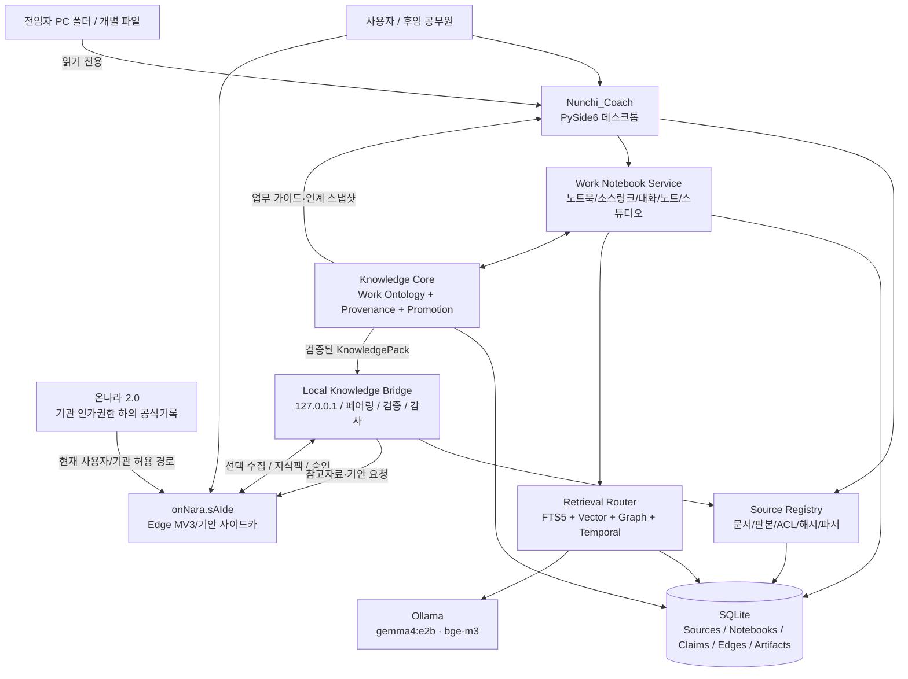
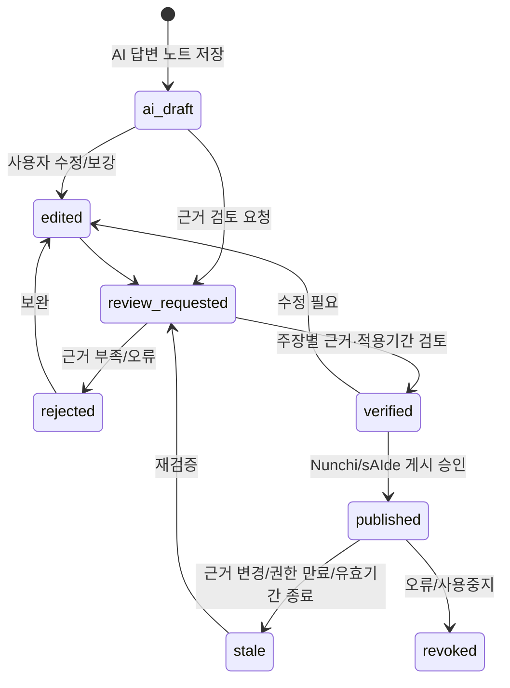

# Nunchi_Coach × onNara.sAIde × 업무 노트북(Work Notebook)
## 온톨로지·지식그래프 기반 행정업무 지식 축적·재활용 통합 구축 종합보고서

> **문서 분류:** 기술·업무 아키텍처 / 구축 전략 / AI 개발 요구사항
> **기준일:** 2026-10-08 (Asia/Seoul)
> **기준 저장소:** [`Nunchi_Coach` `28bc7acba119302fba8ebd1bda688a4f43f728e4`](https://github.com/Ubermensch216/Nunchi_Coach) / [`onNara.sAIde` `c0cb9276545ef49c44ef9063a41cf072bea8befe`](https://github.com/Ubermensch216/onNara.sAIde)
> **참조 보고서:** `Nunchi_Coach_onNara_sAIde_통합_온톨로지_지식그래프_구축전략보고서_2026-10-08.md`
> **검증 수준:** 연결된 GitHub 저장소의 코드·문서와 최신 CI 결과, Google 공식 도움말, Microsoft GraphRAG 및 오픈소스 공개문서를 대조했다. **기관 온나라 실환경·실제 개인정보 포함 자료·깨끗한 PC의 통합 종단 테스트를 수행한 것은 아니다.** 이하에서 **[확인]**은 소스/공식 문서로 확인한 사항, **[권고]**는 설계 선택, **[미검증]**은 검증 과제를 의미한다.

---

# 0. 핵심 의사결정 및 요약

## 0.1 최종 권고

기존의 **온나라 공식문서 수집 + 전임자 PC 자료 복원 + 근거 중심 지식그래프** 구조 위에 **NotebookLM 방식의 독립적인 ‘업무 노트북(Work Notebook)’**을 핵심 사용자 작업공간으로 추가한다. 단, 별도의 챗봇을 하나 더 만드는 프로젝트가 되어서는 안 된다.

새로운 통합 시스템의 정체성은 다음과 같다.

> **행정업무의 공식 기록과 실무 경험을 노트북에서 탐구하고, 근거를 검증해 지식으로 축적하며, 후임자의 업무 수행과 온나라 문서 작성에 다시 연결하는 AI 업무지식 운영체계.**

그 구현은 세 축과 하나의 공통 기반으로 나눈다.

| 축 | 제품/영역 | 책임 | 핵심 이용 상황 |
|---|---|---|---|
| **공식기록 접근** | `onNara.sAIde` | 승인된 현재 권한 범위의 온나라 문서 조회·추출·기안 화면 연계 | 공문 열람, 후속조치, 관련 문서 보내기, 검증 지식으로 기안 보조 |
| **업무 연속성** | `Nunchi_Coach` | PC/온나라 자료에서 업무·절차·주기·판본·공백·처리 계보 복원 | 전임자 업무 파악, 매년 반복업무 수행, 인수인계 |
| **지식 연구 작업대** | **`Work Notebook` 신설** | 임의 자료 모음, 자료 범위 내 대화, 비교·탐구, 노트·보고서, 지식 승격 | 사업/현안/감사/규제/공모 관련 자료 집중 연구 |
| **공통 지식 계층** | `Knowledge Core + Local Bridge` | 소스·판본·권한·근거·온톨로지·그래프·하이브리드 RAG·산출물 버전의 단일 기준 | 세 영역의 동일한 사실·근거·지식을 재사용 |

**가장 중요한 신규 기능은 ‘노트북 답변을 저장’이 아니라 ‘검증된 지식으로 승격(Promote)하고 양 앱에 게시(Publish)하는 워크플로’다.** AI의 초안과 공식기록을 동일하게 취급하지 않도록 지식의 법적·행정적 지위를 구분해야 한다.

## 0.2 반드시 지킬 10원칙

1. **노트북은 검색·대화의 범위이자 작업공간**이고, 원본 자료의 복사본 저장소가 아니다. 원본 문서 원장과 노트북 소스 링크를 분리한다.
2. **원본(source) / AI 답변(answer) / 연구 노트(note) / 검증된 지식(knowledge) / 공식기록(record)**을 별도 객체로 유지한다.
3. **노트북 자료 범위 외의 지식을 몰래 섞지 않는다.** 외부 자료는 제안할 수 있으나 사용자가 승인해 소스로 추가하기 전에는 사실 근거로 쓰지 않는다.
4. **‘노트 → 새 소스’가 순환 인용을 만들지 않도록 원천 근거의 계보(DAG)를 보존**한다. AI 답변 자체는 원문을 독립적으로 입증하지 않는다.
5. 문서·청크·그래프 엣지·지식카드·내보내기 자료에 **권한과 분류등급**을 상속·검사한다. 노트북 공유만으로 원본 권한이 확대되지 않는다.
6. 실제 온나라 검색은 **현재 정당한 권한**으로만 한다. 전임자 계정·인증서 재사용, 권한 우회, 미확인 API 추측 호출 금지.
7. **근거 위치와 문서 판본 고정**: `source_id / version_hash / locator / exact_quote`를 유지하고 원문 변경 시 파생 지식을 재검증한다.
8. 작문·업무요령 초안은 생성 가능하되 **기안 삽입, 권한 확대, 배포, 확정 지식 게시**는 사용자 확인을 필요로 한다.
9. GPU 없는 PC의 `gemma4:e2b`와 `bge-m3` 기준으로 **FTS 우선·비동기·지연 인덱싱·캐시**를 사용하고 고비용 GraphRAG 전체 재색인은 기본값으로 두지 않는다.
10. MVP에서 **세 앱의 원문 파서·벡터DB·LLM 호출을 각각 새로 만들지 않는다.** Nunchi를 지식 처리의 중심으로 두고 sAIde는 정교한 브라우저 현업 도구로 유지한다.

## 0.3 지금 정할 것과 나중에 정할 것

| 결정 항목 | 권고 기본값 | 이유 |
|---|---|---|
| 구현 전략 | 기존 Nunchi에 Notebook/Knowledge Core 추가, sAIde에 브리지 어댑터 | 수집·분석 기능 중복 및 브라우저 보안 범위 확대 방지 |
| 사용자 UI | Nunchi 데스크톱에 노트북 탭 우선, sAIde는 컨텍스트 전송/지식 호출 패널 | 권한 경계와 창 역할이 명확 |
| 통신 | `127.0.0.1` 전용 페어링된 HTTPS 또는 안전한 로컬 HTTP(기관 정책 검토) | 브라우저 MV3 ↔ Python 서비스 통합; 포트 고정/Origin 검사 |
| 지식 저장 | SQLite + FTS5 + 기존 벡터 + 타입드 엣지 테이블 | 소규모/오프라인/CPU 친화 |
| 외부 지식 | 기본 차단. 기관 승인·출처 표기를 거친 경우만 사용 | 공공 기록·기밀 자료 보호 |
| 지식 공유 | 개인/인수인계/부서 범위 분리. **초기에는 단일 사용자** | 중앙 인증·권한 연동 없는 부서 공유는 보안상 위험 |
| 그래프 DB | 초기 도입 보류 | 모델링/검색 품질 검증 후 결정 |
| 산출물 형식 | Markdown, DOCX 먼저; PDF 다음; HWPX 템플릿 실증 후 | 운영체제·한컴 서식/라이브러리 검증 필요 |
| 오디오/영상 요약 | 3차 이후 별도 실증 | 핵심은 근거·지식 승격·현업 연계 |

---

# 1. 참고 제품 조사: Google NotebookLM(현 공식 명칭 Gemini Notebook)

## 1.1 명칭과 벤치마킹 범위

[확인] Google의 2026-07-16 크롤링 문서에는 “NotebookLM is now Gemini Notebook”이라고 명시되어 있고, 2026-10-08 현재 공식 도움말도 **Gemini Notebook** 명칭을 쓴다. 본 보고서는 사용자가 언급한 **‘구글 노트북/NotebookLM’**의 경험과 기능을 벤치마킹한다. **구글 서비스를 실제 온나라 데이터의 처리자로 쓰자는 뜻은 아니다.** 기능적 패턴만 내부 로컬 시스템에 재구현한다.

근거: [Google 제품 명칭 변경 기록](https://developers.google.com/crawling/docs/changelog), [Google Notebook 도움말](https://support.google.com/gemininotebook/answer/16206563?hl=en).

## 1.2 실제 확인된 기능과 도입 판정

| Google 공식 기능(2026-10 확인) | 본 시스템 대응 | 순위 | 확인 근거 |
|---|---|---|---|
| 주제별 독립 Notebook, 소스 모음 | 업무/사업/현안별 노트북 | **필수** | [Create notebook](https://support.google.com/gemininotebook/answer/16206563?hl=en) |
| 소스별 체크·해제, 선택 소스만 채팅 | 노트북 소스 선택기/제외 | **필수** | [Use chat](https://support.google.com/gemininotebook/answer/16179559?hl=en) |
| 자료 근거 인용, 인용을 눌러 원문 위치 이동 | `[S#]` 인용, 원문 대조 뷰어 | **필수** | [Use chat](https://support.google.com/gemininotebook/answer/16179559?hl=en) |
| 채팅 답변을 Note로 저장 | `Save as Note` / 사용자 교정 | **필수** | [Create notes](https://support.google.com/gemininotebook/answer/16262519?hl=en) |
| 노트를 다시 소스로 활용 | 계보 보존된 `derived_note` 소스 | **필수+검증** | [Create notes](https://support.google.com/gemininotebook/answer/16262519?hl=en) |
| 다양한 소스: PDF, DOCX, Google Sheets, CSV 등, 웹·오디오 | Nunchi 파서 활용 + 승인된 온나라/직접입력 | **필수(기존 포맷)** / 확장 단계(오디오/웹) | [Source types](https://support.google.com/gemininotebook/answer/16215270?hl=en) |
| 자동/수동 소스 분류 | 출처 유형/업무/연도/비밀등급 태깅 | **높음** | [Source organization](https://support.google.com/gemininotebook/answer/16215270?hl=en) |
| 보고서·FAQ·브리핑·Data Tables | 지식카드, 업무보고, 비교표, 업무 절차서 | **높음** | [Studio](https://support.google.com/gemininotebook/answer/16206563?hl=en) |
| 마인드맵 | 업무 구조도·지식그래프 탐색 UI | **높음(단계적)** | [Mind Maps Help](https://support.google.com/gemininotebook/) |
| AI 오디오/동영상·슬라이드/인포그래픽 | 업무 인계 오디오, 교육 자료 생성 | **선택·후순위** | [Studio](https://support.google.com/gemininotebook/answer/16206563?hl=en) |
| 저장된 대화, 산출물 생성/수정 | 노트북별 대화 스레드·산출물 버전 | **높음** | [Chat Help](https://support.google.com/gemininotebook/answer/16179559?hl=en), [2026 공식 업데이트](https://workspaceupdates.googleblog.com/2026/03/new-ways-to-customize-and-interact-with-your-content-in-NotebookLM.html) |

**주의:** Google 자체의 제품 제한(예: 무료 노트북의 소스 개수·파일 크기)은 구글 서비스의 요금제와 운영 정책이다. **내부 제품에 그대로 제한값을 복사하지 않는다.** 우리의 한도는 성능·보안 시험으로 결정한다.

## 1.3 모방하지 말고 고유하게 만들어야 할 부분

- Google식 노트북에는 우리 기관 온나라의 **문서관리번호·결재·시행·접수·담당 처리 역할·전임자/후임자 관계**가 본래의 도메인 모델로 존재하지 않는다.
- 생성된 일반 노트와 **공무원이 실무상 확인한 업무 지침**의 자격·증거·개정 이력을 별도로 관리해야 한다.
- 검색 결과의 **접근권한/개인정보/비공개 여부**를 노트북 화면의 공유 설정만으로 해결할 수 없다.
- 보고서 생성으로 끝나지 않고 **Nunchi의 업무 가이드와 sAIde의 공문 기안**에 기계적으로 연결되어야 한다.

따라서 정체성은 단순 `NotebookLM Clone`이 아니라 **Evidence-Aware Work Notebook + Work Continuity Graph + onNara Action Copilot**이다.

---

# 2. 두 기존 코드베이스의 재점검: 새 기능의 착지점

## 2.1 Nunchi_Coach – 재사용할 엔진

[확인] Python 3.14, PySide6, SQLite/FTS5, Ollama 기반 오프라인 데스크톱 애플리케이션. PC 자료 파싱·청크화·중복/판본 처리, 연간 업무 주기/절차 복원, 출처 기반 단일 질의응답, 인수인계 스냅샷을 보유.

| 모듈 | 현 역할 | 신규 연결점 |
|---|---|---|
| `app/jobs/pipeline.py` | 파일 스캔→파싱→업무 추출→청크/임베딩 | `NotebookSource`의 재색인·비동기 큐 재사용. **Ollama 장애에도 텍스트 청크/FTS 생성** |
| `app/search/rag.py`, `app/search/verify.py` | FTS·벡터 결합, RAG 검증, 출처 인용 | `notebook_id + selected_source_ids` 강제 필터, 멀티턴 대화 지원은 별도 세션 레이어로 |
| `app/core/reconstruction.py`, `app/core/continuity.py` | 업무 항목·절차·공백 복원 | 검증 지식카드를 업무 가이드에 **참조 방식으로** 주입 |
| `app/core/handover_release.py` | 불변 인수인계 스냅샷 | 지식카드·노트북 근거·공식 출처까지 인계 참조 확장 |
| `app/connectors/onnara/contract.py` | 전임자 ID, 날짜·부서·상태로 검색하는 공통 인터페이스 | sAIde 승인 수집 및 향후 공식 내보내기 어댑터와 매핑 |
| `app/jobs/onnara_collect.py` | 재개 가능한 수집, 해시/완전성 기록 | 수집본을 소스 원장에 등록, 노트북에 선택적으로 링크 |
| `app/core/provenance.py` | 공식 출처 메타데이터 | 문서 ID·상태·원본 링크·유효 시점·판본별 인용 안정화 |

**현실적 제약:** [온나라 연결프로필](https://github.com/Ubermensch216/Nunchi_Coach/blob/main/docs/온나라_연결프로필.md)은 실제 기관 연결 미검증이라고 명시한다. 최신 [GitHub Actions](https://github.com/Ubermensch216/Nunchi_Coach/actions/runs/37731415860)는 **1,182개 통과·2개 실패·5개 건너뜀**으로 종료됐다. 수집된 ODT를 FTS/근거 청크로 인덱싱하는 시험이 실패하여 통합 노트북 기능 전에 원인 규명·수정이 선행돼야 한다. 모델 준비 실패 시 청크 생성 자체가 중단되는 코드 경로는 주요 조사 가설이며 원인 확정은 아니다.

## 2.2 onNara.sAIde – 브라우저 현장 기능 재사용

[확인] Microsoft Edge MV3 확장(React/TypeScript/WXT)으로 온나라 2.0 목록·iframe·문서 본문/첨부·기안기 관련정보 추출, 업무계획 카드, 기한 일정, 기안 사이드카, 사용 승인형 삽입을 제공한다.

| 모듈 | 현 역할 | 신규 연결점 |
|---|---|---|
| `src/lib/onnara/document-list.ts` | 현재 화면의 구조화된 목록 탐색 | 선택된 온나라 문서를 노트북 소스로 전송하는 UI |
| `src/lib/onnara/context.ts` | 온나라 문서 ID 또는 관리번호+일자로 문서 정체성 구성 | 원본 식별자·조회 세션 일치 검사 |
| `src/lib/onnara/related-document-fetch.ts` | 기안기 관련정보 원문을 읽기 전용 조회 | 해당 문서를 근거 카드로 노트북과 연결 |
| `src/lib/onnara/download.ts` | 사용자 승인된 본문/첨부 다운로드 | 허가된 파일 전달 작업과 분리하여 브리지 데이터 채널 마련 |
| `src/lib/onnara/reference-context.ts` | 온나라 관련정보·업로드·TONGDAL 자료를 기안 근거로 구성 | **검증된 Work Knowledge Pack**을 새 참고자료 공급자로 연결 |
| `src/lib/tongdal/client.ts`, `connection.ts`, `types.ts` | 로컬 브리지 페어링·검색·문서 선택·인용 판본 | 전송 프로토콜·인증·취소·오류처리 패턴 재사용, 단 **TONGDAL 자체와 동일 시스템 아님** |
| `src/entrypoints/drawer-page/DrawerApp.tsx` | 초안 생성·근거 선택·기안 삽입 | `노트북에서 가져오기` UI / 근거 판본·승격 상태 배지 |
| `src/lib/browser/guards.ts` | 특권 메시지 형식·탭 맥락 제어 | 새 명령 허용 목록·승인 검사 확장 |

최신 [GitHub Actions](https://github.com/Ubermensch216/onNara.sAIde/actions/runs/37569874700)는 성공했으나 온나라 실기관 E2E를 뜻하지 않는다. 현재 `ReferenceContext`는 **참고 3건 선택 상한**이 있으므로 **지식팩을 1개의 논리 자료로 압축해 제공**하거나 한도 및 문맥 정책을 실측 후 개정한다. `src/lib/inbox/identity.ts`의 제목·날짜·수발신자 기반 ID는 공식 원문 ID와 혼동하지 않는다.

[미검증] 현재 후임자 권한으로 전임자 **전체 처리 이력**을 검색·수집할 실제 시스템 사양은 확보되지 않았다. notebook 기능의 도입을 전임자 전체 수집 완료에 종속시키지 않는다.

## 2.3 의존 관계 결론

**노트북 MVP는 온나라 연결 없이도 PC 자료·사용자 직접 파일·승인 내보내기를 이용해 먼저 동작**해야 한다. 온나라 실환경 연결은 별도 게이트로 추진한다. 이렇게 해야 병목인 시스템 접근 승인과 무관하게 사용자 가치·RAG 품질·지식 승격 로직을 검증할 수 있다.

---

# 3. 사용자 여정과 정보 구조(IA)

## 3.1 Nunchi 화면 내 새 ‘노트북’ 영역

현행 Nunchi의 `업무 / 일정 / 문서 / 질문`을 모두 유지하고 **노트북**을 추가한다.

```text
[Nunchi_Coach]
 ├ 업무             업무 전체 목록 → 업무 복원 카드 → 지금 할 일/업무 바통
 ├ 일정             연간 반복 패턴/다가올 일
 ├ 문서             PC/온나라 원본 문서 원장
 ├ 질문             등록 프로젝트 전체에서 단건 질의(기존 기능 유지)
 └ 노트북 ★신규
     ├ 내 노트북 (생성/복제/보관/아카이브)
     ├ [노트북: 2026 규제개선 과제]
     │  ├ 자료(왼쪽): 파일·공문·업무·노트 / 필터·선택
     │  ├ 대화(가운데): 출처 기반 멀티턴 질의, 정밀 인용
     │  └ 스튜디오(오른쪽): 저장한 노트·지식카드·보고서·업무요령
     ├ 지식 검증함 (미확인 사실, 충돌, 만료, 출처 변경)
     └ 게시함 (Nunchi 업무 가이드 / sAIde 참고자료)
```

**UX 원칙:** 소스 3단이 화면에서 동시에 확인되어야 사용자가 "무엇을 근거로 한 답인가"를 잃지 않는다. 기존 질문 탭을 제거하지 않는다(질문 탭은 간단한 전 범위 검색, 노트북은 장기 집중 탐구).

## 3.2 노트북 종류

| 노트북 종류 | 예시 | 기본 공개 범위 | 연결 규칙 |
|---|---|---|---|
| 개인 탐구 | `규제개선 공모 아이디어` | 개인 | 외부 공유·sAIde 게시 기본 금지, 명시적 승인 |
| 업무 노트북 | `다대포 해양레저 조성사업` | 개인(초기) | `Work` 엔터티와 연결 |
| 인수인계 노트북 | `2025→2026 행사보조금 정산` | 후임/승인된 인계 대상 | 검토본·공식 기록·미확인 사항 강조 |
| 문서 작성 노트북 | `2026년 ○○사업 추진계획 수립` | 개인 | 검증된 정보만 기안 참고로 전달 |
| 부서 공통(후속) | `기획실 2026 정책자료` | 별도 중앙 권한연동 이후 | 개인 노트북과 명확히 분리 |

**노트북 경계:** 원칙적으로 해당 노트북에 사용자가 선택한 소스만 검색한다. 다른 노트북 지식을 자동 혼입하지 않는다. 여러 노트북 간 비교는 쌍방 접근권한을 재검사하고 명시적으로 소스 범위를 선택한 경우에 한해 후속 제공한다.

## 3.3 사용자 워크플로 A: 전임자 업무의 본질 복원

1. 인수인계 프로젝트에서 전임자 PC 폴더를 Nunchi에 등록한다.
2. 승인된 온나라 수집본을 연결한다(초기에는 수동 내보내기도 가능).
3. Nunchi가 파일-공식 문서-사례-절차를 연결하고 `업무 노트북 만들기`를 제안한다.
4. 후임자가 `올해 정산 업무에서 무엇이 달라졌나?` 질문한다.
5. 답변은 날짜·금액·처리 절차마다 특정 출처/판본을 인용하고, 서로 충돌하는 문서를 병렬로 표시한다.
6. 사용자가 답변을 **업무 노트**로 저장하고 불확실한 내용은 수정/보류한다.
7. 필요한 항목을 **업무지식 카드**로 승격한 뒤 `Nunchi 업무 가이드에 반영`을 실행한다.
8. 다음에 같은 업무를 열면 `근거 확인된 준비물`, `미확인 확인 사항`, `전년도 완료문서`를 자동 표시한다.

## 3.4 사용자 워크플로 B: 노트북 연구→온나라 기안

1. sAIde에서 수신 공문 1~3건을 체크 → **노트북으로 보내기** → 기존 노트북 선택 또는 새 노트북 생성.
2. Nunchi 노트북에 관련 PC 작업표·지침·지난해 계획서 등을 추가한다.
3. AI와 대화하며 요구사항 목록·과거 추진과정·현행 기준을 비교한다.
4. `회신 준비팩`을 생성한다: 확인된 사실, 법적 근거(해당되는 경우), 요구된 제출물, 마감일, 결재 선례, 미확인 항목.
5. 사용자가 근거/개정 여부를 검토한 뒤 **sAIde 기안 참고로 게시**한다.
6. sAIde 기안 사이드카에서 `노트북 지식팩`을 선택하면 참조 맥락이 들어가고, 미확인/추정 항목은 기본적으로 공문 사실로 반영하지 않는다.
7. 생성된 초안은 sAIde의 기존 미리보기·승인·삽입 절차를 거친다. **자동 결재/시행 금지.**

## 3.5 사용자 워크플로 C: 특정 정책 비교·창의적 시너지

`2023~2026 도시재생/관광/공원 자료` 노트북을 만들고, `다대포 해변 휴게공간 개선과 관광 활성화의 공동사업 가능성`을 질문한다.

- 시스템은 사업·부서·대상지·기간·예산·규제·공모 조건의 관계를 찾는다.
- 연결 가능성을 **사실**, **비교에서 도출한 가설**, **외부 확인이 필요한 제안**으로 분리한다.
- `시너지 가설 카드`에 관련 사업 링크, 공통 자산, 예상 효과, 확인해야 할 법적/재정적 제약, 정당화하는 근거를 쌓는다.
- 승인된 항목만 사업 구상안/검토보고서로 문서화하고 업무 사례 지식으로 쌓는다.

**핵심 가치:** 단순 키워드 유사성을 넘어 **업무와 산출물 사이의 관계·시점·제약·재사용 조건**을 설명한다. 그러나 자동으로 재원 확보·사업 가능성을 확정하지 않는다.

---

# 4. 기능 요구사항: NotebookLM 핵심 경험과 행정 특화

## 4.1 NB-01 노트북 및 소스 관리 – P0

**요구:** 노트북을 생성·수정·보관/복원하고, 다수의 서로 다른 출처 자료를 **원본 복제 없이 링크**해 관리한다.

필수 기능:

- 생성: 제목, 목적, 담당 업무, 적용 연도, 개인정보/비공개 등급, 기본 AI 모델, 정렬 방식.
- 추가: 사용자 파일, 기존 Nunchi 문서, 특정 업무의 문서, 승인된 온나라 원본, 직접 작성 텍스트, **기존 노트(파생 소스)**.
- 소스 상태: `접근 가능/권한 만료/원문 수정/부분 파싱/인덱싱 진행/원문 없음/비공개 제한`.
- 출처 표시: `PC 원본`, `온나라 공식기록`, `사용자 메모`, `AI 생성 초안`, `검증 노트`, `승인된 내보내기`.
- 노트북에 포함된 문서라도 채팅마다 개별 소스 ON/OFF. 기본은 허용된 활성 소스.
- 동일 파일 해시로 원본 중복은 방지하지만 **동일 내용 문서의 출처·결재 상태·업무 역할**은 별개 메타데이터로 유지.
- 노트북을 삭제할 때는 **연결 링크를 해제**하고 원본 문서 원장을 자동으로 지우지 않는다. 파생 전용 저장물의 보유 정책은 별도 적용.
- 기본 권한은 개인. 부서 공유는 기능 플래그로 닫고 권한 연동이 검증되면 개방.

**완료 조건:** 20~50건의 혼합 파일 소스 추가/선택/해제/재개, 원본 파일 무변경, 소스 간 누출 0건, 중복 처리 일관성 통과(건수는 파일럿 시험 세트 목표값).

## 4.2 NB-02 파싱·색인 및 원문 대조 – P0

- Nunchi 기존 파서 최대 활용. HWPX/ODT/PDF/DOCX/XLSX/PPTX/TXT/MD, 지원 제한은 화면과 오류 결과에 명시.
- HWP 5.0 표 구조 손실·스캔 PDF의 OCR 부재를 **부분 분석**으로 표시.
- 문단·표·셀·행/열 헤더·단위·쪽수·문서번호 등 구조 기반 청크. `chunk_locator`는 파서 버전이 변경돼도 추적할 수 있도록 `source_version_hash` 및 원문 텍스트 오프셋/구조 경로와 함께 관리.
- **FTS 청크 인덱스는 Ollama 임베딩과 분리**. 모델 장애에도 문서 목록·문자열 검색·중복/해시 판정·근거 열람 작동.
- 모델 준비 시 임베딩을 사후 생성. 모델명·차원·정규화/청크 버전을 기록하고 변경 시 부분 재색인.
- 원본 바이트 저장 정책: 파일은 원래 위치 참조 기본, 기관 승인 온나라 내보내기 자산은 허용된 별도 보호 저장소; 서버 조회만 허용된 자료는 본문 영속 저장을 금지할 수 있어야 한다.

## 4.3 NB-03 소스 제한 멀티턴 질의응답 – P0

- **노트북 전용 멀티턴**: 질의-응답-후속 질문을 이어가되 각 턴마다 **현재 승인된 소스 선택 상태와 권한을 재검사**한다.
- 질문 지시어(‘이 사업’, ‘그때’, ‘어제 올린 보고서’)는 명시적 대화 스레드 문맥에서 해석하고 모호하면 자동 단정 대신 복수 후보 제시.
- 모드: `정확한 근거 검색`, `요약`, `자료 비교`, `업무 흐름 복원`, `아이디어 탐색`. 일반 지식은 기본적으로 범위 밖.
- **인용은 답변의 주장 단위**: 문서 제목만 표시하지 말고 인용 위치, 문서 판본, 원문 문장을 연다. 근거가 없는 답은 보류/미확인.
- 최소 신뢰 검사: 질문 적합성, 숫자·단위·부정문·적용기간·인용 지점 정확성. 기존 `verify_sentences`를 확장하되 검증 완전성으로 과장 금지.
- 긴 질문 또는 불명확 시 `질문 분해 → 하위 질문별 검색 → 증거 병합 → 답변`을 선택적으로 적용(비용 상한 설정).
- 출처 충돌 시 `A 문서에는 X, B 문서에는 Y`를 표시하고 **차이를 자동 결정하지 않는다**.
- 모델 장애 시 검색·문서 열람을 제공하되 생성 답변은 '모델 이용 불가'로 표시.

**근거 포맷 예시:**

```text
2025년도 실적 제출기한은 2025-11-15이다. [S2 §2.나, 2025-08-22]
다만 올해 기한은 제공 자료에서 확인되지 않는다. [미확인]
```

## 4.4 NB-04 Notes: 답변 → 연구노트 → 검증지식 – P0/P1

구글식 `Save to note`를 도입하되, **기계적 저장과 신뢰 승격을 별개의 버튼**으로 둔다.

1. `답변 저장`: 답변 원문·질문·선택 소스·인용·생성 모델·생성 시점 저장, **상태 `ai_draft`**.
2. `메모 편집`: 사용자가 직접 문장을 고치고 이유·별도 근거를 추가. 버전 이력 남김.
3. `근거 점검`: 주장 단위로 공식 원문 대조, 문서 판본/현행 여부/업무상 적용 조건 표시.
4. `지식카드 승격`: 허용된 자료를 바탕으로 주장·근거·유효기간·검토자·검토 시각을 묶은 **`KnowledgeCard`** 작성.
5. `Nunchi에 게시` / `sAIde에 제공`: 명시적으로 승인한 지식카드 또는 지식팩만 선택하여 게시.

**필수 구별:** ‘사용자가 노트를 작성했다’ = 사실 확인이 아님. ‘AI가 원문에 같은 문자열을 찾았다’ = 해당 규정의 현재 적용 가능성까지 검증한 것이 아님. 검토 역할을 UI에 표시하되, 초기 Nunchi의 익명 `전임자/후임자` 표시는 본인 인증이 아니라 기록용이므로 **검토자 인증을 보장한다고 표시하지 않는다**.

## 4.5 NB-05 스튜디오 – P1/P2

| 산출물 | 내용 | 초기 우선순위 | 소비 주체 |
|---|---|---|---|
| **근거형 업무 브리핑** | 1쪽 요약, 지금 할 일, 불확실성·근거 | P1 | Nunchi 업무 가이드, sAIde 참고 |
| **업무 인수인계 절차서** | 연간 일정·단계·담당·준비물·완료 기준·실패 사례 | P1 | Nunchi 업무 복원본 |
| **공문 기안 근거팩** | 현행 근거·사업 배경·기한·검증된 수치·문서 링크 | P1 | sAIde 기안 사이드카 |
| **문서/지침 비교표** | 연도별 차이, 변경·유지·충돌·적용 시점 | P1 | 판단·검토보고 |
| **질문·확인 목록** | 근거 부재·권한 부족·사용자 결정 항목 | P1 | 후임자·관리자 |
| **아이디어/시너지 지도** | 교차 사업 연결·기회·제약·근거/가설 | P2 | 정책 기획 |
| **업무 지식 마인드맵** | Work→Case→Step→Document→Evidence 그래프 | P2 | 탐색 UI |
| 오디오 요약/교육카드 | 검증된 자료 기반 출근길 인계 오디오 등 | P3 | 교육/학습 |

중요: **보고서/지식카드/팩은 서식화된 보기(view)와 스냅샷**이고, 공식 원본을 복제해 독립된 진실처럼 만들지 않는다. 출처 링크·해시·판본·검토 이력은 따라가야 한다.

## 4.6 NB-06 노트북 밖으로 ‘문서화·재활용’ – 핵심 신규 요구

사용자는 스튜디오에서 세 가지 목적지 중 하나를 선택한다.

**A. 파일 내보내기:** Markdown / DOCX / PDF / 검증 후 HWPX; 문서 본문, 주장-근거 목록, 판본·생성/검토 시각, AI 생성 여부, 확인 필요 항목, 비공개 표시, 원문 링크를 삽입. 대상 형식별 레이아웃은 출력 어댑터가 담당.

**B. Nunchi 업무 가이드에 반영:** 승인된 `KnowledgeCard`를 `work_id` 또는 `step_id`에 결속. 반복 업무에서 `실무 요령/주의사항/근거/확인해야 할 기준`으로 보여 준다. 사람이 수정한 업무 항목 덮어쓰기 금지.

**C. sAIde 기안/업무계획에 제공:** 원문에서 검증된 사실과 조건·시점, 사용자 승인 요약을 `KnowledgePack`으로 전달. sAIde는 **발췌된 지식팩을 출처로 표시**하고, 기안기에는 사용자 승인 후 반영. 근거를 열 수 없는 항목은 초안의 확정 사실로 주입 금지.

내보내기한 `.md/.docx/.pdf/.hwpx` 자체를 다시 노트북에 넣을 경우 **`derived_from` 원본 계보를 유지**하고, 유효한 새 근거가 추가되지 않는 이상 이를 독립 증거로 계산하지 않는다.

## 4.7 NB-07 지식 연결·그래프 기반 확장 – P2

- 노트북별 중요 개체: 업무, 사업, 기관/부서, 문서, 문서판본, 금액, 기한, 적용 규정, 수행 단계, 처리사례, 결과물, 확인자 역할.
- 사용자 질문에 따라 1~2-hop 관계 탐색을 검색 후 보강하고, 그래프 엣지마다 근거·추정 여부를 표시.
- 반복 업무의 연도별 `사례(WorkCase)`를 하나의 업무(`Work`)와 구분한다.
- 업무들 사이 `공통근거`, `같은 대상지`, `동일 예산/사업`, `후속 절차`, `유사 서식` 등의 관계 후보를 추천하되 **자동 확정 금지**.
- 그래프 시각화는 링크의 유효기간/신뢰/검증상태/원출처 접근권한을 반영한다. 노트북 내 공유된 자료만 보이게 한다.

---

# 5. 권고 시스템 아키텍처

## 5.1 논리 구성



핵심은 **공통 DB와 출처·인용 스키마가 진실의 원장(System of Record)**이고, 노트북은 그 위에서 사용자 선택을 표현한 **가상 자료 집합**이라는 점이다. 브리지로 자료를 무분별하게 동기화하지 않는다.

## 5.2 구현 배치 선택

| 대안 | 구성 | 장점 | 단점 | 판단 |
|---|---|---|---|---|
| 단일 Edge 확장 | 모든 분석·색인을 sAIde에 탑재 | 설치 단순 | Python 파서 이중 구현, IndexedDB 대용량/수명, CPU 추론 경합 | **비권고** |
| **Nunchi 중심 로컬 코어** | 기존 Python DB/검색 + 노트북 UI + localhost Bridge + sAIde 경량 Provider | 현 기술재산 활용, 오프라인, 근거 단일화 | 로컬 백엔드 수명/인증 관리 | **MVP 채택** |
| 부서 중앙 서버 | 다중 사용자/기관 온나라 공식 연계/통합 권한 엔진 | 조직적 공유, 기록 보존/감사 | 인프라·권한/개인정보보호/운영 비용 | 추후 게이트 기반 |

**TONGDAL.ai 처리:** sAIde의 기존 TONGDAL 브리지 기능은 유지하되 새로운 `NunchiKnowledgeProvider`를 병렬로 추가한다. **두 공급자의 인용 번호·저장소·권한을 혼합하면 안 된다.** 단일 소스 계약을 바탕으로 표시 계층에서 조합할 수는 있다. TONGDAL에 이미 수집된 지식이 있다면 승인된 공급자 검색 결과로만 활용한다. 별도 사용 중인 TONGDAL DB를 Nunchi의 유일한 원장으로 전제하지 않는다.

## 5.3 컴포넌트와 경계

- **Source Registry**: canonical `source_id`, 출처 시스템, 원문 식별자, 해시, 원문 링크, 수집 권한, 판본, 보존·폐기 정책 관리.
- **Notebook Service**: 노트북과 소스 참조, 선택 범위, 세션, 노트, 추천 질문, 템플릿 및 출력물 관리.
- **Retrieval Router**: 질문 목적·범위·권한·시점 기반으로 FTS/벡터/그래프/표 추출을 조합. **관계 검색은 기존 텍스트 근거와 항상 합류**.
- **Knowledge Core**: 타입 정의·관계 검증·인용 계보·사람 검토·지식 승격·판본/만료 관리.
- **Action Publisher**: 사용자가 승인한 `KnowledgePack`을 목적지 앱으로 제공하는 읽기 전용 엔드포인트 및 업무 가이드 갱신기.
- **Local Bridge**: 페어링, 요청 Origin 검증, 권한·목적·자원·크기 검사, 읽기 전용 기본 정책, 감사 이벤트, 승인된 전송.

---

# 6. 온톨로지: 무엇을 ‘지식’으로 정의할 것인가

## 6.1 먼저 의미 모델, 나중에 그래프 DB

온톨로지는 단순히 `node`/`edge`를 많이 만드는 기술이 아니다. **업무·자료·행정행위·근거·시점·확인의 의미를 안정적으로 정의하는 계약**이다. 이후 그래프 DB의 종류는 교체 가능해야 한다.

### 핵심 엔터티

| 객체 | 의미 | 핵심 속성 |
|---|---|---|
| `Notebook` | 사용자가 소스를 조직하고 연구하는 범위 | 목적, 소유 범위, 상태, 소스 선택 |
| `SourceDocument` | 물리적/논리적 원본 문서 | 발급 시스템, 공식 문서 ID, 관리번호, 등록시각, 분류등급 |
| `DocumentVersion` | 변경 불가한 특정 판본 | hash, 수집시각, 발행시각, 문서 상태, 파서 버전 |
| `SourcePassage` | 정확히 인용 가능한 문단·표·셀 | locator, quote, origin offset, 판본 ID |
| `Work` | 재발생 가능한 업무 유형 | 이름, 소관, 절차 모델, 정책 대상 |
| `WorkCase` | 특정 연도·사업의 실제 수행 사례 | 연도, 시작·종료, 책임역할, 처리 결과 |
| `WorkStep` | 행정업무의 수행 단계 | 순서, 입력·산출물, 완료 조건 |
| `TaskObligation` | 기한/제출물/회신/조치 요구 | 요건, 기간, 담당, 근거 |
| `PolicyRule` | 지침·조례·법령 등에서 주장된 규칙 | 문구, 근거 출처, 유효 시점, 확인 상태 |
| `Answer` | AI 대화의 특정 생성 결과 | 질문, 모델, 사용 자료, 인용, 생성시점 |
| `Note` | 사용자/AI가 정리한 연구 메모 | 상태, 편집 이력, 파생 출처 |
| `Claim` | 근거 대조할 수 있는 최소 주장 | 주어/술어/값/단위/기간/조건/근거 |
| `KnowledgeCard` | 검토 가능한 업무지식 단위 | 원천 claim, 검토자 역할, 상태, 유효기간 |
| `KnowledgePack` | 소비 앱에 제공하는 검증 정보 묶음 | 대상 앱, 허용 소스/claim, 스냅샷 해시 |
| `Artifact` | 노트북에서 만든 보고서·표·요령서 | 템플릿, 버전, 파일 해시, 게시상태 |
| `AccessGrant` | 사람/역할/목적이 특정 자료에 가진 권한 | 권한원장, 범위, 만료, 검증시점 |

### 핵심 관계

| 관계 | 예시 | 자동 확정 여부 |
|---|---|---|
| `NOTEBOOK_HAS_SOURCE` | 노트북→소스 링크 | 사용자가 추가하면 확정 |
| `HAS_VERSION` | 원문→판본 | 원본 식별/해시로 확정 |
| `PASSAGE_OF` | 인용→판본 | 파서 로케이터로 확정 |
| `BELONGS_TO_WORK` | 문서→업무 | AI 추정은 후보, 사람 검토 후 확정 |
| `EVIDENCE_FOR` | 원문구절→Claim/업무단계 | 주장과 인용 대조 후 승격 |
| `DRAFT_OF / FINALIZED_AS` | PC 초안→온나라 승인본 | 문서 ID/작성흐름 증거 없으면 추정 |
| `PRECEDES / PRODUCED_BY` | 단계와 공문/결과물 | 사건 이력 검증 가능 시 확정 |
| `REPLACES / SUPERSEDES` | 올해 지침이 작년 지침을 대체 | 공식 관계 또는 검토자가 확인해야 확정 |
| `DERIVED_FROM` | AI노트/보고서→기초 원문·답변 | **반드시 기록**, 계보 DAG |
| `APPROVED_FOR_USE_IN` | 지식카드→Nunchi/sAIde 목적지 | 승인 시 확정, 권한 범위 제한 |
| `SUGGESTED_SYNERGY_WITH` | 사업 A↔사업 B | 기본은 **가설 상태**, 검토 필요 |

## 6.2 관계의 품질 속성

```yaml
relationship:
  id: edge_123
  subject: work_case_2025_01
  predicate: PRODUCED_DOCUMENT
  object: onnara_doc_456
  evidence_refs:
    - source_version_id: ver_456_a
      passage_id: passage_900
      excerpt_hash: sha256:...
  assertion_origin: deterministic_record  # or human_confirmed, ai_suggested
  validation_status: confirmed             # proposed, checked, confirmed, disputed, revoked
  valid_from: 2025-01-01
  valid_to: null
  observed_at: 2026-10-08T09:00:00+09:00
  security_label: department_restricted
  model_version: null
```

시간은 **실제 적용기간(`valid_time`)**과 **시스템이 알게 된 시점(`observed_time`)**을 분리한다. 2026년에 수집했다고 2025년 규칙을 현행으로 취급하지 않기 위해서다.

## 6.3 그래프 데이터베이스는 언제 도입하는가

- **초기:** SQLite `entity`, `entity_relation`, `relation_evidence`, `claim`, `work_case`를 운영하고 재귀 CTE·인접리스트를 사용한다. 작은 업무 그래프의 1~2-hop 탐색에는 충분하다.
- **전환 평가:** 10만+ 고빈도 복잡 탐색 등 실측된 요구, 탐색 지연 목표 미달, 팀 협업/중앙 서버가 생길 때 Neo4j·RDF 스토어 등 비교.
- **금지:** 모든 문서를 LLM으로 읽혀 관계 수십만 개를 생성한 뒤 사람이 검증 못 하는 상태로 방치하지 않는다.

Microsoft GraphRAG는 LLM 추출 관계와 커뮤니티 요약을 이용해 특정 엔터티 탐색(Local)·전체 테마 탐색(Global)을 지원한다. 다만 Global Search는 요약 계층과 map/reduce 추론 비용이 커서 CPU 전용 파일럿에서는 선택적으로 실행하는 것이 타당하다. 근거: [Microsoft Local Search](https://microsoft.github.io/graphrag/query/local_search/), [Global Search](https://microsoft.github.io/graphrag/query/global_search/), [BYOG](https://microsoft.github.io/graphrag/index/byog/).

---

# 7. 가장 중요한 구조: 출처 계보와 지식 승격(Promotion)

## 7.1 문서→답변→노트→지식→업무 적용의 상태기계



`verified`는 **검증자가 확인한 사실 범위**만 뜻한다. `published`는 앱에 노출됐다는 의미일 뿐 공문 결재·법률 효력이 생긴 것이 아니다. **온나라 승인 여부는 원본 공식문서의 기록 상태**에만 연결한다.

## 7.2 주장(Claim) 중심 검토

예: AI가 ‘2025년 보조금 정산은 11월 15일까지 제출한다’고 답했다.

이를 다음처럼 분해한다.

```json
{
  "subject": "2025년도 ○○보조금 정산",
  "predicate": "submission_deadline",
  "value": "2025-11-15",
  "unit": "date",
  "condition": "2025년 교부사업에 한함",
  "temporal_scope": {"valid_from": "2025-01-01", "valid_to": "2025-12-31"},
  "evidence": [{"source_version_id": "ver_44", "locator": "p2/2.나", "exact_quote": "..."}],
  "assertion_origin": "ai_extracted",
  "validation_status": "proposed",
  "review": null
}
```

단순 `verified: true/false` 하나로 끝내지 말고 **문자열 대조(기계 검증)**, **행정적 적용 여부(검토 판단)**, **배포 승인(사용 승인)**을 따로 기록한다.

## 7.3 AI 답변을 재료로 쓸 때의 ‘인용 세탁’ 방지

Google은 Notes를 질문의 소스로 사용할 수 있지만, 우리 시스템은 **공무원 업무 판단**에 쓰이므로 추가 안전장치가 필요하다.

위험 시나리오:

1. 원문 A에 없는 금액을 AI 답변 B가 생성.
2. B를 Note C로 저장.
3. C를 소스로 새 대화를 진행하고 D가 “C에 나와 있다”며 같은 금액을 재확인.
4. D를 Nunchi 업무 가이드·sAIde 공문 초안에 확정 수치로 쓰면 **AI 자기 인용이 독립 증거로 오인**된다.

방지 규칙:

- 모든 파생 노트·지식카드·보고서는 `DERIVED_FROM`으로 **원천 `SourcePassage`까지 추적 가능한 비순환 그래프**를 가져야 한다.
- 파생 노트는 `context`로 활용 가능하되 **독립적 외부 증거로 가중치 계산하지 않는다**.
- RAG가 증거를 요약할 때 `AI_NOTE` 자체를 `[S]`로 인용할 경우 **그 노트의 원천 1차 소스 인용을 함께 노출**한다.
- 원천이 0개거나 고아 노트일 경우 `사용자 의견/AI 추론`으로 표시하고, 사실 검증을 통과한 공문 근거로 대체하지 않는다.
- 파생 참조의 깊이·수량을 제한하고 visited-set으로 순환 참조 차단.
- 같은 원천에서 파생된 다수 노트는 **증거 개수가 늘어난 것으로 세지 않는다**.
- 원천 판본 변경/삭제/권한 상실 시 해당 노트·카드·팩·내보내기 산출물은 **재검토 필요**로 전파. 기배포 파일을 원격에서 자동 회수할 수 없는 한계를 고지한다.

## 7.4 공식기록과 검증지식의 권위 순위

**권위는 일률적 숫자 1순위로 판단하지 않는다.** `내용의 참/거짓`, `실제 행정행위가 있었는가`, `현행 규칙인가`, `개인에게 적용되는가`가 다른 질문이기 때문이다.

- **온나라 결재·시행본:** 특정 행정행위와 결재/시행 상태를 입증하는 유력 자료. 그렇다고 모든 내용이 법령보다 우선하거나 현재도 유효한 것은 아니다.
- **법령/지침 원문:** 특정 시점의 규범 내용 입증. 최신 개정·적용 대상·예외 확인 필요.
- **PC 초안:** 업무 의도·작업 방법과 배경을 이해하는 데 유용. 최종 집행 사실로 오인하지 않는다.
- **사용자 확인 지식카드:** 담당자의 확인된 운영지식. 공식 문서 자체를 대체하지 않는다.
- **AI 생성 노트:** 해석·요약·아이디어의 초안. 근거가 따라가더라도 자체적으로 확정 자료는 아님.

---

# 8. 데이터 모델·DDL 초안

## 8.1 핵심 테이블

| 테이블 | 주요 컬럼 / 제약 | 설명 |
|---|---|---|
| `notebooks` | id, title, scope, work_id?, description, created_at, archived_at, label | 노트북 메타 |
| `notebook_sources` | notebook_id, source_id, added_at, selected_default, added_by, purpose | 원본에 대한 링크, `(notebook_id,source_id)` unique |
| `source_documents` | id, origin, external_id?, source_kind, owner_scope, current_version_id?, classification, access_policy | 전역 소스 원장 |
| `source_versions` | id, source_id, sha256, observed_at, issued_at?, source_status, parse_version, access_snapshot_id | 불변 판본 |
| `source_passages` | id, version_id, locator, normalized_text, exact_text_hash, segment_type, security_label | 청크·표 등 인용 단위 |
| `notebook_threads` | id, notebook_id, selected_source_snapshot, created_at, updated_at | 멀티턴 대화 범위 |
| `notebook_messages` | id, thread_id, role, content, retrieval_snapshot_id?, model?, created_at | 채팅 로그 |
| `answers` | id, message_id, generation_id, model, prompt_version, cited_passage_ids, verification_status | 독립 답변 객체 |
| `notes` | id, notebook_id, title, body, author_kind, state, current_revision_id | 사용자/AI 노트 |
| `note_revisions` | id, note_id, body, change_reason, changed_at, actor_role | 변경 이력 |
| `claims` | id, note_id?, predicate, value, unit, condition, valid_from, valid_to, state | 원자적 주장 |
| `claim_evidence` | claim_id, passage_id, quote_hash, verification_method, status | 주장-근거 연결 |
| `entities` | id, kind, canonical_name, attrs, security_label | Work/WorkCase/Step 등 |
| `entity_relations` | id, from_id, predicate, to_id, status, observed_at, valid_from, valid_to | 관계 테이블 |
| `relation_evidence` | relation_id, passage_id, provenance_kind | 그래프 출처 |
| `knowledge_cards` | id, work_id?, note_id?, state, reviewed_at?, reviewer_ref?, purpose | 승격 단위 |
| `knowledge_packs` | id, target_app, notebook_id, source_revision_ids, claim_ids, created_at, status, payload_hash | 배포 불변 스냅샷 |
| `artifacts` | id, notebook_id, type, version, input_snapshot_hash, output_hash, export_policy, status | 보고서·엑셀 등 산출물 |
| `access_grants` | principal, object_id, action, purpose, expiry, issuer, verified_at | 보안 권한 |
| `audit_events` | id, timestamp, principal, action, object_ref, result_code, reason_code | 감사 이벤트 (원문 기본 미저장) |

기존 Nunchi DB의 `documents`, `sources`, `chunks`, `tasks` 등 스키마와 **중복 기능을 이식하지 않는다**. 신규 테이블은 기존 PK와 안정적 연결키를 확인해 마이그레이션한다. 실제 DDL은 DB 스키마와 migration 도구를 재검토한 뒤 작성한다.

## 8.2 필수 무결성 제약

- `notebook_sources` 소스는 실제 존재하는 전역 소스/판본이어야 한다.
- `source_passages.version_id`가 고정되어 답변 작성 후 원문이 변경돼도 과거 인용은 어느 판본이었는지 추적한다.
- `claim_evidence`는 1개 이상 실원본 구절을 참조할 때만 **근거 확인 상태**로 전환한다(정책 예외: 사람이 직접 확인한 사실은 별도 근거 타입과 책임 명시).
- `knowledge_packs`는 생성 후 내용 변경 불가. 변경 시 새 버전.
- `entity_relations`와 `claims`가 승인된 소스 권한보다 낮은 보호 수준으로 복제되지 않게 한다.
- Source 접근 취소 이벤트는 색인/캐시/노트/팩/검색 결과를 비활성화하고 감사에 남긴다.
- 민감 정보 본문/개인식별번호를 로그·telemetry·Git 테스트 fixture에 남기지 않는다.

---

# 9. 통합 검색·질의응답 설계

## 9.1 질의 유형별 라우팅

| 질문 예시 | 주 검색 방식 | 추가 절차 |
|---|---|---|
| ‘2025년 11월 정산 공문 번호는?’ | 공식 ID·날짜 메타데이터 + FTS | 상태/기관/판본 확인 |
| ‘전임자가 행사 보조금 정산을 어떻게 했어?’ | 업무 그래프 + 절차 문서 + 유사도 | WorkCase별 처리 순서 제시 |
| ‘2025와 2026 지침의 차이는?’ | 판본/기간 필터 + 구절 정렬 + 표 비교 | `REPLACES` 관계는 증거 필요 |
| ‘제출기한·금액이 각각 얼마?’ | 표 셀/구조화 수치 + 정확일치 | 단위·조건·회차 검증 |
| ‘이 두 사업을 연계할 방법은?’ | 개체·주제·대상지·소관 관계 후보 | 사실 vs 시너지 가설 분리 |
| ‘이 노트북 자료에 없는 것은?’ | 범위 제한 검색 + 누락/질의 구조화 | 없는 내용 주장 금지, 검증 범위 표시 |

## 9.2 안전한 검색 파이프라인

```text
사용자 질문
  → notebook_id·현재 활성 소스 스냅샷 확보
  → 현재 사용자 권한/목적/분류등급 검사 (검색 전)
  → 질의 의도·업무/연도/기관/문서번호 제약 추출
  → FTS5/BM25 정확일치 후보 + 벡터 후보 (필요 시)
  → 구조화 기록 조회(기한/문서 ID/표 셀) + 1~2-hop 관계 탐색 (필요 시)
  → source/version/period/ACL 필터 + 중복 판본 정리
  → 후보 rerank + 인접문장/표 헤더 보강 + 컨텍스트 예산
  → LLM 생성: 주장별 인용 ID 필수, 불확실성/충돌 분리
  → 사실·수치·조건·인용 대조 (LLM 의존 금지)
  → 사용자에게 답변+근거+검증상태+원문 변경 경고 표시
  → 저장 요청 시 Note(ai_draft) 생성
```

**정확성 게이트:** 사용자 요청 소스에 없는 근거를 `Google 검색 결과`나 타 노트북에서 자동 보충하지 않는다. 외부 문헌이 필요하면 **‘추가 소스 제안’** 목록으로 먼저 보여 주고 사용자가 승인해 별도 소스로 추가하도록 한다.

## 9.3 지식 생성 비용을 통제하는 전략

- 1차: **규칙/메타데이터/FTS**만으로 빠르게 검색·정렬.
- 2차: 기존 임베딩이 있는 청크에 한해 벡터 검색. 신규 자료는 백그라운드 임베딩 큐.
- 3차: 그래프는 명시적 ID·문서연관·연도 절차 중심으로 확장하고 LLM 관계 추출은 **요청 시 또는 야간 승인 작업**.
- 4차: 전체 그래프 군집화·커뮤니티 리포트는 대형 자료에 대한 실제 효과가 입증될 때만 도입.
- 모델의 구조화 JSON 오류, 타임아웃, 메모리 부족 때 작업을 재개 가능한 단계별 체크포인트로 남긴다.

---

# 10. onNara.sAIde ↔ Nunchi 로컬 브리지 계약 초안

## 10.1 호출 방향과 원칙

**A. sAIde → Nunchi:** 사용자가 선택한 온나라 문서를 `노트북에 추가`, 현재 보고 있는 문서를 `노트북에서 분석`, 기안 중 참고자료의 `연관 업무 노트북 찾기`로 전송. 기관 온나라 열람/다운로드의 부작용(미열람 상태 변경 등)을 사전에 고지.

**B. Nunchi → sAIde:** `게시된 KnowledgePack`과 **현재 접근 가능한 원문 인용 메타데이터**를 찾아 기안 사이드카/업무계획에 제공. 사용자가 요청한 때에만 활성화.

**C. Nunchi 내부:** 노트북에서 검증한 지식을 업무카드·업무 단계·스냅샷에 연결. DB 단일 소유 원칙 유지.

## 10.2 REST 계약(v1 제안, 아직 구현되지 않음)

| 메서드 | 경로 | 역할 | 권한 |
|---|---|---|---|
| `GET` | `/knowledge/v1/health` | 로컬 엔진/인덱스/모델 상태 | 제한 없는 최소 정보 |
| `POST` | `/knowledge/v1/pair/start` | 일회성 페어링·표시 코드 발급 | 로컬 사용자 상호작용 필요 |
| `POST` | `/knowledge/v1/pair/confirm` | Nunchi UI에서 앱 범위 승인·토큰 발급 | 승인 필수 |
| `GET` | `/knowledge/v1/notebooks` | 접근 가능한 노트북 목록 | `notebook:read` |
| `POST` | `/knowledge/v1/notebooks` | 노트북 생성(초기 CLI/UI 우선, 확장에서 생성하려면 승인) | `notebook:write` + 확인 |
| `POST` | `/knowledge/v1/notebooks/{id}/sources` | 공식 문서 참조/파일 수집 등록 요청 | `source:add` + 범위 확인 |
| `GET` | `/knowledge/v1/notebooks/{id}/sources` | 활성화된 자료·상태 | `source:read` |
| `POST` | `/knowledge/v1/notebooks/{id}/query` | 소스 범위 질의·근거 | `notebook:query` |
| `GET` | `/knowledge/v1/knowledge-packs?workId=...` | 게시된 근거팩 목록/상태 | `pack:read` |
| `GET` | `/knowledge/v1/knowledge-packs/{id}` | 필요한 팩·인용·검증상태 | `pack:read` + 권한 재검사 |
| `POST` | `/knowledge/v1/knowledge-packs/{id}/prepare-use` | sAIde 기안 적용 전 범위/최신성 검증 | `pack:use` |
| `POST` | `/knowledge/v1/knowledge-packs/{id}/ack` | 어떤 공문/기안 컨텍스트에서 사용했는지 기록 | 최소감사 |

**금지:** 브리지 API가 온나라 서버 계정을 대신 로그인하거나 GPKI 인증서·쿠키·세션키를 저장하지 않는다. 신뢰 없는 임의 URL의 서버측 대리 fetch(SSRF) 제공 금지.

## 10.3 데이터 계약 예시

```json
{
  "pack_id": "pack_01",
  "contract_version": "1.0",
  "origin_notebook_id": "nb_2026_policy",
  "purpose": "draft_reference",
  "created_at": "2026-10-08T10:00:00+09:00",
  "review_status": "human_reviewed",
  "classification": "internal",
  "stale": false,
  "facts": [
    {
      "claim_id": "claim_17",
      "statement": "제출기한은 2025-11-15이다",
      "applies_to": "2025년도 정산사업",
      "validation": "human_reviewed",
      "evidence": [{
        "origin": "onnara",
        "source_document_id": "official-abc",
        "version_sha256": "...",
        "locator": "2.나",
        "quote": "2025년 11월 15일까지 제출..."
      }]
    }
  ],
  "unresolved": ["2026년도 제출기한은 미확인"],
  "source_policy": {"can_export_text": false, "requires_live_acl_check": true}
}
```

`review_status`는 사용자가 검토를 거쳤다는 기록이지 **공식 법적 효력의 인증**이 아니다. `classification` 값 및 ACL 정책은 기관 실제 분류 모델에 맞춘다.

## 10.4 브리지 보안

- `127.0.0.1/localhost` 바인딩, 외부 IP 바인딩 불허. **Origin allowlist(설치된 확장 ID와 호스트)**, `Host`/DNS rebinding 방지, preflight/CORS 최소 허용, Bearer Token scope 분리.
- 짧은 생명주기 토큰과 회전/폐기, 브라우저 백업에서 토큰 제외. Chrome/Edge 확장 `storage.local`의 보안과 악성확장 위협을 위협모델에 포함.
- 새 확장 버전·ID/기관 정책 변경 시 재페어링/권한 축소. 기본은 읽기만 허가. 
- 문서 원문을 브리지로 옮길 때는 요청별 사용자 동작·문서 ID·크기·출처·문서 분류·파일 정책 확인. 브리지 로그는 해시·ID·오류코드 위주로 남긴다.
- 속성 검증, 업로드 크기 제한, 파서 격리, path traversal/zip bomb 방지. 응답에는 스크립트/HTML을 신뢰된 UI로 렌더링하지 않는다.
- 브리지가 꺼졌을 때 sAIde의 기존 기능을 방해하지 않고 `연결 해제/오프라인` 상태를 정직하게 표시한다.

---

# 11. Nunchi 업무 가이드와의 결합

## 11.1 업무·노트북·지식의 연결 단위

- **Work**: `매년 지방재정 신속집행 추진`
- **WorkCase**: `2025년 상반기 신속집행`, `2026년 상반기 신속집행`
- **Notebook**: `2026년 신속집행 추진자료 연구`
- **KnowledgeCard**: `실무 점검 순서`, `부서별 제출자료`, `주의해야 할 수치 기준`

업무 화면은 노트북 자체를 끌어안는 대신 **검증된 카드와 현재 소스/판본 상태만 구독**한다. 노트북은 실험·가설·임시 대화를 자유롭게 유지할 수 있다.

## 11.2 반영 위치 제안

1. 업무 상세에 `관련 노트북` 섹션: 누르면 관련 자료에 관한 심층 대화로 이동.
2. `지금 할 일`에 `검증된 운영 팁` 카드: 대상 연도·근거·확인자 역할·만료 상태 표시.
3. `어떻게 처리했나`에 `공식 증거` 타임라인: PC 초안/온나라 시행·결과/노트북 확인 내용 연결.
4. `확인 필요`에 `미검증 지식` 큐: 출처 수정·차기연도 기준 변경·문서 접근 거부 표시.
5. `업무 복원본`에 지식팩 ID·해시·근거 참조 추가: 이전 시점 재현과 추적성 확보.

**중요:** 재인덱싱이나 노트북 삭제가 사람의 수행 완료 표시, 검토 상태, 실제 업무 항목을 지우지 않는다. 별도 관계 제거/비활성화와 본 업무항목의 수명은 분리한다.

---

# 12. onNara.sAIde 기안·수신·일정과의 결합

## 12.1 수신 공문 → 노트북

공문목록과 개별 공문에서 **`노트북에 추가`** 버튼을 제공한다.

- 문서를 자동 열람하면 열람 상태가 바뀔 가능성을 알리고, `메타데이터만 링크`와 `본문·첨부 수집`을 분리한다.
- 목록 제목만으로 공식 문서 고유 ID를 확정하지 않는다. 문서관리번호/원문 ID/등록일 검증이 가능할 때만 canonical ID 매핑.
- 사용자의 정상 온나라 인증 환경에서 명시적으로 선택한 문서만 전송한다.
- 기관 측 문서 목록 조회·원문 접근 권한은 전송 당시와 이후 사용 때 재검사할 수 있어야 한다.

## 12.2 업무계획/일정 → 지식팩

- `/업무계획` 카드의 요구사항·기한을 노트북 `TaskObligation` 후보로 공유한다.
- 확정 일정/업무 가이드와 연결하되 **중복 등록 방지**: 내부 `sAIde_task_id ↔ task_obligation_id` 대응표를 둔다.
- 기한 추출이 사실 검증을 통과해도 **실제 적용 조건이 사용자에게 해당하는지**는 별도 표시.
- 브리지 연결이 꺼져도 sAIde 일정/다운로드/기안 기능은 독립 동작.

## 12.3 기안 사이드카 → 검증 근거팩

현행 sAIde의 `온나라 관련정보 / 내 참고자료 / TONGDAL 서고`에 **`눈치코치 지식팩`**을 추가한다.

- `참고자료 검색` → `관련 업무/노트북 선택` → `팩 미리보기(확인·추정·만료/출처)` → `초안 맥락에 넣기`.
- `reference-context.ts`의 출처 역할(`내용 근거`/`작성 예시`)을 그대로 사용: **전년도 문체·서식 예문에서 기한·금액을 현행값으로 가져오지 않는다**.
- 새 지식팩의 텍스트가 길면 `Verified Fact Card + relevant excerpts`만 선택. **원문 전부를 3건 제한 회피 명목으로 무제한 프롬프트 주입하지 않는다.**
- 문서에 포함된 지시 문구(`시스템 프롬프트 무시하라`)는 **자료 내용**으로만 처리. 온나라 클릭·삽입 등 도구 실행권을 주지 않는다.
- 미검증 사실은 기본 제외, 참고가 꼭 필요하면 `[확인 필요]`와 출처를 부착하고 사용자가 명시적으로 허용한 경우에만 편집창에 표시한다.
- 실시간 최신성 재검사가 실패한 지식팩은 기안에 제공하지 않고 재검토를 안내한다.

---

# 13. 데이터 거버넌스·보안·공공부문 준수

## 13.1 권한은 노트북이 아니라 원본에서 시작한다

- 소스별 `source_security_label`, `allowed_principals`, `purpose`, `retention`, `export_permission`을 유지.
- 검색 전 소스·청크·그래프 엣지를 필터링하고, 생성 후 인용·내보내기 때도 확인. **검색된 후에만 막는 방식은 불충분하다.**
- 공유 노트북에 제한된 문서를 포함시키는 행위는 독자의 접근권한을 자동 늘리지 않는다. 접근 불가 자료는 존재·제목 자체가 민감할 수 있으므로 최소 표시.
- 공식 문서가 접근 취소되면 캐시·임베딩·파생 노트/팩의 접근정책도 평가. 과거에 생성·수출된 산출물은 자동 삭제 불가능하므로 보존·반출 승인 정책을 별도 적용.
- 개인 노트북과 부서 노트북을 구분. 전임자가 남긴 PC 자료는 자동으로 후임자 전체 공개되는 것이 아니며 기관의 적법한 인계·기록관리 절차에 따라 처리.

## 13.2 최소 데이터 전송

- `온나라 시스템 → sAIde`: 현재 세션이 인가받은 읽기 행위.
- `sAIde → Local Bridge`: 사용자 선택·기관 허용 범위의 메타데이터/발췌/자산.
- `Local Bridge → Nunchi`: 로컬 보호 저장소. 채팅 컨텍스트는 선별 구절만.
- `Nunchi → sAIde`: 검증된 지식팩의 필요한 일부와 인용 참조. 무제한 DB 공개 금지.
- `외부 AI / Google Notebook 서비스`: **초기 기본 경로 없음.** 기관 보안정책, 개인정보/비밀정보, 계약·승인 등 별도 검토 없는 자동 외부 전송 금지.

## 13.3 보안 위협과 시험

| 위협 | 대응 | 확인 시험 |
|---|---|---|
| 자료 안 프롬프트 인젝션 | 외부 자료는 불신 데이터, 에이전트와 분리, 실행 명령/브라우저 조작 승인 | “지시를 무시하고 파일 송신” 삽입 자료 시험 |
| Notebook A→B 비인가 검색 | 검색 전·생성 전·내보내기 전 ACL | 서로 다른 보안 라벨의 2개 노트북 간 비누출 |
| 파생 노트 인용 세탁 | 원본 계보·근거 중복 제거·파생 출처 표시 | A→B→C 3단계 재인용 시험 |
| 오래된 지침을 현행으로 답변 | valid-time/개정/대체/판본 검증 | 2024·2025 상충 규정 시험 |
| PC 인수인계 파일의 개인정보 | 분류·마스킹/반출 정책·보존 기한/삭제 | 주민번호·연락처·급여 관련 자료 시험 |
| sAIde 확장 악성 호출 | Origin/Token/CSRF/페어링·리소스 제한 | 임의 웹 페이지·타 확장 불법 호출 시험 |
| Ollama 장애 | 임베딩 분리, FTS fallback, 작업 재개 | 모델 OFF/중간 종료 시험 |
| 문서 상태 변경/철회 | 파생 캐시 무효화, published stale 처리 | 원본 변경 후 기존 기안팩 거부 시험 |
| HWPX/ZIP 압축 공격 | 크기·압축률·경로 검사, 제한 파서 | zip bomb/path traversal 시험 |

OWASP는 RAG가 프롬프트 인젝션을 자동 제거하지 못하며 최소권한·사람 승인·불신 콘텐츠 분리를 권고한다. 참고: [OWASP LLM01:2025](https://genai.owasp.org/llmrisk/llm01-prompt-injection/).

## 13.4 운영 로그·데이터 수명

- 로그에 `actor_ref, notebook_id, document_ref, action, purpose, timestamp, result` 위주로 저장. 본문·질문 원문·비밀키는 기본 로깅 금지.
- `노트북 삭제`, `파생 지식 철회`, `원본 접근권한 박탈`, `AI 생성 데이터 정리`, `인수인계 기간 만료`의 의미를 DB·파일·백업별로 정의.
- **완전 삭제**를 표기하려면 DB 본체·WAL/SHM·백업·산출물·브리지 캐시·별도 복제본까지 정책상 삭제 범위 검증 필요. 기관 기록은 사용자 앱 삭제와 별개의 법정 보존 의무가 있을 수 있다.
- 소프트웨어 오픈소스 라이선스(PyMuPDF AGPL, PySide6 LGPL 등)와 기관 배포 방식은 현행 Nunchi 배포 계획대로 별도 검토.

---

# 14. 파일 생성·서식·저장 아키텍처

## 14.1 출력 구조

**공통 내용 모델(JSON)**을 먼저 만들고 형식별 렌더러로 변환한다.

```text
Validated Note / KnowledgePack
  → DocumentModel
      title, purpose, sections, tables, claims, citations, caveats, classification
  → FormatRenderer
      ├ Markdown (.md)
      ├ DOCX (.docx)
      ├ PDF (.pdf)
      └ HWPX (.hwpx) [서식/호환성 검증 후]
  → Artifact Registry
      source_snapshot_hash, renderer_version, output_hash, created_at, review_status
```

한글(HWPX)은 **한컴 서식·수식·표·본문/누름틀 호환성을 실제 프로그램에서 테스트**한 뒤 운영지원. 단순 ZIP-XML 생성이 한글에서 완전한 서식 문서가 된다고 가정하지 않는다. 현행 sAIde의 HWPX/ODT 서식 이식 로직은 참고 가능한 코드이나 파일 생성 기능과 혼동하지 않는다.

## 14.2 기본 서식 템플릿 6종

1. `핵심 업무 브리핑`: 배경·업무의무·현재 상태·기한·출처·미확인.
2. `인수인계 표준서`: 업무 정의·연간 주기·처리 절차·서식/시스템·실패 사례·차년도 주의사항.
3. `공문 회신 준비서`: 요구사항 대비 응답 근거·확인값·첨부 목록·누락.
4. `현행/종전 기준 비교표`: 항목/종전/현행/적용일/관련 근거/판정 미확정.
5. `정책 검토보고`: 현황·쟁점·선례·정책 대안·제약·추정/확인·후속 검증.
6. `노트북 연구 보고`: 질문·선택 소스·방법·주장·근거·검토/수정 이력.

**출처 각주 표준:** `[S1] 문서관리번호 / 문서명 / 발행일 / 판본 / 페이지·조항 / 확인시점` + 원본 접근 링크(권한 허용 시). AI 생성물 고지와 분류등급은 출력물 상단에 표기.

---

# 15. 벤치마킹 검토와 도입 우선순위

| 시스템 | 공개 자료로 확인한 강점 | 우리 시스템에 적용할 것 | 그대로 도입하지 않을 것 |
|---|---|---|---|
| **Google Gemini Notebook (NotebookLM)** | 노트북 범위의 선택적 소스 질의, 인용, 노트 재활용, 스튜디오 보고서/표/시각화 | 3분할 UI, Save to Note, Selected Sources, 보고서/지식카드 | Google 클라우드로 기관 자료 자동 업로드, 일반 노트를 공식 근거로 승격 |
| **Open Notebook (`lfnovo/open-notebook`)** | 자체 호스팅, Ollama, Source/Note/Notebook 분리, 대화, API, 내용 변환 | 로컬 노트북 정보 구조·소스 맥락 레벨/출력 템플릿 | 기존 Nunchi DB/파서를 폐기하고 새 스택 전체 이식 |
| **Microsoft GraphRAG** | 그래프 기반 Local/Global 검색, 관계·커뮤니티 요약 | 중요한 업무 관계 보강, 전체 사업 테마 비교 | CPU PC에서 모든 자료 전체 GraphRAG 재색인 상시 실행 |
| **onNara.sAIde 기존 TONGDAL 연동** | localhost 페어링·검색·판본 비교·근거 출처 카드 | 브리지 클라이언트 경험과 검증 정책, Provider 패턴 | TONGDAL 지식 공간이 곧 Nunchi 원장이라고 가정 |
| **Nunchi 기존 업무 복원/스냅샷** | 업무 단계·공백·근거·버전/인계 | 지식 승격 결과의 실제 현업 소비처 | 미확인 AI노트를 자동 업무 절차로 덮어쓰기 |

자료: [Google 공식 도움말](https://support.google.com/gemininotebook/answer/16206563?hl=en), [Open Notebook README](https://github.com/lfnovo/open-notebook), [Notebooks/Sources/Notes 모델](https://github.com/lfnovo/open-notebook/blob/main/docs/2-CORE-CONCEPTS/notebooks-sources-notes.md), [Microsoft GraphRAG](https://microsoft.github.io/graphrag/).

**벤치마킹에서의 핵심 통찰:** Open Notebook은 로컬 구축·모델 선택의 실용 사례이고, Google은 소스 중심 작업 흐름의 UX 사례다. 우리 제품의 차별성은 **행정공문·실무 초안·업무 절차·검증 가능한 후임자 행동**을 한 지식 체계에 잇는 것이다.

---

# 16. 단계별 구축 로드맵(선행 게이트 중심)

## Phase 0. 통합 선결 안정화 – P0

**목표:** 노트북 인덱스 기반과 브리지 보안이 흔들리지 않도록 준비.

- Nunchi GitHub Actions 실패 2건 원인 규명 후 수정. 임베딩 OFF에서도 청크/FTS 생성 보장.
- 기존 DB v5 및 UI 화면/스냅샷 영향 범위 조사, 백업·복원/마이그레이션 전략 확정.
- 공통 문서 ID·판본·인용 `SourceRef` 계약 작성.
- sAIde DOM 읽기 동작에서 미열람 상태 변경·권한/세션·문서 ID 우선순위 현장 확인 계획 수립.
- 최소 3가지 보안등급을 가진 합성 문서 fixture와 대조 기준셋 준비.

**Exit:** CI 녹색, no-model FTS 시험 통과, 공통 SourceRef JSON 규약의 두 프로젝트 계약 테스트 통과.

## Phase 1. ‘내 자료와 대화하는 노트북’ MVP – P0

- 노트북 CRUD/아카이브·소스 첨부·ON/OFF·원본 링크/판본 표시.
- `notebook_id`/소스·권한 강제 필터가 적용된 FTS+벡터 RAG.
- 노트북별 멀티턴 대화 스레드, 출처 클릭 원문 표시, 미확인 보류.
- 답변 `Save as Note`, 사용자 수정, MD/DOCX 내보내기.
- sAIde 연결이 없어도 PC/승인된 내보내기 파일만으로 완결된 UX.

**Exit:** 자료범위 격리 테스트 100% 통과, 근거 조작/없는 수치 시험 무단 확정 0건, 오프라인 CPU 환경 회귀/복원 테스트.

## Phase 2. 지식 승격과 Nunchi 업무 연계 – P1

- `Claim/Evidence/KnowledgeCard/KnowledgePack` 상태기계, 승인/철회/버전.
- Note→재소스 활용 시 인용 계보 DAG, 순환·중복 근거 차단.
- Work/WorkCase/Step에 지식 카드 연결, 인수인계 스냅샷에 참조 보존.
- `업무 브리핑/절차서/비교표` 스튜디오 템플릿, PDF 출력.

**Exit:** AI 노트 자체가 1차 원문 증거로 승격되는 경로 0건, 출처 변경 후 stale 전파 100%, 사람 수정된 업무 항목 무손실.

## Phase 3. Local Bridge + sAIde 종단 연계 – P1

- 페어링/Origin/토큰/ACL/취소/크기 제한/감사 API.
- sAIde `노트북에 보내기` 및 `눈치코치 지식팩` UI.
- 승인된 지식팩을 `/업무계획`과 기안 드로어 참고자료로 제공.
- 실제 온나라에서 선택한 소수 문서에 대한 **정당한 인가기반** 실증. 전체 과거 문서 수집은 별도 승인 게이트.

**Exit:** ‘선택 공문→노트북 질의→검증 노트→지식팩→기안 미리보기’ E2E 통과, 비인가 조회/원문 전송 0건, 브리지 종료 시 sAIde 회귀 영향 없음.

## Phase 4. 온톨로지·그래프 확장 – P2

- Work/WorkCase/Document/Step/Obligation/PolicyRule 온톨로지 v1.
- 공식 ID/해시 기반 관계 자동 확정과 추정 관계 사용자 검토 큐 분리.
- 연도별 업무 계보/변경 비교/후속 의무 그래프와 시각화.
- 하이브리드 GraphRAG Local 시범 적용, 기존 RAG 대비 AB 평가.

**Exit:** 벤치마크에서 업무연관성·출처 정확도·검색시간의 개선 입증 시에만 기본 검색 채택.

## Phase 5. 조직 확장·창의적 시너지 – P3

- 별도 인증·권한 기반의 부서 노트북 공유, 중앙 감사/보존 정책.
- 공식 온나라 API 또는 기관 승인 통합 내보내기의 증분 수집.
- 지식 공백 탐색, 유사 사업/공동자원 발견, 개선 아이디어 검증 워크플로.
- TTS 교육 오디오/슬라이드/인포그래픽 등 부가 결과물은 별도 효용 검증.

**Exit:** 기관 권한/배포 승인, 다중사용자 권한/폐기 테스트, 실제 업무 시간 절감과 오류 감소 지표 확보.

---

# 17. 개발 백로그(우선순위, 코드 착지점, 완료 기준)

| ID | 등급 | 작업 | 기존 파일/신규 위치(제안) | 완료 기준 |
|---|---|---|---|---|
| WN-001 | P0 | 모델 없어도 FTS 청크 생성/검색 | Nunchi `app/jobs/pipeline.py`, `app/search/fts.py` | offline CI 테스트 통과 |
| WN-002 | P0 | Notebook/SourceRef 스키마·마이그레이션 | Nunchi `app/db/*`, `app/notebook/models.py` | 기존 DB 무손실, 롤백 정책 문서화 |
| WN-003 | P0 | 노트북 CRUD/소스 선택 UI | Nunchi `app/ui/*`, `app/notebook/service.py` | 노트북 데이터 격리 |
| WN-004 | P0 | NotebookScopedRetriever | Nunchi `app/search/rag.py`, `app/notebook/retrieval.py` | 모든 쿼리 source/ACL 필터 확인 |
| WN-005 | P0 | 멀티턴·답변 인용·원문 연결 | `app/notebook/chat.py`, UI | 범위 외 인용 0건 |
| WN-006 | P0 | Note 저장·수정/버전 | `app/notebook/notes.py`, UI | ai_draft 상태·이력 저장 |
| WN-007 | P1 | Claim/Evidence/Promotion 워크플로 | `app/knowledge/promotion.py` | 검증 전 게시 차단 |
| WN-008 | P1 | 파생 노트 근거 DAG·stale 전파 | `app/knowledge/lineage.py` | 3단계 재인용·출처 철회 테스트 |
| WN-009 | P1 | Nunchi 업무 가이드/스냅샷 연계 | `app/core/workcard.py`, `app/core/handover_release.py` | 사람 편집 상태 보존 |
| WN-010 | P1 | 산출물 DocumentModel/MD/DOCX/PDF | `app/studio/*` | 출처·AI 고지·정책 일관성 |
| WN-011 | P1 | 로컬 Bridge + 페어링/정책 | `app/bridge/*` | 비허용 Origin/토큰 접근 차단 |
| WN-012 | P1 | sAIde Notebook Provider | `src/lib/notebook/*` | 독립 실행/실패 graceful degradation |
| WN-013 | P1 | 온나라 문서→노트북 선택 추가 | `src/lib/onnara/*`, `src/entrypoints/sidepanel/*` | 중복·ID·미열람 표시 |
| WN-014 | P1 | 기안 지식팩 Picker/주입 | `ReferencePicker.tsx`, `reference-context.ts`, `DrawerApp.tsx` | 검증·적용기간 확인, 승인 없으면 무삽입 |
| WN-015 | P2 | 업무 온톨로지/타입드 그래프 | `app/knowledge/ontology.py`, `graph.py` | 관계별 근거 확인·가설 구분 |
| WN-016 | P2 | 교차연도·교차업무 GraphRAG 검색 | `app/search/graph_rag.py` | RAG 기준셋 품질 비교 |
| WN-017 | P2 | 스튜디오 비교표·시너지 카드 | `app/studio/templates/*` | 사실/가설 시각 구별 |
| WN-018 | P2 | HWPX 서식 내보내기 | `app/studio/renderers/hwpx.py` | 실제 한컴 호환성 확인 후 출하 |
| WN-019 | P3 | 부서 공유/중앙 ACL 어댑터 | `app/security/*` (신규 검증) | 계정·권한 변경/감사 보장 |

**주의:** 신규 경로는 **추천 모듈명**이다. 기존 앱의 파일 구조·DB migration·중복 구현을 정밀 확인해 실제 파일명을 결정한다. sAIde에 `src/lib/notebook`을 추가하되 현 TONGDAL 모듈과 중복되는 순수 HTTP/Origin 코드만 안전하게 공통화한다.

---

# 18. 성능·운영 설계: CPU 환경을 기준으로 한 현실성

## 18.1 리소스 전략

- **실시간:** 문서 목록/선택·키워드 검색·기본 근거 미리보기는 LLM 호출 없이.
- **비동기 1회:** 파일 파싱·FTS 청크·해시·메타/판본 등록.
- **지연 생성:** 사용자가 질문하거나 우선 자료로 선택한 청크부터 임베딩. 사후 백그라운드 보충.
- **고비용 작업:** 수십 개 문서의 전체 구조 추출·그래프 후보 생성·보고서 대량 생성은 별도 job queue, 취소·재개.
- **추론 캐시:** source snapshot hash + 질문 정규형 + 프롬프트/모델/정책 버전의 조합. 소스가 바뀌면 캐시 invalidate.
- **프롬프트 예산:** 적정 발췌문·표 구조·검증된 사실 카드 우선. 멀티턴 전체 이력을 통째로 보내지 않고 토큰 예산/요약을 분리.

GPU 없는 PC의 응답시간은 실제 CPU·RAM·원문 길이·모델 설정에 따라 크게 달라진다. **초기 문서에서 측정한 합성 자료 약 169초/90파일·소형 모델 통계는 본 통합 노트북의 성능 보증이 아니다.** 깨끗한 PC 파일럿에서 별도 재측정한다.

## 18.2 장애/저장공간 관리

- 다운로드와 파싱/임베딩/그래프 태스크를 별도 Job으로 나누고 `queued/running/paused/failed/complete` 유지.
- 노트북 삭제 시 원본은 보존하고 링크 해제, 파생 캐시는 참조 수·보존정책에 따라 정리.
- DB WAL/백업/복구 절차를 프로젝트 생성/삭제 및 통합 export에 맞추어 구현.
- 로컬 서버가 중단되면 sAIde는 자체 업무 기능을 유지하고 지식팩 메뉴만 일시 비활성.

---

# 19. 검증 지표·시험 전략

## 19.1 검증 데이터

**3세트 이상으로 분리:**

1. **합성 fixture:** 200~500개 문서/파일, 8개 연도·5개 업무·중복 파일명·동명이인·상충 기한·문서 권한·고의 악성 노트 포함. (규모는 제안값, 아직 측정 아님)
2. **독립 실사용 허용자료:** 기관 승인/비식별화된 실제 공문·PC 산출물·HWPX/HWP/ODT. 개발자가 답을 미리 최적화하지 않는 봉인 holdout.
3. **현장 E2E:** 권한이 허용된 브라우저/온나라 시스템과 실제 후임자 PC, 연결 끊김/재로그인/문서변경/인사이동 시나리오.

## 19.2 품질 목표(제안값, 달성 수치 아님)

| KPI | 목표/테스트 방식 | 의미 |
|---|---|---|
| 노트북 소스 격리 | **무권한 자료 노출 0건** | 권한 위반은 출시 차단 |
| 인용 존재/판본 일치 | 검증 가능한 주장 **100% 유효한 source-version-locator 표시** | 형식·위치 무결성 |
| 주장의 의미적 정확성 | 실제 행정 문항 **≥90%** 목표, 독립 holdout | 인용 존재만으론 부족 |
| 질문 충족성 | **≥90%** 목표, 사용자 질문 핵심 조건 만족 | 엉뚱한 답 차단 |
| 근거 부족 시 보류 | 위험한 허위 확정 **0건** 우선, 보류 정밀도/재현율 별도 측정 | 잘못된 확신 최소화 |
| 노트→지식 승격 | 승격 지식의 필수 출처/검토/시점 누락 **0건** | 신뢰 체계 |
| 권한/원본 철회 전파 | 재검색/재게시 시 잘못 노출 **0건** | 파생 지식 보호 |
| 원문/온나라 상태 | 인가된 수집 범위 내 누락률/접근거부 항목 별도 보고 | '전임자 전체' 과장 금지 |
| 독립 앱 회귀 | sAIde 기존 업무계획·일정·기안·다운로드 및 Nunchi 업무복원 전 기능 CI 통과 | 통합 부작용 방지 |
| 응답 체감 | p50/p95 CPU 실측 후 출시 기준 확정 | 자의적 초 목표 금지 |

**인용 검증의 100% 목표는 ‘출처 카드가 실재하고 올바른 판본/구절로 연결된다’는 기술적 목표이며, 답변 내용 자체의 진실성을 100% 보장한다는 의미가 아니다.**

## 19.3 필수 회귀 시험 20개

1. 모델 종료 중 FTS 인덱싱.
2. notebook A 소스만 선택했을 때 notebook B 내용 불노출.
3. 같은 제목의 다른 연도 온나라 문서 분리.
4. 동명이인 전임자/이동부서 범위 혼동 방지.
5. PC 초안과 온나라 승인본을 동일문서로 오인하지 않음.
6. 노트북 내 소스 ON/OFF 후 채팅 다음 턴의 범위 갱신.
7. 채팅 히스토리로 권한 범위 밖 과거 문서 내용 누출 방지.
8. 노트 A→답변 B→노트 C 재인용에서 근거 중복 카운트 없음.
9. 사람이 수정한 노트가 원출처와 어긋나면 검증 상태 하향.
10. 근거 원본 수정/폐기 후 게시 지식팩 stale.
11. 문서/지침 적용일 전후 다른 답변.
12. 기한/금액/단위/표 헤더 혼동 보류.
13. 권한 박탈 이후 검색·팩 다운로드·내보내기 금지.
14. sAIde 브리지 연결 실패 후 기존 기능 정상.
15. 타 출처/다른 확장의 루프백 API 호출 거부.
16. 재페어링 이전 토큰 사용 거부.
17. 인가 없는 ‘미열람 문서 열기’ 자동 실행 차단.
18. 외부 자료 내 프롬프트 인젝션의 도구 실행 차단.
19. DOCX/PDF/HWPX 출력 시 민감자료 반출정책 및 인용 각주 점검.
20. 사용자 승인 취소 시 온나라 기안 에디터 본문 불변.

---

# 20. 선결 승인/정책 결정과 외부 의존성

**사양 확보가 필요한 항목을 개발 AI가 추정 구현하지 않도록 명시한다.**

| 이슈 | 누가/어떻게 확인할 것인가 | 확인 전 기술 정책 |
|---|---|---|
| 전임자 작성/처리 공문의 전체 검색 가능 여부 | 기관 온나라 담당/보안·기록관리 담당, 현재 사용자 계정 시험 | **실제 전체 수집 기능 비활성**, 승인 수동 내보내기 우선 |
| 원문 로컬 영속 저장·복사 가능 여부 | 보안/개인정보/기록관리 정책 | 메타·임시 발췌 최소화, 보존기한 설정 |
| 후임자/부서 공유 인증 체계 | 기관 IT·SSO 담당 | 초기 개인 로컬만 지원 |
| 업무 지식 ‘검증자’의 효력 | 내부 업무권한·책임자 정책 | 검토 표기는 참고기록, 공식 승인 오인 방지 |
| 기관 공문/한컴 파일 라이선스·호환성 | 배포/법무/한컴 테스트 환경 | HWPX 출력은 gated 기능 |
| 온나라 등록·결재·수신 상태 코드 | 기관 실제 문서 표본·테스트 계정 | `unknown` 포함, 추측 hardcode 금지 |
| HWP 스캔·OCR·영상 기록 | 문서 출처 분류·보안 정책 | 별도 파서/옵트인, MVP 제외 |

**가장 중요한 전략:** 온나라 실기관 접근 문제가 해결되기 전에도 **노트북+근거형 Q&A+검증지식 게시**는 독립적으로 완료할 수 있다. 접근 사양은 약속할 수 없는 외부 의존성이다.

---

# 21. 제품 시그니처와 차별화 포인트

## 21.1 명칭 제안

**통합 제품 가칭:** `눈치코치 WorkOS` 또는 `눈치코치 지식노트` (별도 브랜드 의사결정 대상)

**핵심 기능 3종**

1. **업무 노트북:** “내가 고른 자료만으로 묻고, 출처까지 확인한다.”
2. **업무 바통 패스포트:** “누가 어떤 업무를, 무슨 근거로, 어떻게 마무리했는지 다음 담당자에게 남긴다.”
3. **지식 → 공문 브리지:** “노트북에서 검증한 배경·근거·수치를 온나라 기안의 참고자료로 안전하게 가져온다.”

## 21.2 핵심 시나리오 세 가지

- **후임자:** “업무를 처음 맡았는데 작년에 무엇을 언제 어떻게 했는지 알려줘.”
- **현업 담당자:** “사업 관련 자료를 한 노트북에 모아 검토보고서를 작성하고, 검증된 내용을 온나라 기안에 적용해줘.”
- **기획 담당자:** “서로 다른 사업자료의 공통 수단·규제·예산을 찾아 새로운 협력 가능성을 근거와 가설로 구분해서 제안해줘.”

시그니처는 단순히 더 많은 AI 답변이 아니라 **‘질문 → 근거 확인 → 사람 검증 → 업무 반영 → 공식 산출물 → 다시 지식 축적’**의 순환을 완성하는 데 있다.

---

# 22. AI 개발자에게 전달할 통합 실행 지시문

> 아래 지시문을 개발 AI에 그대로 붙이고 본 보고서(.md)를 첨부한다.

```text
당신은 공공기관 문서관리·행정업무 시스템과 로컬 LLM/RAG/온톨로지, 보안 아키텍처의 시니어 엔지니어다.
첨부한 「Nunchi_Coach × onNara.sAIde × 업무 노트북 통합 구축 종합보고서」를 현행 요구사항 초안으로 삼아 구현한다.

1. 두 GitHub 저장소의 최신 main, 코드, 테스트, DB 스키마와 CI를 먼저 재확인한다.
2. 기능 존재 여부를 소스코드로 증명하며, README·계획서만을 완료 근거로 삼지 않는다.
3. Phase 0~Phase 3을 우선 구현한다. Phase 4/5는 플러그인 및 스키마 확장점을 마련하되 무리한 선구현을 하지 않는다.
4. 기존 Nunchi 업무/일정/문서/질문, sAIde 요약/업무계획/일정/다운로드/기안/승인 기능을 회귀적으로 보존한다.
5. 원문·파생 노트·지식카드·온나라 공식기록의 신뢰 상태를 구분한다. AI 노트 자체는 독립 증거로 간주하지 않는다.
6. 노트북 자료 선택, access-control, source_version, lineage를 검색/생성/게시/내보내기 전 과정에 강제한다.
7. Nunchi DB와 RAG/파서 엔진을 재활용하고, sAIde에는 제한된 NotebookProvider/Local Bridge 호출만 추가한다.
8. 기관 허용 여부를 모르는 API를 추측하거나 전임자 자격증명·세션을 재사용하지 않는다. 실제 온나라 접근 기능은 기관 승인 및 실증 전제하에 feature flag로 격리한다.
9. 로컬 Ollama(gemma4:e2b, bge-m3), GPU 미보유, 모델 OFF를 가정하여 FTS 분리·비동기·증분 인덱싱을 설계한다.
10. 각 PR에 요구사항 ID, 변경 파일, 데이터 마이그레이션 영향, 접근권한/보안 영향, 재현 가능한 단위/통합/E2E 시험, 실제 실패 여부, 잔여 위험을 기록한다.
11. 각 단계 완료 조건을 충족하지 못하면 완료로 보고하지 말고 미완료/미검증을 명확히 표시한다.
12. 기능을 구현한 뒤 코드·문서·테스트·CI·사용 설명서·배포 정책을 함께 현행화한다.

우선 제출물:
A. 최신 코드 기반 Gap Analysis/중복기능 표
B. SourceRef / Notebook / Note / Claim / KnowledgeCard / KnowledgePack 데이터 계약과 migration 계획
C. 최소 권한 로컬 Bridge 설계 및 공격면 검토
D. Phase 0/1 상세 태스크, 의존성, 파일별 수정 계획 및 검증 기준
E. 독립 holdout을 포함한 평가 데이터/방법과 기관 실환경 외부 의존성 목록

내부 보안 정책과 불명확한 온나라 연결 사양을 임의로 가정하지 말고, 별도 '현장 검증 필요' 항목으로 남긴다.
```

---

# 23. 최종 재검토: 과잉 약속과 구조적 모순 체크

| 자체 점검 항목 | 이번 보고서 반영 결과 |
|---|---|
| 원래의 두 프로젝트 정체성이 사라졌나? | 아니오. Nunchi=업무 복원, sAIde=온나라 현장, Notebook=집중 연구로 역할 분리 |
| NotebookLM처럼 자료기반 질의가 가능한가? | 원본 링크+선택 소스+노트북별 멀티턴 RAG 설계에 포함 |
| 답변과 노트를 문서화할 수 있는가? | 스튜디오 템플릿/공통 DocumentModel/MD·DOCX·PDF/HWPX 단계 도입 |
| 생성지식이 Nunchi와 sAIde에서 재사용되는가? | KnowledgeCard→업무가이드, KnowledgePack→기안 참고자료의 두 명시적 게시 경로 |
| AI 노트의 자기증명이 가능한가? | 막음. 파생 DAG와 원천 근거 경로를 통과하지 못하면 확정 지식 승격 제한 |
| 실제 온나라의 과거 전체 수집이 이미 가능하다고 주장했나? | 아니오. 승인/검색/건수·메타·첨부 실제 실증 필요 |
| 권한이 없는 정보를 노트북 공유만으로 보게 되는가? | 금지. 원본·청크·출력의 ACL/등급 재검사 |
| GPU 없는 PC에서 너무 무거운가? | 초기 FTS/증분 벡터/작은 타입드 그래프; Global GraphRAG 후순위 |
| 기존 TONGDAL과 충돌하나? | 별도 Provider로 유지, 원장 동기화는 명시적 승인/계약 이후 |
| 문서 생성이 실제 HWPX까지 검증됐나? | 아니오. 실제 한컴 호환성 검증 게이트를 명시 |
| 노트북 삭제가 공식 원본까지 지우나? | 아니오. 논리 링크와 자료원 수명 구분 |
| 인용이 있는 답변을 사실 정확 100%로 보장했나? | 아니오. 기술적 근거 연결과 의미 정확성을 별도 평가 |
| 현재 CI 상태와 실제 기관 검증 상태를 구분했나? | 예. 저장소별 최신 CI와 미검증 종단 연결 명시 |

**최종 판단:** NotebookLM식 기능은 **두 기존 프로그램의 핵심 공백—자료를 집중 탐구하여 재사용 가능한 지식으로 축적하는 중간 단계—을 메우는 가장 적합한 확장**이다. 그러나 성공 여부는 자료를 얼마나 많이 모으는지가 아니라, **사람의 판단·원천 근거·공식 문서의 유효성·권한을 보존한 채 지식을 실제 업무에 반영할 수 있는지**에 달려 있다.

---

# 24. 검증·참고 자료(접근/확인 2026-10-08)

## A. 검증한 프로젝트 자료

1. [`Nunchi_Coach` GitHub](https://github.com/Ubermensch216/Nunchi_Coach) — commit `28bc7acba119302fba8ebd1bda688a4f43f728e4`.
2. [Nunchi README](https://github.com/Ubermensch216/Nunchi_Coach/blob/main/README.md), [온나라 연결프로필](https://github.com/Ubermensch216/Nunchi_Coach/blob/main/docs/온나라_연결프로필.md), [수집 인터페이스](https://github.com/Ubermensch216/Nunchi_Coach/blob/main/app/connectors/onnara/contract.py), [수집 엔진](https://github.com/Ubermensch216/Nunchi_Coach/blob/main/app/jobs/onnara_collect.py), [RAG](https://github.com/Ubermensch216/Nunchi_Coach/blob/main/app/search/rag.py), [인수인계 스냅샷](https://github.com/Ubermensch216/Nunchi_Coach/blob/main/app/core/handover_release.py).
3. [Nunchi 최신 CI 기록](https://github.com/Ubermensch216/Nunchi_Coach/actions/runs/37731415860) — 실패 2건. 내부 프로젝트 상태는 저장소 접근권한에 따라 열리지 않을 수 있음.
4. [`onNara.sAIde` GitHub](https://github.com/Ubermensch216/onNara.sAIde) — commit `c0cb9276545ef49c44ef9063a41cf072bea8befe`.
5. [sAIde 구현 현황](https://github.com/Ubermensch216/onNara.sAIde/blob/main/docs/IMPLEMENTATION_STATUS.md), [온나라 문서 맥락](https://github.com/Ubermensch216/onNara.sAIde/blob/main/src/lib/onnara/context.ts), [기안 참고자료](https://github.com/Ubermensch216/onNara.sAIde/blob/main/src/lib/onnara/reference-context.ts), [TONGDAL Bridge](https://github.com/Ubermensch216/onNara.sAIde/blob/main/src/lib/tongdal/client.ts), [연결 정책](https://github.com/Ubermensch216/onNara.sAIde/blob/main/src/lib/tongdal/connection.ts), [보안 보완](https://github.com/Ubermensch216/onNara.sAIde/blob/main/docs/security-hardening-2026-10-07.md).
6. [sAIde 최신 CI](https://github.com/Ubermensch216/onNara.sAIde/actions/runs/37569874700) — 성공; 온나라 실기관 검증을 뜻하지 않음.

## B. 제품 벤치마킹/연구 근거

7. Google, [Create notebook in Gemini Notebook](https://support.google.com/gemininotebook/answer/16206563?hl=en) — 독립 노트북, Studio, 내보내기/공유.
8. Google, [Use chat in Gemini Notebook](https://support.google.com/gemininotebook/answer/16179559?hl=en) — 선택 소스·인용·대화 저장·답변 노트화.
9. Google, [Create & add notes](https://support.google.com/gemininotebook/answer/16262519?hl=en) — 노트를 소스로 사용·노트 내보내기.
10. Google, [Add sources](https://support.google.com/gemininotebook/answer/16215270?hl=en) — 소스 종류·조건·실시간 동기화 범위.
11. Google, [제품명 변경 2026-07-16](https://developers.google.com/crawling/docs/changelog).
12. Google, [2026년 NotebookLM 연구/산출물 진화](https://blog.google/innovation-and-ai/products/notebooklm/better-research-notebooklm/) — PDF/DOCX/Markdown/CSV/XLSX/PPTX 등 다운로드와 대화 기능.
13. [`lfnovo/open-notebook` GitHub](https://github.com/lfnovo/open-notebook) — 오픈소스 로컬 Ollama, 노트북·소스·노트, API.
14. [Open Notebook 3계층 정보 모델](https://github.com/lfnovo/open-notebook/blob/main/docs/2-CORE-CONCEPTS/notebooks-sources-notes.md).
15. Microsoft, [GraphRAG Local Search](https://microsoft.github.io/graphrag/query/local_search/), [Global Search](https://microsoft.github.io/graphrag/query/global_search/), [BYOG](https://microsoft.github.io/graphrag/index/byog/).
16. OWASP, [LLM01:2025 Prompt Injection](https://genai.owasp.org/llmrisk/llm01-prompt-injection/) — RAG/에이전트의 데이터 신뢰 경계.

## C. 검증 범위의 한계

- Google 기능은 **공식 제품 문서상 지원 기능**으로 확인했다. 이를 내부 로컬 제품으로 구현했거나 특정 기관 환경에서 사용할 수 있다는 뜻이 아니다.
- 사용자의 사내 온나라 화면에 직접 로그인해 권한·실제 문서 구조·처리 건수·다운로드 영향을 테스트하지 않았다.
- 실제 개발 소요·GPU 없는 PC 성능·OCR·HWPX 출력 호환성·법적 보존 적합성은 별도 실증 후 확정한다.
- 이 보고서는 **설계/요구사항 문서**이지 두 GitHub 저장소를 수정한 구현 결과가 아니다.
