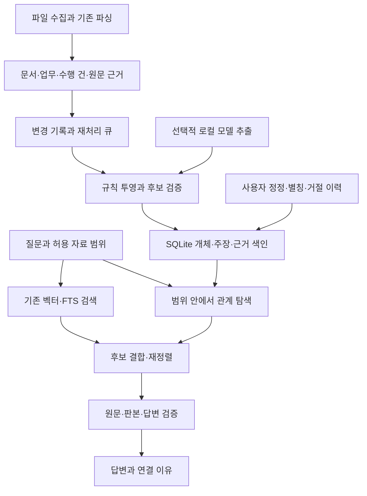

# 눈치코치 지식그래프·온톨로지 상세 구현 계획

작성·재검토일: 2026-10-11 / 상태: 구현 전 설계 / 기준 HEAD: `ed592a67f6c8ad7251e7ec3b16367454b5e48fef`

## 1. 결정 요약

**현재 SQLite와 업무 복원 구조를 유지하고, 기존 관계를 원문 근거와 함께 조회하는 그래프 계층을 추가한다.** 먼저 모델 없이 기존 데이터를 투영하고, 범위·판본·교정 보존을 검증한 뒤 검색에 연결한다. LLM의 새로운 관계 추출은 마지막에 선택적으로 도입한다.

초기 제품의 목표는 다음 세 가지다.

1. 특정 업무에 필요한 서식·담당·제출처를 찾고, 그 연결의 근거 문서를 보여준다.
2. 전년도 사례와 올해 적용되는 지침을 구분하고, 변경·충돌·자료 부족을 설명한다.
3. 전임자의 정정과 후임자의 확인을 재분석·인계 이후에도 보존한다.

별도 그래프 DB 서버, 전체 자료의 무제한 LLM 재분석, 대형 그래프 시각화는 초기 범위에 포함하지 않는다. 파일 형식·파서 한도 확대는 별도 과제다. 이 계획만으로 처리 가능한 파일 수나 정확도가 증가했다고 주장하지 않는다.

**첫 출시 범위는 아래 P0~P7이다.** P8의 LLM 추출과 P9의 확장 규모 시험은 별도 후속 단계다. 현재 요청에 따라 설계와 검토서 보완까지만 수행했으며 제품 코드·DB·실행 의존성은 변경하지 않았다.

## 2. 이전 검토서 재검토 결과와 수정

이전 [도입 검토서](<D:/Dev/Nunchi_Coach/docs/지식그래프_온톨로지_도입검토_2026-10-11.md>)의 경량 도입 방향은 유지한다. 다만 다음 사항은 실제 구현 전에 바로잡아야 한다. 이 문서가 이전 검토서의 개략 설계보다 우선한다.

| 항목 | 재검토 결과 | 구현 결정 |
|---|---|---|
| 연도별 수행 건 | `action_schema.sql`에 이미 `work_cases(task_id, period_year, label)`이 있다. 기존 보고서가 누락했다 | TaskCase를 새 업무 정본으로 만들지 않는다. 실제 수행 건은 `work_cases`에 연결한다 |
| 산출물·실행 | `action_runs`, `action_steps`, `artifacts`와 산출물 판본·대체 관계가 이미 있다 | 해당 기록을 투영한다. 그래프 추론으로 실행·승인·완료 상태를 바꾸지 않는다 |
| 과거 사례 | `task_steps`의 과거 처리 사례와 `work_cases`의 실제 실행 건은 다르다 | 과거 문서에서 추정한 사례를 열린 실행 건으로 자동 생성하지 않는다 |
| 확인 상태 | `workstate.py`는 근거·적용성·사람 확인·수행 상태를 분리한다 | 그래프에서 단일 confirmed/stale 등급으로 뭉개지 않는다 |
| 연도 | `QueryScope.years`는 `documents.eff_year` 필터다. `doc_years`는 작성·실적·평가·제출연도를 별도로 다룬다 | 문서 연도와 업무 연도 필터를 명시적으로 분리한다 |
| 검색 삽입점 | `rag._with_variants()`가 순위를 다시 구성한다 | 최초 RRF 직후에 넣지 않고 질의 확장 결합 뒤, `_select_context()` 전에 추가한다 |
| 검색 우회 경로 | `search_only`, 직접 필드 답변, 노트북 overview는 일반 RAG 경로와 다르다 | 각 경로의 지원 범위를 따로 정의하고 시험한다 |
| 근거 이력 | 기존 `evidence`는 자동 동기화 때 교체될 수 있다. `chunk_id`도 재색인 때 달라진다 | 기존 evidence ID나 chunk ID만으로 그래프 이력을 식별하지 않는다 |
| 판본 | 원본 해시, 파싱 결과, 조각 색인 세대는 서로 다르다 | 원본 판본과 분석·색인 버전을 분리한다. 과거 원본 파일 전체 보관 기능이 있다고 가정하지 않는다 |
| 업무 합치기 | `taskedit.merge/split`은 항목·단계 등을 옮기지만 현재 구현에서 `work_cases` 이전은 처리하지 않는다 | 그래프만 보고 수행 건 소속을 자동 변경하지 않는다. 원래 소속과 합쳐진 업무 연결을 구분한다 |
| 인계 | 현재 `handover_release.FORMAT_VERSION`과 `transfer.PACKAGE_FORMAT`은 1이다 | 그래프 사람 판정을 보존하는 인계 형식과 구버전 읽기를 함께 설계한다 |

재검토 근거: [수행·산출물 스키마](<D:/Dev/Nunchi_Coach/app/db/action_schema.sql>), [업무 상태](<D:/Dev/Nunchi_Coach/app/core/workstate.py>), [업무 편집](<D:/Dev/Nunchi_Coach/app/db/taskedit.py>), [검색](<D:/Dev/Nunchi_Coach/app/search/rag.py>), [범위](<D:/Dev/Nunchi_Coach/app/search/query.py>), [업무연도](<D:/Dev/Nunchi_Coach/app/core/docyears.py>), [재색인](<D:/Dev/Nunchi_Coach/app/core/reindex.py>), [인계](<D:/Dev/Nunchi_Coach/app/core/transfer.py>).

myAI와 TONGDAL.ai 비교는 이전 보고서에 기록한 커밋을 기준으로 유지한다. 이번에 두 저장소의 전체 앱 성능을 새로 검증한 것은 아니다. 두 프로젝트의 구현을 그대로 복사하는 대신, 유형 제한·별칭·관계 근거·증분 갱신의 설계를 눈치코치의 데이터 계약에 맞게 적용한다.

## 3. 전체 구성과 데이터 소유권

| 정보 | 수정 가능한 정본 | 그래프의 역할 |
|---|---|---|
| 업무·문서 배정·복원 항목·단계 | 기존 `tasks/task_docs/task_items/work_steps` | 읽기용 투영. 화면 수정은 기존 API로 보낸다 |
| 실제 수행 건·기한·실행·산출물 | 기존 `work_cases/action_*/artifacts` | 원래 상태와 출처를 함께 연결한다 |
| 원문·파싱 결과·조각 | 기존 문서/섹션/조각 저장 | 근거 판본과 위치의 스냅샷 및 현행 조각 연결 |
| 그래프 전용 별칭 확인·동일 개체 판정·관계 거절 | 신규 `kg_decisions` | 재생으로 지워지지 않는 사용자 기록 |
| 자동 개체·관계 후보·탐색용 색인 | 신규 kg 테이블 | 입력과 버전으로 재생 가능한 파생 데이터 |

그래프에서 기존 업무 기한을 수정할 때는 `ActionStore`의 기존 수정 경로를 사용한다. 그래프 전용 수정이 업무 카드와 다른 기한을 유지하는 구조를 만들지 않는다. 사용자 입력이 사실 확인의 한 종류일 수는 있지만, 원문 인용과 법적 효력 확인을 대신하지는 않는다.

## 4. 온톨로지 v1: 좁고 명확한 업무 어휘

### 4.1 개체와 식별

| 유형 | 기존 연결 또는 생성 규칙 | 혼동 방지 |
|---|---|---|
| Task | `tasks.id` | 현재 tasks의 의미를 유지한다. 완성된 업무 분류체계라고 가정하지 않는다 |
| Case | `work_cases.id` | 업무·연도·label을 재해석해 별도 실행 건을 만들지 않는다 |
| HistoricalCase | 과거 사례의 묶음 후보, P8 이후 | Case와 구분하고 실제 Case 연결은 명시적 사용자 처리 |
| Step | `work_steps`와 `task_steps`의 각각의 출처 키 | 실제 수행 단계와 과거 사례 단계를 유형 속성으로 구분 |
| Organization / Role | 기관·부서·역할 추출 후보와 사용자 기록 | 유형·소속 기관·적용 기간을 포함해 동일성 판단 |
| Form | 서식 항목·파일 연결 | 같은 제목도 서식 판본과 기관이 다르면 분리 |
| Artifact | `artifacts.id` 또는 문서에서 언급된 산출물 후보 | 실제 파일과 언급된 산출물을 구분 |
| DocumentVersion | 프로젝트 문서 식별자 + 내용 해시 | 같은 내용 사본은 연결 가능하나 문서별 선택·출처는 보존 |
| Regulation / Article | 문서에 명시된 법령·조문 후보 | 법령 조회 옵션과 공식 판본 검증 없이 현행 효력 확정 금지 |

ID는 프로젝트 UUID와 개체 UUID로 만든다. 이름·별칭만으로 ID를 만들지 않는다. 기존 테이블 연결은 별도 binding으로 유지한다. 새 DB 생성 시 또는 마이그레이션 시 프로젝트 UUID를 한 번 발급하고 인계 출처 ID와 수신 프로젝트 ID를 구분한다.

이름 정규화는 유니코드·공백·안전한 표기 변형까지로 제한한다. 숫자·기관 구분자를 함부로 삭제하지 않는다. 별칭은 여러 개체에 연결할 수 있다. 기관 맥락이 없는 '복지과'는 여러 후보를 유지한다. LLM 유사도만으로 합치지 않는다.

### 4.2 초기 관계와 속성

| 관계·속성 | 출발 → 도착/값 | 활성화 조건 |
|---|---|---|
| HAS_DOCUMENT | Task → DocumentVersion | `task_docs`와 배정 상태 투영 |
| HAS_CASE | Task → Case | `work_cases.task_id` 투영 |
| HAS_STEP | Task/Case → Step | 실제 원본 연결이 있을 때만. Task의 모든 단계를 모든 Case에 복제하지 않음 |
| PRECEDES | Step → Step | `after_step_id` 등 명시적 연결; 같은 업무·수행 범위 및 순환 검사 |
| DOCUMENTS_CASE | DocumentVersion → Case/HistoricalCase | 명시적 연결·검증된 근거가 있을 때만 |
| OWNED_BY / SUBMITTED_TO | Task/Case/Step → Organization/Role | 담당과 제출처를 혼용하지 않고 기간·조건 보존 |
| REQUIRES_FORM | Task/Case/Step → Form | 원문 관계 근거 또는 명시적 사용자 입력 |
| PRODUCES | Case/Step → Artifact | 실제 기록과 예상 산출물을 구분 |
| BASED_ON | Case/Step → DocumentVersion/Regulation/Article | 참고·근거 연결; 그 자체로 법적 의무라는 뜻은 아님. Claim의 원문 근거는 별도 support 테이블로 연결 |
| SUPERSEDES | 새 문서/산출물/Claim → 같은 종류의 이전 대상 | 명시적 변경 근거. 날짜·파일명 '최종'만으로 생성하지 않음 |
| due_date / amount | Task/Case/Step → 타입이 있는 값 | ISO 날짜 또는 십진 문자열·통화/단위·조건. 금액은 float로 저장하지 않음 |

Claim은 문장을 평가·인용하는 별도 주장 객체다. Claim 간 대체·충돌은 `kg_claim_links`로 관리하며, 모순을 표현하기 위해 임의의 '충돌 개체'를 만들지 않는다. 미등록 관계를 `RELATED_TO`로 바꿔 저장하지 않고 진단 가능한 미지원 후보로 남긴다.

### 4.3 시간과 상태

아래 차원을 별개로 저장한다.

- 출처: 기존 구조 투영 / 규칙 추출 / 모델 후보 / 사용자 진술.
- 근거: 기존 `basis_state`의 stated/inferred/conflict/missing 의미 유지.
- 적용성: 기존 current/past/unknown 및 업무연도·조건. '현행 원본 해시'와 '올해 적용되는 규정'은 다른 판단이다.
- 사람 확인: none/predecessor/successor/recheck와 판정자·시점. 기존 수행 상태도 별도로 유지한다.
- 검증: 구조 적합 여부, 원문 인용 일치 여부, 관계 의미의 지지 여부와 검증 방법.
- 수명: active/stale/retracted. 한 근거가 낡아도 다른 현행 지지 근거가 있는지 재평가한다.

적용 기간 `valid_from/valid_to`는 알 수 없으면 NULL과 unknown 사유를 유지한다. 반개구간 `[from, to)`을 내부 규칙으로 정하되 종료일을 원문에서 어떻게 읽었는지 보존한다. 지식 이력은 `recorded_at/retracted_at`으로 따로 보관한다. 문서 작성일을 자동으로 관계 효력 시작일로 삼지 않는다.

기존 '확인됨' UI 표시는 재사용할 수 있지만, 원문 불일치·구판·거절 상태보다 우선하지 않는다. 사람이 모든 자동 관계를 확인해야만 검색할 수 있는 구조도 피한다. 규칙으로 확인한 관계는 원문과 함께 바로 사용하고, 추정 관계는 그 상태를 유지한다.

## 5. SQLite 저장 계약과 마이그레이션

### 5.1 논리 스키마

아래는 구현할 테이블의 계약이며 실행 DDL은 P1에서 작성한다. 실제 SQL 타입·인덱스·CHECK와 마이그레이션 시험을 같은 변경에 포함한다.

| 테이블 | 주요 필드·키 | 보존/재생 정책 |
|---|---|---|
| `kg_entities` | uuid PK, type, label, scope_key, lifecycle | binding된 ID와 사용자 생성 ID 보존; 자동 표시 속성 재생 가능 |
| `kg_bindings` | source_table, source_key, entity_id; source tuple UNIQUE | 기존 정본과의 매핑. 삭제된 정본은 tombstone으로 구분 |
| `kg_aliases` | entity_id, label, normalized_label, alias_kind, scope_key, origin, evidence_id 또는 decision_id, source_key | 대표 이름/별칭의 출처도 보존. label 단독 UNIQUE 금지; 개체+별칭+범위+출처 기준 중복 방지 |
| `kg_claims` | uuid, claim_key, subject_id, predicate, object_id 또는 value_json/value_type, scope_key, 시간·상태·생성 버전 | 논리 주장 키는 재실행 간 안정적; 폐기 이력 보존 |
| `kg_claim_links` | from_claim, kind(supersedes/conflicts), to_claim, support_ref | 중복·자기 대체 금지. 대체 순환 금지; 충돌은 대칭 표시 |
| `kg_claim_events` | uuid, claim_id, event_kind, recorded_at, generation/decision 참조, before/after | 자동·사람 변경의 상태 이력. 철회 후 재등장도 덮어쓰지 않고 기록 |
| `kg_evidence` | uuid, anchor_key, kind, doc_uuid/doc_id, doc_hash, parse_fingerprint, locator, exact_quote, offsets, chunk_id, source_record_snapshot | 인용·출처 스냅샷. chunk_id는 nullable이며 삭제 시 SET NULL |
| `kg_claim_evidence` | claim_id, evidence_id, support_role, validation_result/version, generation_id | 주장-근거 연결. 한 주장에 독립 근거·반증 여러 개 허용 |
| `kg_decisions` | uuid, target_kind/key, decision, before/after, actor, created_at, supersedes_decision | append-only 사람 기록. 재생 색인 삭제와 분리 |
| `kg_generations` | id, partition_key, input_fingerprint, status, active 표시, 처리 수·실패 수·버전 | 문서/업무 단위 분석 세대. 검증된 세대만 게시 |
| `kg_jobs` | partition_key+job_kind UNIQUE, wanted_revision, state, lease, attempts, reason | dirty 병합·취소·중단 재개용. 최신 입력만 최종 게시 |

정본 전체를 복제하는 테이블이 아니다. 예를 들어 Task 이름은 원본에서 갱신하고, 문서 전체 텍스트는 kg_evidence에 복사하지 않는다. 근거 인용과 검증에 필요한 최소 위치만 보관한다.

필수 SQL/Python 계약:

1. `object_id`와 literal 값은 정확히 하나만 존재한다. 관계별 domain/range와 값의 타입·단위를 검사한다.
2. claim_key는 정규화한 subject/predicate/object 또는 값/업무 범위/적용 기간/조건을 해시한 값이다. 생성 모델명과 실행 ID는 논리 동일성 키에서 제외한다. 형식 버전을 키에 포함한다.
3. SQLite의 NULL 포함 UNIQUE만 믿지 않는다. 조건·범위를 정규화한 비NULL key와 UNIQUE 인덱스를 사용한다.
4. 같은 원문에서 반복 추출된 주장은 하나로 묶고 근거만 연결한다. 같은 파일의 사본 수가 관계 점수나 독립 근거 수를 부풀리지 않게 한다.
5. 검색 인덱스는 `(subject_id,predicate)`, `(object_id,predicate)`, alias label+scope, evidence doc/hash, claim scope/lifecycle 및 job state에 둔다. EXPLAIN QUERY PLAN으로 확인한다.
6. claim에 여러 근거·분석 세대가 있을 수 있다. 특정 문서 세대 폐기 시 해당 support만 비활성화한다. 다른 근거가 있는 주장을 통째로 삭제하지 않는다.
7. 동일 개체 합치기는 원래 개체·주장 끝점을 파괴적으로 덮어쓰지 않는다. 결정 이력을 반영한 canonical view를 만들고 되돌리면 원래 끝점으로 복구한다. 거절도 재생 후 유지한다.
8. claim의 논리 내용과 evidence 스냅샷은 불변으로 취급한다. 현재 상태는 support/decision/event에서 산출한다. 관측·철회가 반복되어도 단일 retracted_at 덮어쓰기로 과거 이력을 잃지 않게 한다. 조회용 상태 컬럼은 이 이력에서 재생하는 캐시다.

### 5.2 원문 근거와 구조 근거

`kg_evidence.kind`는 최소 `document_quote`, `source_record`, `human_statement`를 구분한다.

- document_quote: 원본 해시·분석 fingerprint·문서 위치·정확한 인용이 일치해야 원문 근거 자격을 얻는다. offset은 어떤 문자열 기준인지 함께 기록한다. 공백 정규화가 필요하면 정규화-원문 위치 매핑을 보존한다.
- source_record: `task_docs` 등 구조 기록과 그 origin/status의 스냅샷이다. 업무 탐색 근거로 쓸 수 있지만 원문에 그런 문장이 있다고 인용하지 않는다.
- human_statement: 사용자 진술과 기록 시점이다. 별도 출처로 표시한다. 사용자 확인만으로 원문 일치 검사를 통과시키지 않는다.

원문 존재 확인과 관계 의미 검증은 다르다. 인용에 '복지과'가 실제 있어도 '복지과가 제출처'인지는 따로 검사한다. 모델 자기 확신 점수는 이 검사를 대신하지 않는다. 표는 셀과 행·열 머리글 위치를 함께 연결해야 하며 본문 앞 300자 같은 대체 인용은 금지한다.

### 5.3 버전 11에서의 이전

현재 `SCHEMA_VERSION`은 11이다. 다음 버전이 비어 있다는 전제에서 12로 추가하되, 구현 착수 시 다른 변경이 선행했으면 다음 번호로 조정한다.

1. 기존 `migrations.upgrade()`와 SQLite backup API를 사용한다. WAL DB 파일을 파일 복사만으로 백업하지 않는다.
2. `_to_v12`에서 신규 스키마를 트랜잭션 안에서 개별 문장 실행한다. 기존 패턴처럼 `sqlite3.complete_statement`를 활용하고 `executescript`의 암묵 커밋을 피한다.
3. 새 DB의 `Database.init()`에도 같은 스키마를 넣는다. 기존 action/notebook/coverage 테이블이 준비된 뒤 그래프 참조와 변경 트리거를 설치한다.
4. 마이그레이션은 테이블·인덱스·프로젝트 식별자·dirty 등록까지만 한다. 전체 문서 투영과 모델 호출은 시작 화면을 막지 않는 후속 작업으로 수행한다.
5. v11→신규 DB와 새로 만든 DB의 테이블·인덱스·제약·기본값을 비교한다. 중간 실패, 재시도, 이전 앱의 최신 스키마 거부 동작도 시험한다.

## 6. 생성·갱신·복구 경로

### 6.1 최초 투영

`app/core/knowledge/`에 ontology, projection, evidence, resolution, lifecycle, validation 모듈을 만든다. DB 접근은 `app/db/knowledge.py`로 모으고 새 kg SQL을 UI에 직접 넣지 않는다.

처리 순서는 업무/문서 binding → 실제 수행 건/산출물 → 단계 선후 → 항목의 타입 있는 값 → 근거 검사 → 사용자 판정 재적용 → 분석 세대 게시다. 기존 파이프라인의 restore 이후 구조 투영을 예약한다. 노트북 업로드는 `notebook_ingest`에도 별도 접점이 필요하며, 업로드 문서를 기존 업무에 자동 배정하지 않는다.

자동 관계는 원본 기록의 추정·확인 상태를 그대로 물려받는다. 실제 `work_cases`가 없는 문서에 대해 Case를 만들지 않는다. 연결이 명확하지 않은 항목을 모든 연도 Case에 붙이지 않는다. 최초 투영은 LLM 없이 수행한다.

### 6.2 변경 탐지와 세대 게시

기존 DB는 여러 경로에서 SQL을 직접 수정한다. 일부 서비스 함수에만 hook을 넣으면 누락될 수 있으므로 **작은 DB 트리거로 revision/dirty만 기록하고, 무거운 재계산은 worker가 담당**한다. 트리거가 개체 추출이나 전체 그래프 갱신을 수행하지 않게 한다.

P1에서 변경 감시 대상을 `documents`, `task_docs`, `tasks`, `task_items`, `work_steps`, `task_steps`, `evidence`, `work_cases`, `artifacts`, `doc_years`와 투영하는 추가 테이블로 명시한다. 인용 재연결은 reindex 전환·rollback과 index revision에 연결한다. kg 테이블의 자체 쓰기가 무한 dirty 반복을 만들지 않게 감시 범위를 분리한다.

UPDATE 트리거는 실제 의미·해시·누락·배정·확인 상태 필드가 바뀐 경우에만 작동한다. 스캔의 last_seen 갱신이나 진행률 변경마다 그래프를 무효화하지 않는다. 소속 변경은 OLD와 NEW 양쪽 partition을 dirty로 기록한다. 문서 전체 삭제·복귀와 연결 삭제도 빠뜨리지 않는다.

1. 원본 쓰기와 같은 트랜잭션에서 partition revision을 증가시키고 job을 upsert한다. 영향받는 문서/업무 partition은 즉시 검색에서 제외한다.
2. worker가 입력 fingerprint와 revision을 잡고 짧은 읽기로 필요한 스냅샷을 만든다.
3. 파싱 후처리·모델·검증 동안 DB 쓰기 트랜잭션을 잡고 있지 않는다. 스레드마다 기존 Database 연결 원칙을 따른다.
4. 결과를 staging generation으로 저장한 뒤 짧은 트랜잭션에서 현재 wanted_revision과 입력 fingerprint를 다시 비교한다.
5. 같을 때만 active generation을 교체한다. 달라졌으면 결과를 superseded 처리하고 최신 job을 남긴다. 실패·취소는 이전 유효 세대를 파괴하지 않는다. 원본이 바뀐 이전 세대는 재게시하지 않는다.
6. 현재 generation에 연결된 support와 사용자 판정으로 active claim view를 만든다. 마지막 유효 support가 없어지면 현재 답변 자격을 제거한다.

전역 `kg_revision`은 질문 도중 변경 감지용, partition revision은 영향 범위 재처리용으로 구분한다. 전역 숫자 하나가 바뀌었다고 전체 프로젝트를 재추출하지 않는다. 작업은 동일 fingerprint에서 멱등적이고 중단된 lease는 재시작 시 회수한다. 반복 실패는 제한된 재시도 후 진단 목록으로 보내고 다른 문서는 계속 처리한다.

### 6.3 수명주기별 동작

| 사건 | 필수 동작 |
|---|---|
| 원본 내용 변경 | 새 DocumentVersion, 기존 해시 support 현행 자격 제거, 새 추출. 이전 주장/사람 기록 보존 |
| 같은 원본 재파싱 | 같은 DocumentVersion, 새 parse fingerprint. 인용 재검사 후 재연결. 원본 효력 변경으로 간주하지 않음 |
| 조각 재색인·rollback | index revision 변경, transient chunk 연결 다시 찾기. 원문 위치·인용 일치 없는 chunk ID 재사용 금지 |
| 파일 이동·이름 변경 | 내용 동일성 확인 후 위치만 갱신. 출처·문서별 선택 의미 보존 |
| 원본 누락·삭제 | 누락 즉시 현재 검색 제외. 이력 근거는 원본 미확인 표시. 실제 개인정보 삭제 요청은 해당 보존 인용까지 삭제하는 별도 삭제 정책 적용 |
| 원본 복귀 | mark_seen만으로 그래프를 유효화하지 않고 해시·분석 fingerprint·근거 재검사 |
| 사용자 거절·별칭 수정 | 결정 저장과 kg revision 증가. 진행 중 결과가 사람 결정을 덮어쓰지 못하게 최종 판정 재적용 |
| 업무 합치기·나누기 | `taskedit` 트랜잭션으로 영향 업무를 dirty 처리. 혼합 근거는 재검토. Case/실행 기록 소속은 현 정본을 보존 |
| 파생 노트·지식 카드 | 원문까지 provenance를 펼친다. AI 답변을 다시 추출해 독립 원문 근거 수를 늘리지 않음 |

업무 합치기 뒤 과거 Case는 원래 task binding을 보존하고, `merged_into`를 따라 화면에서 '합쳐진 업무의 이전 수행 건'으로 탐색할 수 있다. Case의 task_id·실행 이력을 실제로 옮기는 기능은 충돌하는 `(task_id, period_year, label)`과 승인·산출물 처리 정책을 따로 정하기 전까지 포함하지 않는다. 업무 나누기에서는 문서 일부만 옮겼다는 이유로 Case를 복제하지 않는다.

## 7. 검색 통합과 답변 계약

### 7.1 범위가 먼저다

모든 검색은 scope를 해석한 뒤 허용 문서 집합을 만든다. `doc_ids=None`은 무제한, `[]`는 없음이라는 기존 의미를 유지한다. 개체 별칭 조회부터 관계의 각 근거, 최종 인용까지 동일 범위를 적용한다. 범위 밖 문서에서만 발견한 별칭이나 연결도 탐색 자격으로 쓰지 않는다.

같은 해시의 문서가 여러 개일 때 허용 집합 안에서 대표를 정한다. 선택하지 않은 사본으로 인용을 바꾸지 않는다. 전역 canonical entity에 범위 밖 정보가 붙어 있어도 이름·설명·관계 요약이 선택 자료 답변에 새어 나오지 않도록 범위 안 provenance를 갖는 표시 값만 반환한다.

연도 필터는 다음과 같이 확장한다.

- 기존 호출의 `years` 의미는 document_date/eff_year로 유지한다.
- 새 `year_basis`를 document_date, performance, evaluation, submitted, case 중 명시적으로 선택하게 한다. 업무 수행 질문 화면에는 '업무연도', 문서 검색에는 '문서연도'로 구분 표시한다.
- case 모드에서는 선택 Case의 period_year와 명시적으로 연결된 근거 문서 집합을 사용한다. 문서 작성연도가 다르다는 이유만으로 제외하지 않되, 사용자가 별도로 지정한 문서 제한은 계속 교집합으로 적용한다.
- 실적·평가·제출 모드는 `doc_years`의 해당 kind를 사용하고, 현재 추출 자체가 제한적이라는 점을 표시한다. 알 수 없는 연도는 자동 보충하지 않는다.
- 업무연도에서 과거 참고자료를 보여주는 경우 현재 결론과 분리된 참고 영역에 둔다. 기존 연도 필터를 조용히 완화하지 않는다. 연도 비교는 복수 연도를 명시한 비교 모드에서만 한다.

P4의 범위 변경은 벡터·FTS·그래프·직접 필드 경로에 공통 적용한다. 그래프에서만 수행연도를 다르게 해석하는 상태로 출시하지 않는다.

### 7.2 탐색과 점수

초기 설정은 깊이 1, seed 최대 8, 방문 관계 최대 100, 원문 보충 후보 최대 5, 그래프 조회 예산 150ms로 시작한다. **이는 측정 전 튜닝 초깃값이며 처리 성능 보장이 아니다.** 2단계 탐색은 P9의 평가 전까지 끈다.

탐색은 제한된 SQL과 필요한 근거의 지연 로딩으로 구현한다. 전체 조각·전체 개체를 Python 메모리에 올려서 상한을 나중에 적용하지 않는다. 고차수 개체에서도 실제 방문 예산을 지키도록 페이지별 LIMIT과 경과 시간 확인을 넣고, 긴 읽기 SQL의 취소도 검증한다.

graph.search는 `chunk_id`, claim/evidence ID, 관계 경로, 자격 사유, scope fingerprint, generation을 반환한다. 이웃 개체에 붙은 아무 문서가 아니라 **경로의 관계를 실제로 지지하는 근거**를 반환한다. 각 hop에 근거 없는 관계가 있으면 답변용 경로에서 제외한다.

일반 RAG의 순서는 기존 질문/변형 질의의 벡터·FTS 결합 → 그래프 순위의 별도 가중 RRF 추가 → strong 후보 자격 반영 → 기존 `_select_context` → 원문 인접 조각 보충 → 기존 검증으로 정한다. 기존 combined 점수는 유지하고 graph ranking 기여만 더한다. 그래프 가중치 초깃값 0.2를 실험하고 myAI의 수치를 그대로 최적값으로 채택하지 않는다.

기존 벡터 최소 유사도 미달 후보도 허용된 관계 경로·현재 원문·scope 검증을 통과하면 graph-qualified로 별도 입장할 수 있다. 그래프에 연결됐다는 이유로 후보 전부를 strong으로 넣지 않는다. 같은 근거와 중복 경로는 한 번만 점수에 기여하게 한다. 기본 TOP_K·문서별 상한은 첫 실험에서 유지한다.

### 7.3 분기별 지원

| 경로 | 초기 적용 |
|---|---|
| 일반 `rag._ask` | `_with_variants` 이후에 그래프 후보 결합. 일반 재정렬·출처·수량·인용 검증 유지 |
| 모델/임베딩 OFF `search_only` | SQL 별칭·관계 탐색 + FTS 후보 결합. 답변 생성 없이 원문 자료와 연결 이유 제공 |
| `_labelled_answer` 직접 필드 | 기존 허용 문서 전체 검사 유지. 구조적 충돌·대체 검사를 동일 범위에서 수행하되 LLM 후보만으로 정확한 필드 답을 덮어쓰지 않음 |
| 노트북 일반 질문 | 선택 문서 snapshot + graph revision 재검사. 저장 인용에도 관계 경로·검증 버전 기록 |
| 노트북 overview | 첫 출시에서는 기존 전체 자료 요약 유지. 그래프가 전체 자료를 대표했다고 표시하지 않음 |
| 별도 법령 조회 | 기존 opt-in 경로 유지. 외부 법령 결과를 선택 파일에서 나온 사실로 합치지 않음 |

질문 시작 시 content_revision, index_revision, kg_revision, scope fingerprint와 노트북 선택 snapshot을 잡는다. 최종 답변 저장·반환 전 다시 확인한다. index_revision은 rollback 시 감소할 수 있으므로 숫자 대소가 아니라 snapshot 동일성을 비교한다. 변경되면 한 번 재시도하거나 기존 '자료 변경으로 다시 질문' 경로로 안내한다. 변경 전 원문으로 만든 답변을 그대로 저장하지 않는다.

그래프 준비 중·오류·시간 초과 시 기존 검색으로 돌아간다. 진단에는 이유를 남긴다. 특히 법정 기한·금액에서 충돌 검사가 불가능한 경우 '그래프가 충돌 없음을 확인했다'고 표시하지 않는다. 그래프 가용성이 기존 검색의 필수 전제가 되지 않게 한다.

## 8. LLM 추출은 별도 단계로 제한

P8은 구조 그래프만으로 답하지 못한 질문 유형을 평가한 후 적용한다. 기존 로컬 모델 클라이언트를 재사용하고 설정 변경 없이 외부 모델로 자료를 보내지 않는다.

추출 단위는 토큰 예산에 맞춘 문단/표 구간과 주변 맥락이다. 출력 JSON에는 유형·관계·개체 후보·적용연도·조건·exact_quote·위치가 필요하다. 원문 지시문은 데이터로 취급하고 출력은 허용 스키마로만 읽는다.

처리 단계는 구조 검사 → 정확한 인용·판본 검사 → 관계의 방향·조건·부정/예외 표현 검사 → 개체 후보 해소 → dedup → 기존 사람 판정 적용 → 후보 게시다. 규칙으로 의미 지지를 확인할 수 없는 모델 관계는 inferred 상태로 유지한다. 중요한 기한·금액·현행 효력·대체를 모델 자기 점수만으로 확정하지 않는다.

거절 키는 모델 실행 ID와 독립적으로 관리한다. 같은 원본 해시·논리 주장·범위에 대한 거절은 프롬프트 변경 후에도 살아남는다. 원본이 바뀌어 새 근거가 생기면 기존 거절을 숨겨 버리거나 자동 승인하지 않고 '새 판본에서 재검토'로 연결한다.

커버리지에는 원본 파서 추출 범위, 대상 조각 수, 방문 수, 성공 수, 검증 탈락, 실패, 보류, 사용자 예산으로 미처리한 수를 각각 기록한다. 15개 표본 처리 같은 동작을 전체 완료로 표시하지 않는다. 방문율 100%도 의미 관계 재현율 100%는 아니다.

기본은 사용자가 다루는 업무·선택 자료부터 처리한다. 전체 프로젝트 확장은 동일 큐에서 중단·재개 가능하게 한다. 모델 호출 수와 입출력 토큰·벽시계 시간·실패율을 계측하고, 초기 재시도는 일시적 오류만 최대 2회로 제한한다. 모델이 꺼져 있어도 구조 그래프는 사용 가능해야 한다.

## 9. 화면과 인계

### 9.1 화면

기존 업무 카드와 노트북의 원문 확인 흐름에 작은 '연결 근거' 영역을 추가한다. 전체 그래프 그림은 만들지 않는다.

- 필요한 서식/제출처: 연결 이유, 적용 업무연도, 원문 열기.
- 변경·충돌: 이전 값/새 값과 각각의 원문, 대체 여부 미확정 표시.
- 동일 이름 후보: 기관·유형·근거를 나란히 보여주고 합치기/분리/거절을 취소 가능하게 제공.
- 진행 상태: 기존 구조 연결 완료, 관계 분석 N/M, 미처리 이유. 그래프 구축률을 자료 이해 정확도로 표현하지 않음.

수행 완료·공식 기한·파일 생성·외부 제출은 기존 action/approval 경로만 사용한다. 그래프 관계를 확인하는 행위가 실행 승인이 되지 않는다.

### 9.2 인계 형식

자동 색인 전량보다 **사람의 동일성 판정·별칭·거절·수정·원문 연결 식별자**를 우선 보존한다. 신규 snapshot 형식 2와 package 형식 2를 제안하고 v1 읽기는 계속 지원한다. 새 reader를 먼저 구현한 다음 writer를 바꾼다.

export에는 ontology version, project/source UUID, 결정 이력과 대상 키, 필요한 개체 binding·근거 해시·상대경로를 넣는다. 수신 측 정수 ID를 그대로 재사용하지 않는다. 기존 hash/경로 매칭 결과가 모호하면 자동 합치지 않는다. 수신 측 최신 사용자 교정은 보존하고 충돌을 기록한다. 자동 관계는 가능한 한 재생한다.

이전 인계본의 payload와 해시를 재작성하지 않는다. 새 저장부터 v2로 만들고 v1 자료는 그래프 결정이 없는 것으로 읽는다. 현재 파일 크기·압축 멤버 제한과 해시 검증을 유지한다. 인용 스냅샷을 포함하면 인계 자료에 실제 본문이 추가될 수 있으므로 기존 미리보기에서 포함 자료를 보여준다.

P7 완료 전에는 사용자 그래프 판정을 정식 기능으로 출시하지 않는다. DB 백업에는 남지만 인계에서 사라지는 기능으로 출시하면 인수인계 제품의 핵심 계약을 어기기 때문이다.

## 10. 오픈소스 적용 범위

**RDFLib와 pySHACL은 처음에는 개발·CI 검증 의존성으로 도입한다.** 사용자 실행물의 상시 import 경로에서는 제외하고, 저장·조회·필수 제약은 SQLite/Python으로 강제한다. RDFLib는 RDF 변환, pySHACL은 SHACL 구조 제약 검증에 사용한다. [RDFLib](https://github.com/RDFLib/rdflib), [pySHACL](https://github.com/RDFLib/pySHACL), [W3C SHACL](https://www.w3.org/TR/shacl/) 공식 자료를 2026-10-11 재확인했다.

온톨로지의 정본은 버전 관리되는 `ontology.json` 한 곳으로 둔다. Python validator와 TTL/SHACL 산출물은 같은 정의에서 생성하고 결과 차이 시험을 둔다. SQL의 기본 제약과 SHACL이 지원하는 규칙의 일치도 fixture로 검사한다. 자유 형식 조건의 의미적 진실성까지 자동 생성 validator가 확인한다고 주장하지 않는다.

개발 전용 `requirements-knowledge-dev.txt`와 대응 잠금 정책을 추가한다. 기존 `requirements.lock`과 `app.tools.lockfile` 규칙에 맞춰 별도 환경에서 호환 버전을 선택·고정한다. 최신 버전이라는 이유만으로 기존 배포 의존성을 일괄 올리지 않는다. 라이선스와 전이 의존성 고지를 점검한다. 표준 자료는 로컬 fixture로 고정하고 검사 중 원격 ontology import·임의 JS 실행을 사용하지 않는다.

Graphiti의 시간 이력, myAI의 유형 제한과 검색 확장, TONGDAL.ai의 정규화를 설계 참고로 사용한다. 기존 그래프/신규 그래프 이중 저장, 모델 자기점수 승인, 단순 별칭 전역 병합은 옮기지 않는다. 실제 소스 복사 시에는 해당 저장소와 포함 라이브러리의 라이선스 범위를 확인한다.

LightRAG·Microsoft GraphRAG는 필요 시 독립 비교 실험에만 쓴다. LadybugDB·Oxigraph 전환은 SQLite 관계 탐색이 실제 병목일 때 판단한다. 자세한 기능·라이선스 근거는 이전 검토서 9절을 따른다. 이번 단계에서 이 엔진들을 설치하거나 정본으로 채택하지 않는다.

## 11. 구현 작업 분할·의존성·일정

아래 공수는 **숙련 개발자 1명, 기존 시험 환경 사용, 비식별 평가 자료 확보를 전제로 한 계획 추정**이다. 실제 데이터 라벨링·모델 속도·Windows 패키징 문제에 따라 달라진다. P0에서 측정 후 조정하며 고정 납기 약속이 아니다.

| 단계 | 구체 작업·주요 파일 | 선행 | 완료 기준 | 예상 인일 |
|---|---|---|---|---:|
| P0 기준선·계약 | 신규 평가 fixture, `app/tools/knowledge_eval.py`; 온톨로지·시간·정본 계약 확정 | 없음 | 동결 질문셋·기존 성능·실패 사례·하드웨어 기록 | 2~3 |
| P1 스키마·표준 검증 | `app/db/knowledge_schema.sql`, `knowledge.py`, migrations/repo, ontology.json·validator·SHACL 개발 환경 | P0 | 새 DB/업그레이드 동일, 실패 롤백, 제약 fixture 통과 | 3~4 |
| P2 구조 투영 | `core/knowledge/projection.py`, binding·근거·별칭 기본형; pipeline/notebook_ingest 접점 | P1 | 모델 없이 기존 관계 투영, 두 번 실행 결과 동일, 정본 불변 | 2~3 |
| P3 갱신·재개 | lifecycle/jobs, repo invalidation, reindex switch/rollback, taskedit/action 변경 감지 | P2 | 변경·삭제·중단 시 낡은 근거 제외, 사람 기록 보존 | 3~4 |
| P4 범위·검색 | search/graph.py, query.py 연도 의미, rag 세 분기, notebook snapshot 검증 | P3 | shadow 실행, 모든 경로 scope 통과, 검색 품질 게이트 충족 | 3~5 |
| P5 설명·판정 UI | 기존 업무/노트북 화면, 별칭 판정·거절·되돌리기; 기능 플래그 내부 사용 | P4 | 원문으로 이동, 충돌/추정 구분, 기존 action 승인 불변 | 2~3 |
| P6 통합 회귀·조정 | 관계 검색 A/B, 마이그레이션·모델 OFF·대량 후보·Windows 시험 | P5 | 아래 필수 품질·성능 게이트 통과 | 2~3 |
| P7 인계·출시 | handover_release/transfer v2, v1 reader, 진단·백업·릴리스 안내 | P6 | export/import 후 사람 판정 동일, 단계적 활성화·끄기 검증 | 2~3 |
| P8 모델 관계 후보 | knowledge/extraction.py, JSON 검사·원문/의미 검사·coverage·예산 | P7 | 구조 그래프 대비 이익, 관계 정밀도·실패율·비용 측정 | 4~6 |
| P9 확장 판단 | 10,000문서 시험, 2-hop/대체 엔진 필요성 실험 | P8 또는 규모 요구 | 측정에 근거한 유지/확장 결정 | 2~4 |

첫 출시 P0~P7 합계 **19~28인일, 약 4~6주**. P8~P9 추가 **6~10인일**. 각 단계는 작고 검토 가능한 커밋/PR로 나누며 테스트와 함께 완료한다. 단계 결과가 기준을 충족하지 않으면 다음 기능의 기본 활성화를 보류하고 기존 검색을 계속 제공한다.

권장 첫 구현 묶음은 P0+P1이다. 평가와 정합성 기반 없이 모델 추출부터 붙이면 관계 수만 늘고 검색이 실제로 좋아졌는지 판단하기 어렵다.

## 12. 검증 계획과 출하 기준

### 12.1 평가 자료

최소 120문항: 단순 원문 조회 30, 별칭/기관 구분 20, 여러 문서 연결 25, 연도/변경/충돌 25, 자료 부족/보류 20으로 구성한다. 튜닝 40문항과 동결 시험 80문항을 업무·문서 묶음 단위로 나눠 중복 문서 누출을 막는다. 정답은 문서·해시·위치·인용·허용 관계·업무연도를 포함한다.

범위 위반·원본 변경·재색인·중단 복구는 질문 정확도와 분리된 자동 회귀 fixture로 만든다. 가능한 실제 비식별 업무 자료를 포함하되 부족하면 합성 자료와 실제 자료 점수를 구분한다. 같은 모델이 만든 질문과 같은 모델의 자기평가만으로 합격시키지 않는다.

비교군은 A 기존 검색, B 기존+구조 그래프, C 기존+구조+모델 후보다. parser·embedding·질문·context 예산을 고정한다. 검색 개선과 LLM 답변의 우연한 차이를 분리하기 위해 검색 지표와 답변 지표를 따로 측정한다.

### 12.2 필수 회귀 사례

| 영역 | 반드시 통과할 사례 |
|---|---|
| 유형·동일성 | 같은 이름의 기관/개념 분리, 다른 기관의 동명 부서, 별칭 다의성, 미등록 관계 거부, 반복 추출 중복 없음 |
| 원문 | 실제 없는 quote 탈락, 존재하지만 관계를 지지하지 않는 quote 분리, 표 헤더 포함, 문서 뒤쪽 관계, 파싱 부분 성공 표시 |
| 시간 | 2025 작성/2024 실적 문서, 전년도 기한 오사용 방지, 변경 공문 효력 미확정, 상충 기한 병존 |
| 범위 | 선택 밖 중간 hop/별칭/라벨 노출 없음, [] 빈 scope, 명시 연도 우선, 선택 사본 인용, 노트북 자료 선택 변경 |
| 갱신 | 원문 수정·누락·복귀·파일 이동, 재파싱·재색인·rollback 후 chunk ID 변화, 마지막 근거 삭제/다른 근거 잔존 |
| 동시성 | 모델 실행 중 사용자 거절·문서 변경, 작업 중 강제 종료·재개, 같은 dirty 반복, stale generation 게시 거부 |
| 업무·인계 | 합치기/나누기 뒤 Case·실행 기록 보존, v1 읽기, v2 왕복, 동일 해시 다중 후보, 수신자 교정 충돌 |
| 회귀·장애 | 그래프 off 결과 일치, 모델 OFF, 그래프 예산 초과/예외 시 기존 검색, 직접 필드·overview·별도 법령 경로 |

우선 확장할 기존 시험: `test_migrations.py`, `test_workstore.py`, `test_refresh_integrity.py`, `test_reindex.py`, `test_taskedit_integrity.py`, `test_query_scope.py`, `test_rag_hybrid.py`, `test_rag_facts.py`, `test_notebook_chat.py`, `test_notebook_ingest.py`, `test_transfer.py`, `test_action_runner.py`. 신규 시험은 `test_knowledge_*.py`로 묶는다. 내부 함수 호출 횟수보다 결과의 근거·범위·이력 불변성을 검사한다.

### 12.3 게이트

아래 수치는 **구현 전 제안하는 합격 목표**다. P0 측정으로 실행 가능성을 확인하고 개발 착수 전에 동결한다. 이번 문서 작성에서 달성했다고 보고하는 수치가 아니다.

- 필수 회귀 세트의 범위 밖 노출·원문 없는 인용·과거 기한의 현행 확정·사용자 결정 유실: 0건.
- 동결 연결 질문군의 Recall@10: A 대비 B가 최소 5%p 개선. 표본 수와 성공 건수를 함께 보고하며, 기준선이 이미 높으면 사전 정의한 확인 시간 개선 과제로 대체한다.
- 단순 조회의 정답률: A 대비 2%p 초과 하락 없음. 소표본에서는 개별 회귀 사례도 모두 검토한다.
- 전체 답변의 근거 없는 확정 비율: A보다 증가하지 않을 것. 기한·금액·효력의 치명적 오류는 별도 0건 게이트.
- P8 관계 추출 정밀도: 독립 검토 표본 최소 200개에서 95% 이상 목표. 표본 구성·신뢰구간·유형별 점수를 함께 보고하고 이것만으로 공식 사실 자격을 주지 않는다.
- 1,000문서 시험에서 그래프 추가 조회 p95 150ms 이내, 기존 검색 대비 추가 peak RSS 150MB 이내를 초기 목표로 둔다. 하드웨어·관계 밀도·cold/warm을 명시한다. 초과 시 예산/인덱스를 조정하고 shadow 유지.
- graph off일 때 기존 평가 결과·저장 부작용이 기준선과 동일할 것. off는 검색·추출을 끄지만 변경 dirty 기록은 유지해 재활성화 시 복구한다.

### 12.4 규모와 비용

100 → 1,000 → 10,000문서 순서로 파일 수, 추출 문자·조각 수, 개체·주장·근거 수, 중복률, 평균/최대 관계 차수를 함께 측정한다. 작은 파일 10,000개와 긴 스캔 파일 10,000개를 같은 부하로 취급하지 않는다.

단계별 처리 시간·모델 호출·RSS·DB 크기·증분 1건 갱신·질문 p50/p95·오류율을 기록한다. 구조 투영과 모델 추출 시간을 분리한다. 기존 벡터 행렬 로딩 등 기존 검색 비용도 같이 계측해 모든 지연을 그래프 DB 탓으로 돌리지 않는다.

추정식은 `모델 처리 조각 수 × 조각당 호출 수 × 실측 평균 호출 시간`으로 시작하고 실패·재시도 시간을 더한다. graph 처리 범위는 파서가 읽은 범위를 넘을 수 없다. 한글 문서·표·스캔본 지원 개선은 별도 추출 평가로 관리한다.

## 13. 활성화·장애 대응·운영

설정은 `off → shadow → on` 세 단계와 별도 `model_extraction` 토글로 둔다. shadow는 관계 후보·지연·scope 탈락 사유를 계산하지만 사용자 답변의 후보를 바꾸지 않는다. on은 품질 게이트 통과한 구조 관계부터 켠다. 모델 추출은 기본 off에서 시작한다.

진단에는 ontology/schema/extractor 버전, 최근 게시 세대, dirty/실패 job, stale 근거, 검증 탈락, 그래프 fallback 이유, 후보 수·추가 검색 시간·커버리지를 기록한다. 기본 진단 로그에는 원문 전문을 남기지 않는다. 실제 근거는 기존 접근 가능한 로컬 DB와 원문 보기에서 확인한다.

장애 시 우선 graph off로 전환하고 같은 새 앱/스키마에서 기존 검색을 유지한다. 파생 색인은 재생하되 `kg_decisions`와 안정 binding을 삭제하지 않는다. 기존 바이너리로 돌아가려면 마이그레이션 전 백업 복원이 필요할 수 있으며, 복원 후 사라질 최신 사용자 변경은 별도 보존·이전해야 한다. 운영 중 DB를 단순 다운그레이드하는 스크립트는 만들지 않는다.

최종 출시 산출물은 스키마와 validator, 투영·갱신 worker, 범위 공통 검색, 근거 설명 UI, 인계 v2/v1 호환, 평가 결과, Windows 실행물 검증, 운영·복구 안내다. 이 목록이 완료되어야 '눈치코치에 지식그래프 적용 완료'로 판단한다.

## 14. 이번 설계 작업에서 확인한 범위

기존 보고서와 현재 코드의 데이터 모델·검색 분기·마이그레이션·재색인·인계 계약을 다시 대조했다. RDFLib·pySHACL·SHACL 공식 자료를 재확인했다. 이 계획은 새 라이브러리의 Windows 실행 시험, 실제 기관 자료의 관계 정확도 시험, 제품 회귀시험을 대신하지 않는다.

다음 구현 시작점은 **P0의 동결 평가셋과 P1의 안정 식별·근거·상태 계약**이다. 현재 자료를 무리 없이 이전하고 사용자 교정을 지키는 것이 첫 번째 완료 기준이다.
